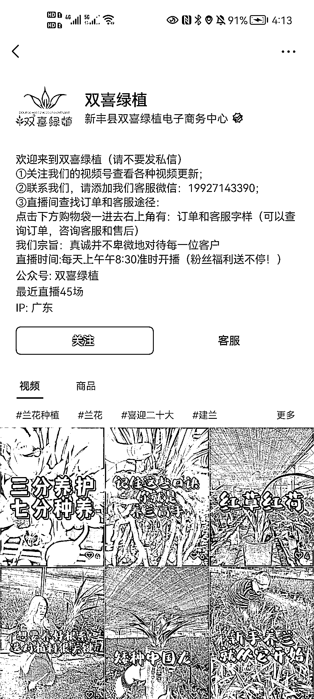
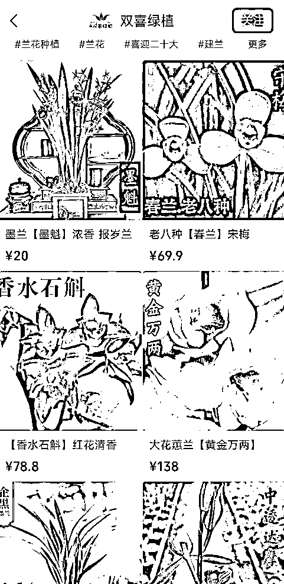

# 【案例八】双喜绿植：一个绿植企业号的经营样本

这个案例来自广东新丰，账号叫“双喜绿植”，主体是企业认证蓝V。先看主页：

**一、流量从哪里来？**

内容主打真实感，直接跑到苗圃里拍实景视频。流量来源不只一条：平台免费的自然推荐、日常直播、线下花卉活动，三个入口同时发力。账号名字和个人简介都把“绿植”这类关键词摆在明处，简介里还专门提示用户去橱窗下单；直播间也会不断提醒大家购买。更特别的是，它还配了企业🛰️客服、蓝V认证标识以及绑定的👸号，让买家天然多一层信任。

**二、卖什么？**

成交方式很直接，就是带货。主营石斛、蕙兰等绿植，货源来自自家基地，没有中间商。单笔价格集中在20到100元，属于不用怎么犹豫就能入手的小额消费。

**三、成交路径怎么做？**

交易全程留在平台内部，借助🛰️视频号的商品橱窗来承接。同时，企业🛰️承担客户服务和售后对接，把一次性的买家慢慢变成能够反复下单的老客户。

这个案例的亮点在于：不拼花哨玩法，用实拍内容加上完整的信任配套，把一盆盆绿植卖得明明白白。
