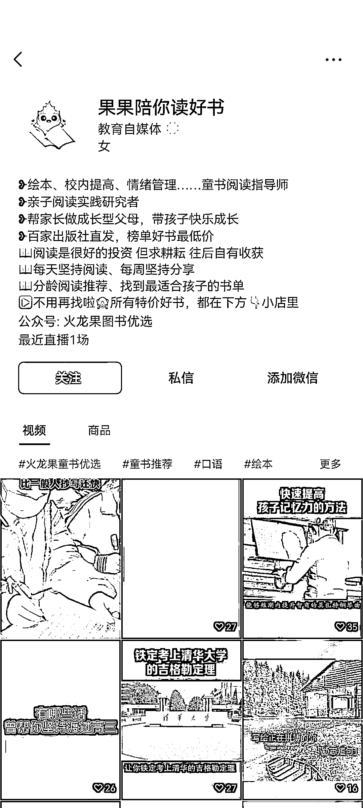
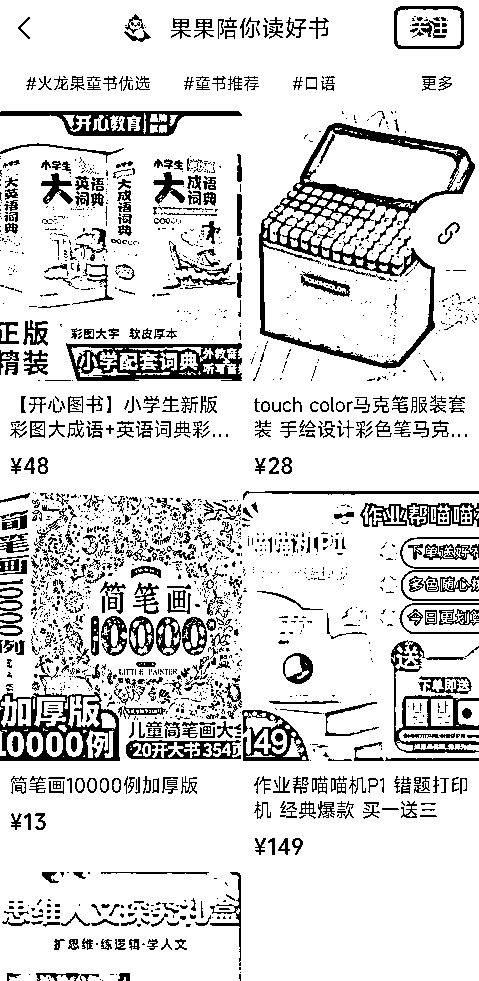

# 【案例九】果果陪你读好书：励志混剪引流，橱窗卖学习用品

账号属性：金V达人认证

案例主页：

1. 流量从哪里来

内容打法上，用励志类视频做混剪，再配合带货视频做购买引导；流量主要来自平台自然推荐。账号名称和简介都把标签打得很清楚，资料区也设置了指向橱窗的购买引导。另一个细节是，主页挂了👸号，并配置了2个企业🛰️客服入口，同时拥有金V达人认证。

2. 卖什么、怎么供货

变现方式为直接带货。选品围绕学习场景，包括词典、点读笔、教辅书等。货品来自第三方，合作店铺覆盖🛰️小商店、魔筷、有赞等渠道。客单价在9.9元到59.9元之间，佣金比例30%以上。

3. 成交如何落地

成交载体是平台内；工具组合为🛰️视频号橱窗和企业🛰️；第三方数据工具会用到蝉妈妈、考古家、飞瓜等。