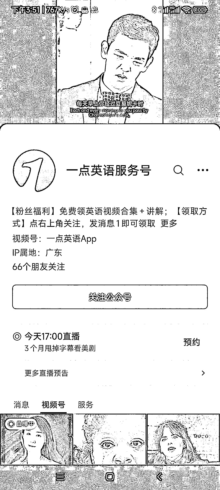
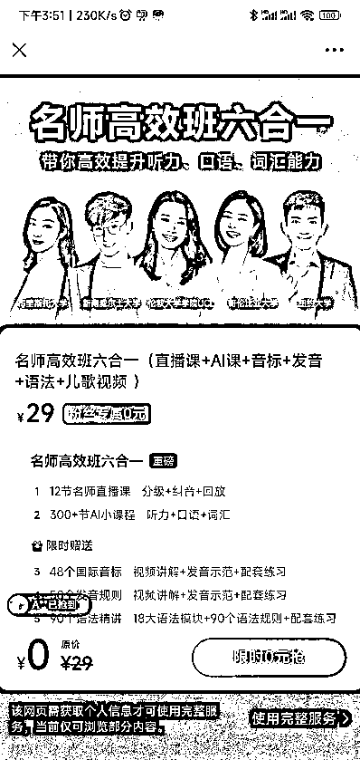

# 【案例十一】一点英语服务号：用美剧片段带出英语课

## 1. 流量来源

“一点英语服务号”是广东地区的蓝V企业号。它获取流量的方式，是把多部美剧的片段重新剪成短视频，依靠平台自然推荐获得曝光。内容重点落在英语的听、说、读、写以及常见俚语表达上，并在视频中引导观众点赞、转发和收藏。其特色在于，借美剧剪辑把有兴趣的用户引向线上英语培训课程。

## 2. 变现产品

变现方向是英语培训，属于培训品类。课程来源为账号自有的课程体系，产品设计采用低价课向高客单价课程转化的路径。

## 3. 变现路径

承载转化的是平台引流。素材中“方法”部分没有进一步展开，因此可确认的核心做法是依托平台把流量导入培训课程。