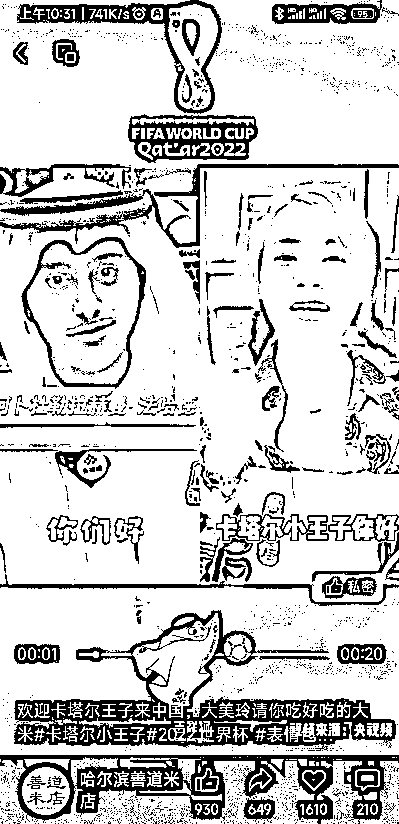
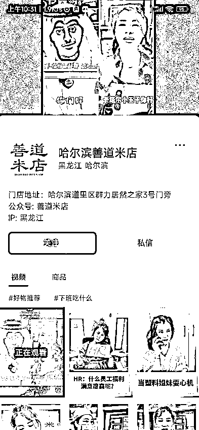
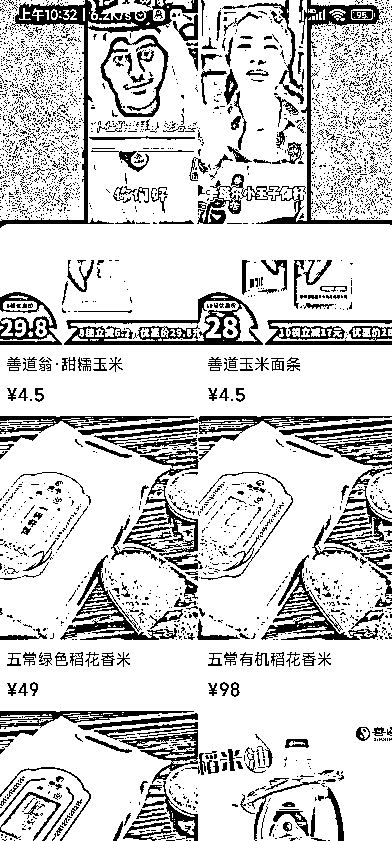

# 【案例十二】哈尔滨善道米店：用段子合拍推东北大米

这是一个普通账号，所在地为哈尔滨。

## 1. 流量怎么来

内容玩法是把网络热门段子重新拍一遍，并请网红一起同框出镜；图1展示的就是与卡塔尔王子合拍的对话画面。流量主要来自平台自然分发。具体做法是先靠段子的趣味性留住观众，再把网红之间的对话剪成内容，顺势把商品带出来。亮点有两点：段子本身有吸引力，且真人参与拍摄。

## 2. 卖的是什么

主推商品是东北大米，所属品类为三农，供货与渠道都由商家自营，价格区间在49元到198元之间。

## 3. 怎么完成变现

变现围绕网红段子合拍展开。至于更具体的操作方法，原素材到这里没有继续展开，此处保持原状、不作补充。