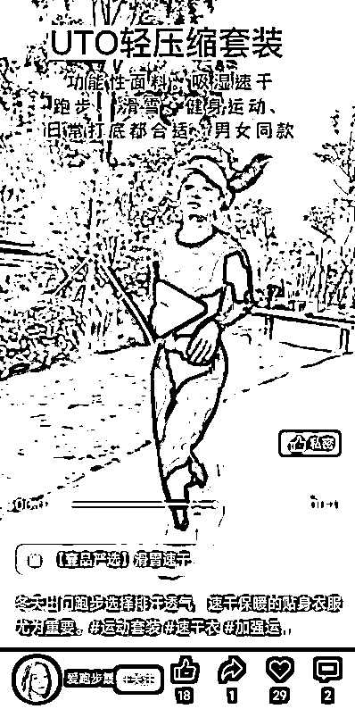
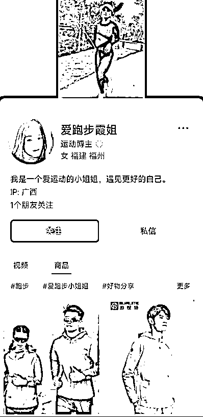
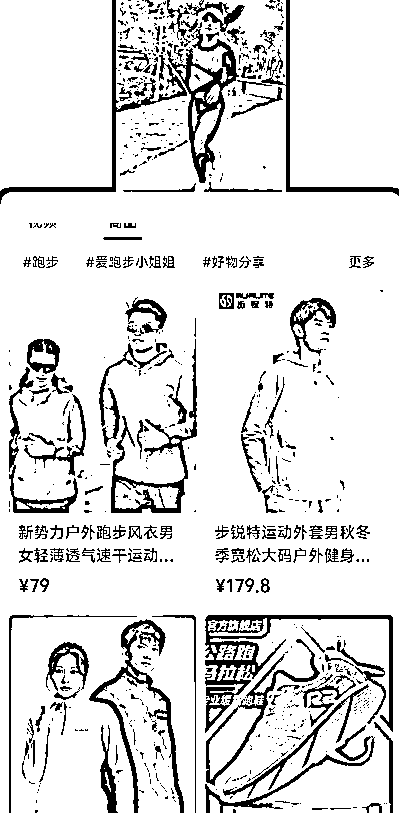

# 案例十五｜爱跑步霞姐：把运动日常拍成带货内容

这位博主是金V认证的运动博主“爱跑步霞姐”，坐标福建福州。她的内容不走复杂剧情路线，而是让本人出现在镜头里，记录锻炼过程，再把装备分享嵌进去。

1. 流量来源
内容形态以视频实拍为主：拍真实的运动日常，同时穿插产品分享。流量主要依靠平台自然分发，不依赖其他渠道。具体做法是一边呈现运动场景，一边给产品镜头；博主本人出镜，加上金V身份带来的较高账号权重，是这套内容能被看到的重要条件。

2. 变现商品
售卖方向集中在运动装备上，涵盖运动服装、运动鞋、手套与护腕等，其中护腕是重点细分类目。供货端对接合作商家与优选联盟，价位从49元到598元。

3. 变现路径
落地载体是运动过程实拍，再配合产品展示。现有资料没有展开更细的方法拆解，但核心链路已经明确：用真实运动画面承接注意力，让产品在场景里获得露出，进而完成转化。