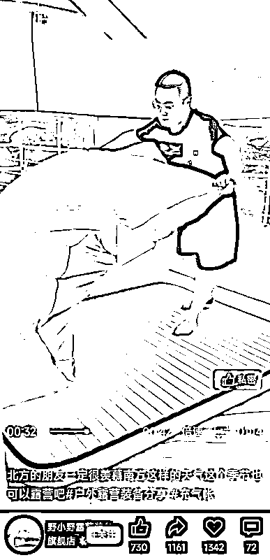
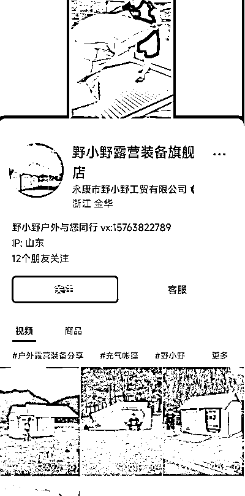
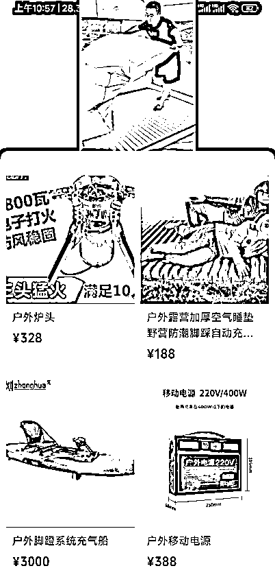

# 【案例十六】野小野露营装备旗舰店：爆款内容拉高复购

账号属性：企业蓝V认证
归属地：浙江金华

1. 流量从哪里来
【内容形式】以热销单品出镜为主，已有多条点赞破十万的视频
【渠道】平台自然流量打底，同时叠加付费流量投放
【方法】用停留时长更高的内容来吸引用户
【特点】主推热销款，并把实际使用效果直接呈现出来
【类目特点】这类人群黏性很强，通常会顺手把配套工具和周边一次性配齐，所以整体客单价高，复购率也高。

2. 变现靠什么产品
【产品】充气床垫、帐篷、船、户外炉以及其他露营装备等
【品类】露营户外
【货源/渠道】由商家自主供货
【价格】99元至3000元

3. 变现路径怎么跑
【载体】以热销产品展示为核心，同时持续高频铺量
【方法】