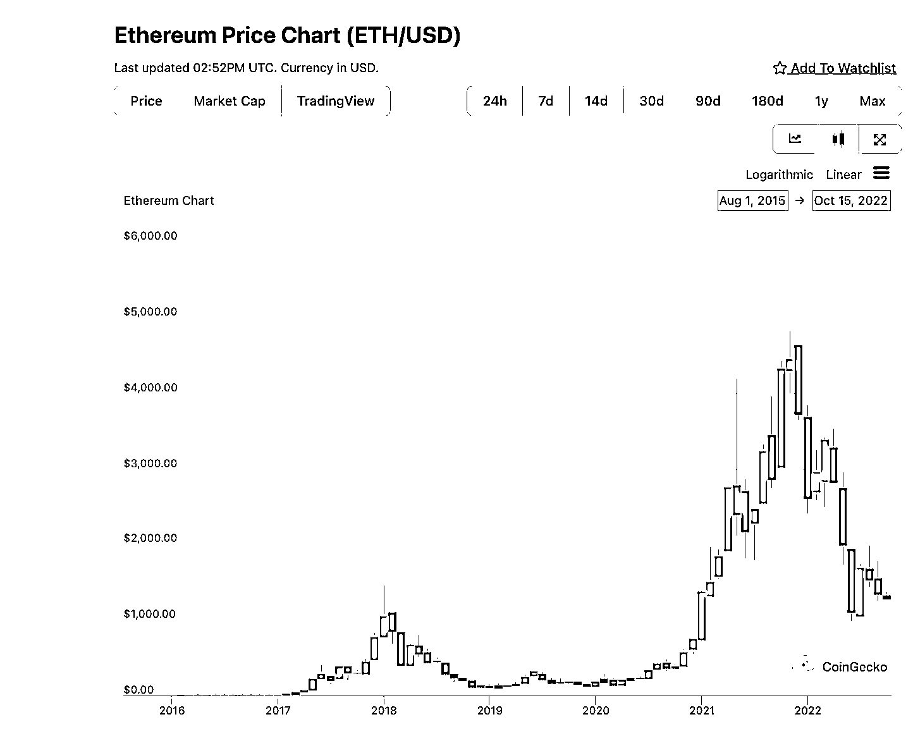

# 1.4 案例拆解：谷歌与以太坊，两个世界的生态巨头

上一节提到了 Web3 到底解决了哪些 Web2 时代遗留的问题，也留了四个思考题供大家琢磨。这一节换个角度，直接用两家典型公司做对比，从具体案例里看清两个世界的差别。

Web2 阵营选谷歌。安卓、搜索、YouTube，这一整套产品线摆出来，就是 Web2 里的庞然大物。目前市值约 1.3 万亿美元，在全球科技公司里只排在苹果和微软之后。

Web3 阵营选以太坊。它是当前 Web3 生态里体量最大的一家公司，市值约 1600 亿美元，在整个加密资产世界里仅次于比特币。

为什么选这两个来对照？因为两者在各自领域都属于生态型标杆，放在一起做类比很有参考价值。

常有人问我以太坊到底是什么。一开始我试着讲“去中心化的、开源的、用智能合约搭建的区块链平台”，结果发现没人听得进去。后来我想了个更接地气的说法：你可以先把以太坊理解为 Web3 的安卓。当然，底层网络架构差别很大，这块后面讲到区块链技术和 Web3 基建时会详细展开，现在先有个画面感就够用。

下面从四个维度切入：商业模式、扩张路径、融资方式，以及投资人和用户分别得到什么、承担什么风险。

## 一、商业模式

任何商业公司，本质上都逃不开一组问题：为谁服务？提供什么产品或服务？解决什么痛点？拿什么收费？收多少？这几个环节少了哪个都不成立。

可能有人会反驳：我用谷歌、百度、抖音、🛰️，商家也没收我钱啊，难道他们是在做慈善？并不是。这只是站在用户视角看到的“免费”。任何商业公司最终都要盈利，就算某个阶段让利免费，也总会从你身上找到变现的入口。

拿抖音举例。它给用户提供刷不完的短视频，转头把用户的注意力打包卖给品牌方，靠广告费赚钱。这不是抖音一家的事，基本所有平台型互联网公司都跑这套逻辑。

谷歌也一个样。安卓系统用户可以免费用，但谷歌在商家那侧收费，本质还是把你这个人的注意力或者数字资产挪去变现。

那以太坊的商业模式长什么样？简单说，它为用户和商家搭了一个安全可信的网络，然后明码标价：用户用网络交手续费，商家接入也交手续费。规则打一开始就写进协议里，白纸黑字，说好不改。比起 Web2 那些明面上免费、背地里收割的套路，它显得坦诚很多。

拓展阅读：《区块链盈利模式（解读以太坊将是第一条盈利的区块链）》

## 二、扩张路径

谷歌和以太坊都有明显的规模效应。你越强，用户越多，生态越大，用户和商家都离不开你，慢慢就形成垄断。换一种描述：用户多了，平台能吸引的商家就多；商家多了，用户体验更好；体验好了，用户更多，这就是一个加速转动的飞轮。

至于两家怎么推动增长，本质上没太大区别：烧钱优化产品、烧钱拉新用户。差别在于花钱用的“工具”——前者用美元这类法定货币，后者很多时候用的是自己发行的加密资产。另一个隐性差别在理念：Web3 的用户心里普遍揣着对去中心化的认同，这股信念感会转化成生态的黏性。

## 三、融资方式

要论形式上最大的不同，我觉得就是融资渠道。先理清两个词：IPO 和 ICO。

IPO，首次公开募股，指的是 Web2 公司向普通投资者发行股票的过程。听起来是“首次公开”，实际在公开之前，已经有一批股票私下给了机构投资人。散户进场能买到的，多数是机构挑剩下的份额，说白了就是在接机构的盘。尤其在 Web2 靠烧钱抢规模的商业模式下，公司往往顶着超高估值上市，一上市就已经是高位。

ICO，这个名字是 Web3 独有的，首次代币发行。这里的 coin 既像货币，又像股票，比传统股权多了一层属性，这是和 Web2 的第一个差异。

第二个差异是，如果你把代币当成股票，那这个“首次”是真的首次——普通用户直接参与，没有中间商。与其叫首次发行，不如叫众筹更直观。

第三个差异是，ICO 不需要牌照。当然，目前国内对 ICO 是不允许的，这一点放到后面监管合规的章节再展开讲。

谷歌的融资上市路径没什么特别之处，重点说说以太坊当年的 ICO。

2013 年，19 岁的 Vitalik 跑到加州圣何塞参加了一场比特币主题会议。听完全场他笃定自己那个想法可以做，回来就辍学了。此后他用 6 个月时间在以色列、加州、伦敦、洛杉矶、拉斯维加斯、阿姆斯特丹来回跑，见了一圈当时还在叫区块链、现在叫 Web3 的同路人。他发现这些人并没有真正解决比特币的局限，仍然把区块链拴在金融这个框里。他想的却是另一回事：给比特币加上一套图灵完备的编程语言，那任何人都能在这条链上开发去中心化应用，而不再只服务金融场景。

想法讲出去，没人当回事。那他干脆自己干，回家花一个月写出了白皮书，给它取名以太坊，Ethereum。白皮书在朋友圈里传了一圈，既换来一些认可，也帮他凑齐了最早的合伙人。

几个月后，V 神在迈阿密比特币大会上介绍了以太坊，当场引发不小的轰动。随后 ICO 启动，42 天里共募到 31000 枚比特币，售出 60,102,216 枚以太币，按当时汇率大约是 1840 万美元。要是按今天的比特币价格折算，差不多价值 6 亿美金，算得上是一桩天价募资。

早期买入且拿住以太坊的人，回报相当惊人。当时的 ICO 价还不到 0.5 美元，现在单价在 1300 美元附近，不到 10 年翻了数千倍。下面是以太坊的历史价格走势，看到这张图估计很多人已经拍痛大腿了——哪怕当时只投 1000 块，如今也是一个不小的数目。Web3 里这种机会并不罕见。

顺手放个查询工具。你现在还没有交易所账户的话，可以用这两个网站看加密资产实时价格：coingecko（www.coingecko.com）。不过第三方统计里排名更靠前、全球访问量更大的，是 coinmarketcap（coinmarketcap.com），一并附上。

## 四、最后一个问题

看到这，剩下那个问题其实已经很明朗了，留作这一节的思考题：

Web2 里的投资机构和普通投资者，最后得到了什么？又承担了哪些风险？

