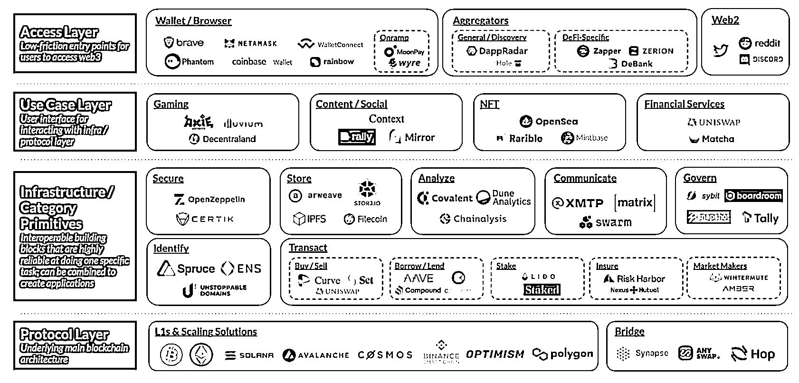

# 2.1 一张图看懂 Web3 的四层架构

先放一张结构图，帮你把 Web3 的框架看明白：

[`www.coinbase.com/blog/a-simple-guide-to-the-web3-stack`](https://www.coinbase.com/blog/a-simple-guide-to-the-web3-stack)

前文里出现过不少对初学者来说比较陌生的名词，例如区块链、基础设施、智能合约、比特币、以太坊、DeFi、交易所、NFT、GameFi、DAO 等。它们共同组成了 Web3 的各个要素。

这一节先借助上面的结构图，给这些概念分个层。这样一来，学习 Web3 时就能先有一个整体框架；以后碰到新概念，也更容易找到它所在的位置。

从下往上梳理，Web3 大致可以分成四层：协议层、基础设施层、应用层和接入层。这个结构和盖房子很像，下面一层是上面一层的地基。

为了便于理解，下面借用大家熟悉的腾讯系产品做类比。这个类比不算完全精准，但能帮助建立直观印象。

1. 协议层

我们平时使用的各种互联网产品，底层都离不开互联网协议。什么是互联网协议？可以把它理解成一套大家都认可的语言规则。

互联网之所以能连接全球，就是因为各地遵循的是同一套交流标准。就像一个人如果完全不懂中文，就很难和只讲中文的人顺畅对话一样；能够连接、能够对话，前提是双方对一套交流标准有共识。这一层，就是协议层。

2. 基础设施层

再看基础设施层。我们平时用🛰️、🛰️支付、🐧 或腾讯游戏时，背后其实有一套系统在支撑运转。

比如使用🛰️支付，后端要完成记账和处理；支付账户需要安全体系来保障；用户产生的数据要存进公司的服务中，而且不仅要存，还要处理。这一系列工作，都属于基础设施层。缺少这一层，我们很难顺畅使用日常的 APP 和网站。

3. 应用层

应用层最好理解，因为它离我们的生活最近。腾讯生态里的🛰️、🐧、王者荣耀等，都可以归到这一层。

同样，我们使用的各类互联网产品，通常也是按照这样的架构被生产出来，再提供给用户使用。

4. 接入层

接入层可以简单理解为“你用什么身份进入应用”。用🛰️，需要注册🛰️账号；用淘宝，需要注册淘宝账号。总之，得有一个身份才能使用各类应用。在 Web2 世界里，这个身份常常是手机号或邮箱。

理解了这套架构后，再回头看 Web3 的各类产品，就可以逐一对应了。从分层和演进来看，Web3 与 Web2 并没有明显差别；真正的不同，主要体现在理念和具体形式上。

先看协议层，这里的区别比较明显。

Web3 目前存在多张网络，每张网络都有自己的协议。前面提到的以太坊是一张网络，比特币也是一张网络；此外还有 Solana、Cosmos、币安等，各自都有独立网络。

如果只用“多张网络”来理解不够直观，也可以联想 Web2 中 iOS 和安卓两大移动操作系统生态。Web3 目前也有多个类似生态，头部是以太坊，币安生态近两年的发展也很快。

在 Web3 中，这种生态系统通常被称为“链”，这个词来自区块链。链可以分为公链、私链、联盟链，后面章节会展开讲。以太坊对应以太坊链，币安对应币安链。

当然，每条网络也都需要自己的基础设施层和应用层。于是，在 Web3 结构图里，我们会看到基础设施层中的安全、存储、身份系统等产品；应用层目前则主要包括游戏、社交、数字藏品、金融服务等。

到了接入层，Web2 的做法是：你在各个平台分别注册手机号或邮箱，注册后形成的数字身份归属于平台。Web3 则不同，每条网络只需要一个钱包地址，就能访问该网络中的全部应用。

这一点和 Web2 有明显差异：不需要用🛰️时注册一个账号，用淘宝时再注册一个，用网上银行时又注册一个。有了钱包，资产也放在这里，用这个钱包地址就能访问该网络中的所有应用。

最后总结一下：Web3 的协议层像一块土地，基础设施层相当于在这块地上盖起一栋楼。为什么要盖楼？因为楼里要提供游戏、建设、购物等各种服务，这些服务对应应用层。楼还设有门禁，需要验证身份才能进入；在 Web3 里，这个身份就是你的钱包地址。

有了这张分层架构图，Web3 的各类产品就更容易归类了。以后再遇到 Web3 产品，可以直接用它来对号入座。接下来的内容，也会按照这个架构，把其中有代表性的产品逐一拆开讲解。

