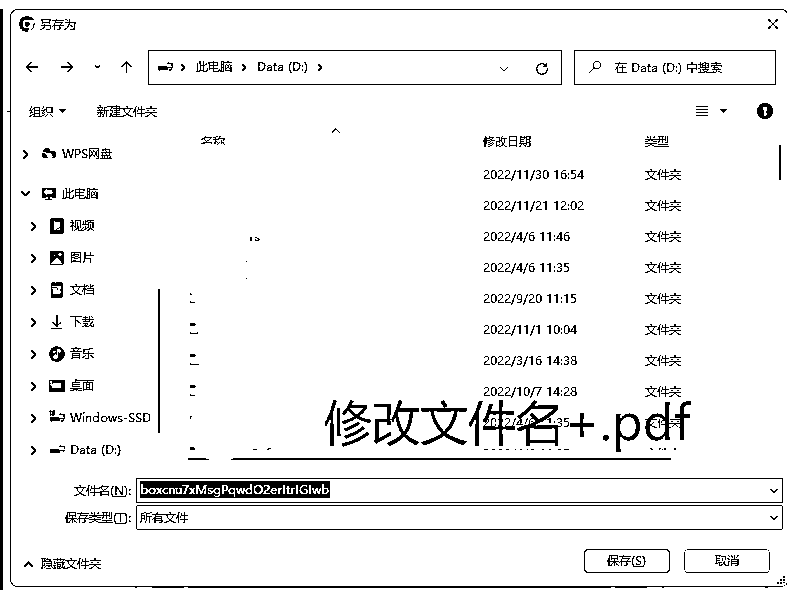
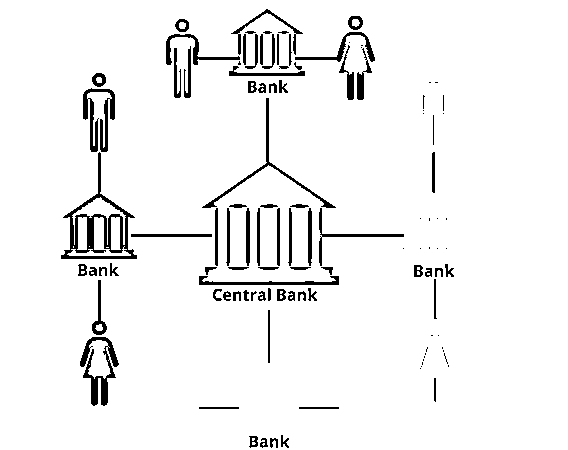
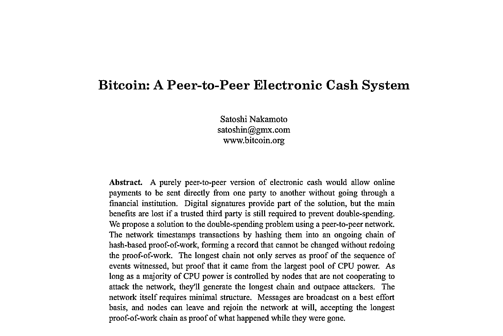
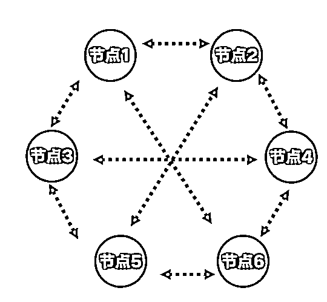
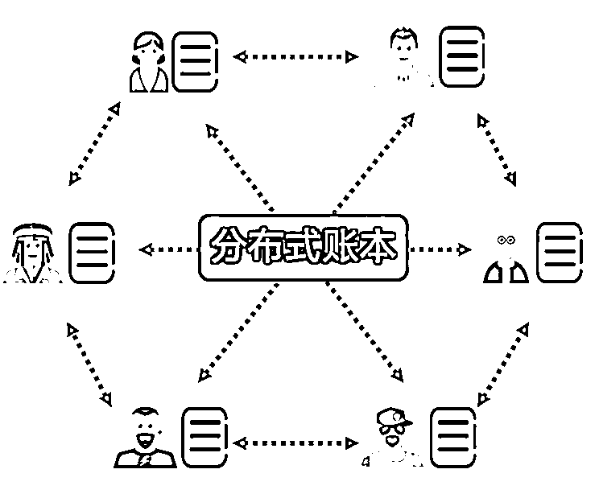
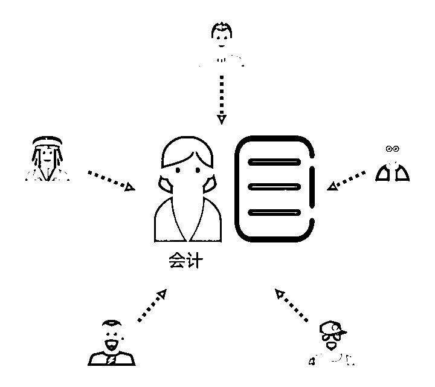

# 2.2 区块链到底解决了什么？

想搞懂 Web3，得先从它的关键技术说起——区块链到底是什么。

这期内容定位是入门，所以不会展开技术细节。想深入学习的同学，我准备了一份延伸阅读材料，大家可以自己啃，有问题随时在群里交流。

这期内容更想聊清楚一件核心的事：这项技术到底解决了什么问题，它又是用什么方法解决的。

区块链技术起源于比特币（Bitcoin）。2008 年，一位化名“中本聪”的极客发表了一篇论文，标题直接定义了一个新事物：比特币——一种点对点电子货币系统。也正是从这篇论文开始，区块链技术逐渐为人们所熟知。

这里把《比特币白皮书》的链接放上来，作为大家的深度阅读作业，强烈建议多读几遍：

[《比特币白皮书》英文版.pdf](https://search01.shengcaiyoushu.com/upload/doc/KS1WdDWSDogQNmxGRDNc1gXRnEb/WDaobFf44o4V6Nxp8n8cVspcnTD)
[《比特币白皮书》中文版.pdf](https://search01.shengcaiyoushu.com/upload/doc/KS1WdDWSDogQNmxGRDNc1gXRnEb/Jfs9bYicCoRNj4xMkQHcMHOQn6e)

提示：如果下载后打不开，或文件名变成乱码，自己改一下文件名，加上 .pdf 后缀，并在“保存类型”里选择“所有文件”。

一遍读不懂也没关系，多读几次，慢慢就能理解了。

下面，我们试着回答几组问题：

- 比特币和区块链的提出，到底是要解决什么问题？为什么非它不可？
- 它给出的解法是什么？
- 这种技术到底有什么特别之处？

1. 区块链当初为什么要被提出？

如果你耐心翻过比特币白皮书，就会发现，中本聪当时最想解决的是一个叫“双花”的问题：同一笔钱，被同时花到了两个地方。为什么会产生这样的问题？这还要从现有的货币体系说起。

先来看看我们现有的货币体系长什么样：

简单来说，这个体系是一个中心化交易系统：大量用户和银行参与其中，每笔交易都要靠后端的记账、清算系统完成。

银行最核心的业务，说白了就是两个字：记账。账不能记错，更不能记假账。

但来到数字时代，中心化管理的数据库，其实存在各种被篡改的可能。有哪些可能？不妨想象这样几个场景：

其一，中心化银行真的可信吗？我们的钱在银行的记账系统里，本质上只是一串数据，而且这串数据是不对我们公开的。真实的账目状况，个体几乎无从知晓。

其二，中心化银行真的足够安全吗？为什么每次经济危机出现时，有些国家的银行会突然取不出钱？

其三，国家背书真的可靠吗？银行背后往往是国家信用，像美国、中国这类大国，国家背书相对靠谱；但一些第三世界国家局势极不稳定，本币汇率的波动甚至可能比我们国家的股市振幅还大。再极端一点，有些国家直接破产了，那这种背书还有什么意义？这些都是现实存在的问题。

以上只是我能想到的一部分情况，肯定还有更多，大家可以继续发散。

正是基于这些担忧，中本聪提出了一套新方案：绕开中心化机构，让用户在彼此之间直接点对点支付，构建一个去中心化的货币系统。

2. 区块链又是怎么做到的？

区块链这个词听起来抽象，它其实就是英文 blockchain 直译过来的。拆开看：block 是区块，chain 是链。区块可以理解成一个信息块，区块链就是由这些信息块前后相连组成的一条链。

换成更贴近生活的说法：每个区块就是一本不断生成的子账本，这些子账本通过一种名叫“哈希算法”的方式前后连接起来，最终汇总成一本总账。所以这事并不玄乎，本质上就是一种极难被篡改的新式记账技术。

把解决方案浓缩一下，大致是这样：

- 中心化机构既然靠不住，那就干脆不让它管账；
- 把数据库的管理权交给所有人，一起记账、一起维护；
- 每个人手中的账本必须和其他人的保持一致，才算有效；
- 最终网络中所有账本内容完全相同；
- 没有人能够私自修改账本。

如果说中心化记账是“一个人或一个系统说了算”，那区块链就是“所有网络参与者共同记账”。发生一笔交易，大家就一起记录一次；这些记账的人可能分散在世界各地。

这种模式带有明显的规模效应：参与记账的人越多，网络就越安全、越健康。所以，如何吸引足够多的人来参与，就成了关键。

借用一个俗语，无利不起早。比特币系统吸引大家参与网络建设的方式，是每 10 分钟发一次红包。

分布式网络每 10 分钟需要产出一个子账本，并把它接到原来的总账本上。而生成子账本、校验，再确认无误地加入总账本，这一整套流程都需要网络中的计算机贡献算力。大家干了活，就有机会抢到比特币红包。

比特币就是靠着这样的“红包机制”完成了货币发行。按照白皮书的设定，红包会持续发 142 年：最开始每 10 分钟发 50 个比特币作为奖励，以后每 4 年减半，从 50 到 25，再到 12.5，如此类推。所以，比特币的总量被恒定在 2100 万个。即便红包最终发完，参与网络建设和维护的节点，也依然能靠用户支付的交易手续费获得收益。

在 Web3 里，抢红包这个动作被形象地称为“挖矿”，参与网络建设的人叫“矿工”。因为抢到红包是概率事件，矿工们往往会把算力集中到一起“合挖”，这些集中起来的计算节点，就是“矿池”。到这里，挖矿、矿工、矿池三个概念就顺带解释清楚了。

比特币网络刚运行时，参与的人极少，全网总算力也很低，当时随便一台笔记本电脑就能挖出不少比特币。它发生的第一笔交易，是一位老兄用 1 万枚比特币买了两个披萨。现在再看，1 万枚比特币价值约 2 亿美金，高峰期甚至超过 7 亿美金——这两块披萨，足以称得上是史上最贵披萨。

3. 区块链有哪些特别之处？

基于上面的梳理，如果非要给区块链的特征做一个总结，我认为只有两点：

- 分布式解决方案
- 不可篡改

至于去中心化、公开透明，这些在我看来都是分布式解决方案带来的必然结果。

还要强调一点：区块链技术之所以诞生，是因为中心化模式出了问题，于是采用了去中心化的方案来解决，而不是为了“去中心化”这个目标本身，才发明出区块链。

所有参与者一起记账，账本天然就是公开的。可完全公开，就一定比有限公开更优吗？我觉得这个问题还有讨论空间，大家不妨各抒己见。

