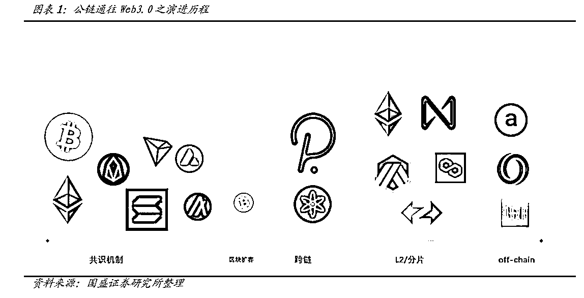

# 2.4.2 公链演进：效率至上，持续迭代

按时间顺序回看公链的演进脉络，会更清晰。

2008 年，比特币问世；从那时起到 2012 年，行业里的主要代表是比特币和莱特币。到了 2013 年，以太坊登场，并把智能合约这一概念推向台前。此后，各种平台网络开始涌现，目标多是修补以太坊网络暴露出的短板，解决思路涵盖共识机制、侧链、跨链、多链、Layer2 等方向。

整体来看，公链的发展始终沿着提升效率这条主线，持续推陈出新。

