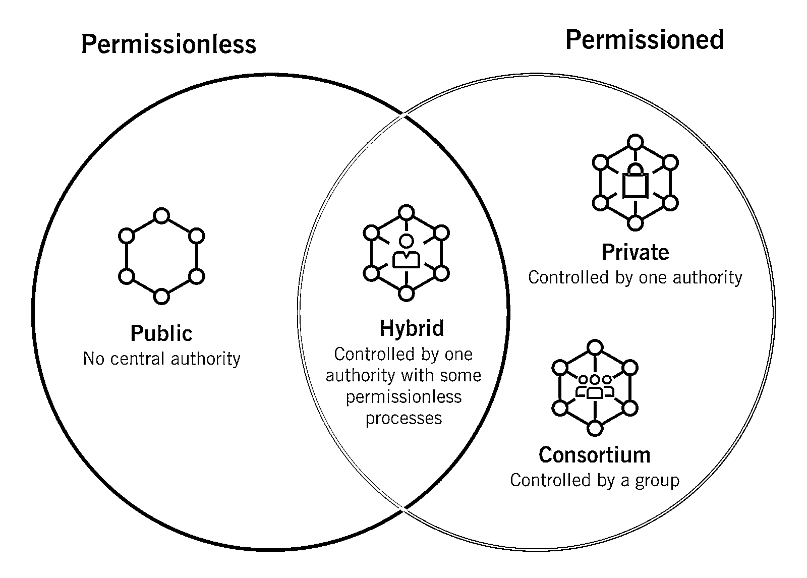
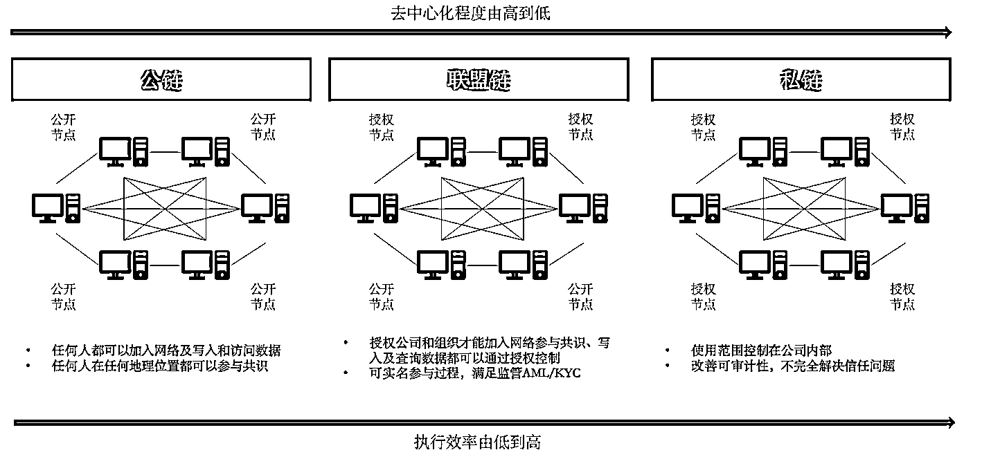

# 2.5 三种链，一文分清

如果把区块链看作一本共享账本，那么“谁能看、谁能写、谁来管”就决定了它的类型。前面我们提过，按去中心化程度来划分，区块链网络通常有三种形态：公链、联盟链和私链。下面逐一拆开讲。

公链可以理解为完全开放的账本。它不设准入门槛，任何人都能自由加入网络，使用网络，甚至参与网络维护。比特币网络就是最典型的代表，也是世界上第一条公链。链上的数据一旦确认，就无法随意更改，而且会向网络中的所有参与者公开。

私链则完全不同。它的中心化程度最高，通常只服务于某个组织或机构的内部场景。私链借用了区块链的记账技术，但管理权仍然掌握在机构自己手里，并不向外部开放。

联盟链位于公链和私链之间。它由多个组织或机构组成协作联盟，共同维护一条链。网络维护权限只开放给联盟成员，属于“部分允许”的模式。

用银行来打个比方：假设比特币是一家没有中心总行的银行，那么私链就像工商银行内部使用的记账网络；联盟链则像工商银行与花旗、德意志、北欧银行等多家银行共同搭建的互联网络。数字人民币网络，实际上就可以归入联盟链的范畴。

最后，从几个维度收拢一下三者的区别：

- 去中心化程度：公链完全去中心化，联盟链是多中心组合，私链则是中心化。
- 准入条件：公链无需许可、自由进出；联盟链由联盟决定；私链仅限组织内部使用。
- 记账人：公链由所有参与者共同记账；联盟链和私链的记账人由联盟或组织自行规定。
- 激励机制：公链通常用代币激励；联盟链和私链多采用工资或其他形式。
- 共识机制：公链常见工作量证明、权益证明等机制；联盟链和私链往往使用自定算法。
- 典型场景：公链对应比特币、以太坊等网络；联盟链对应数字人民币；私链对应公司内部的记账、审计系统等。

