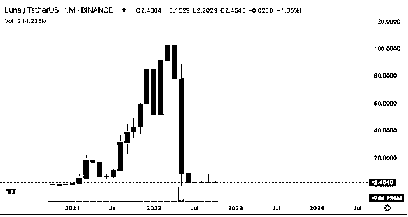
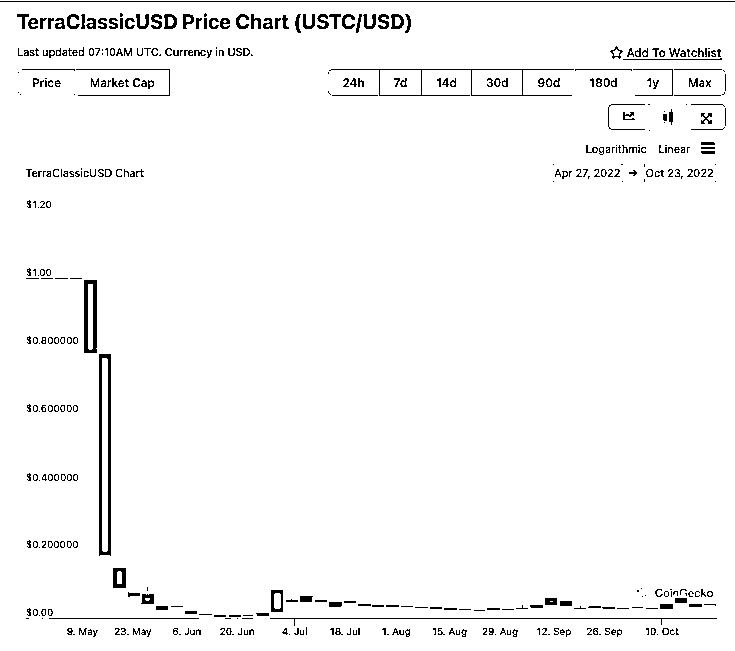

# 4.3.1 三天归零

上一节梳理稳定币类型时，我们把法币抵押型、质押型和算法型放在一起讨论。其中，算法稳定币最让人担心的点，恰恰是它可能不稳定。下面这个案例，就发生在今年5月，堪称Web3历史上绕不开的一次重大事件：UST稳定币归零。一个市值超过400亿美元的公链项目，仅用3天便轰然倒塌。

2021年公链赛道全面爆发，不少项目市值涨幅从几十倍到上千倍不等。在这波浪潮里，Terra显得很特别：凭借算法稳定币设计叠加双币结构，它曾跻身Web3市值前十。其体系围绕生态代币LUNA和稳定币UST运转。LUNA从2021年约1美元一路上涨到100多美元，今年5月触及高点后，仅3天就崩盘。LUNA与UST合计近400亿美元的体量，几乎在极短时间内蒸发。

5月10日，UST出现脱锚；到5月14日，价格已滑落至0.17美元，随后一路阴跌直至归零。这里要特别提醒：LUNA归零，价格波动大尚可理解；但UST被当作稳定币使用，很多人拿它当美元。打个比方，若有人这几天没看加密市场，以为自己账户里存着1000万美元，结果5天内只剩100多万美元，这种落差极其夸张。

币价崩塌之后，真正值得追问的是：背后到底发生了什么？为什么会崩？