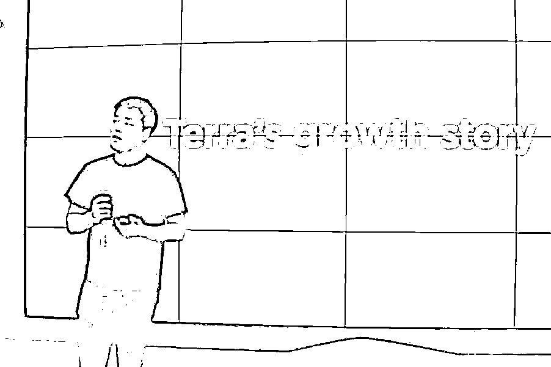
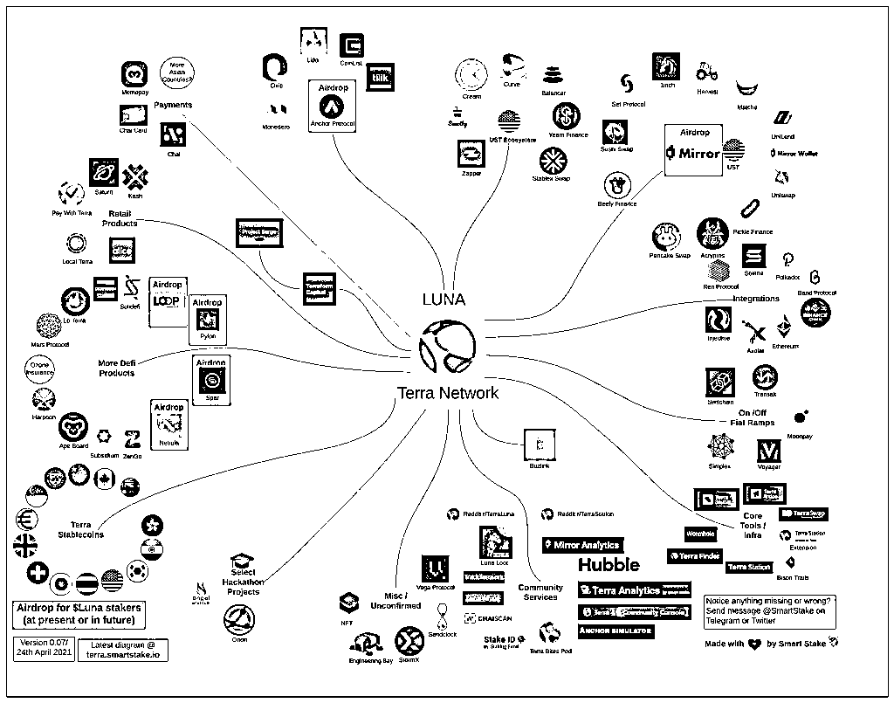
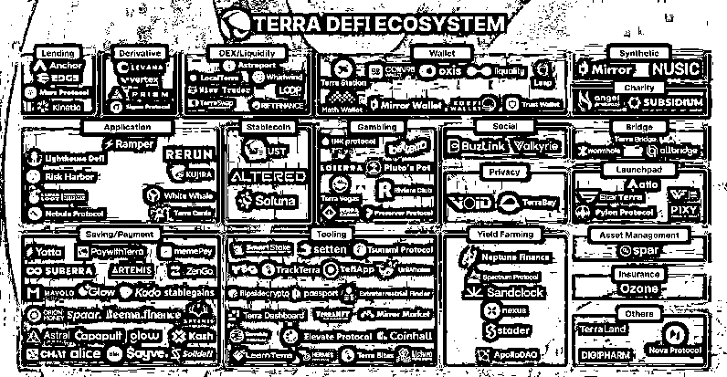
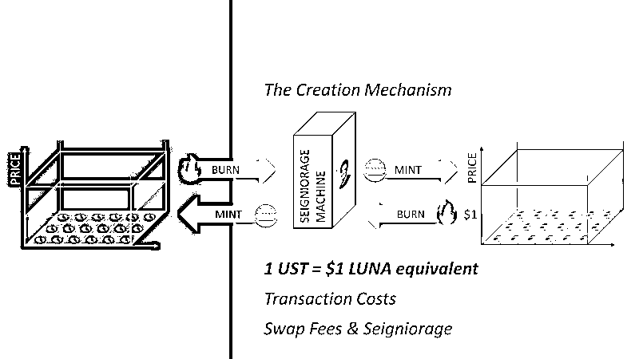

# 4.3.2 百倍 Terra：精英开局与双币锚定

Terra 诞生于 2018 年，掌舵者 Do Kwon 是韩国 90 后创业者，毕业于斯坦福大学，还登上过福布斯 30 岁以下 30 人商业精英榜。项目最早的设想，是借助一串法币作为参照，在区块链上提供算法稳定币支付方案。

起步阶段，Terra 立足韩国搭建稳定币支付业务，随后把目光投向东南亚。它曾被视为韩国本土的国民级稳定币平台：旗下移动支付应用 Chai 可以理解为支付宝，并在韩国监管框架内接入了 15 家大型银行。

经过一连串布局，Terra 生态曾冲进 Web3 市值前十，链上锁仓规模最高达到 181 亿美元。生态的枢纽是稳定币 UST。围绕它，团队做出了支付应用 Chai，功能类似支付宝；储蓄协议 Anchor，类似银行；合成股票市场 Mirror，对标股市；此外还有在这些金融底座上生长出的各类衍生应用。它们共同把 UST 当作生态内流通媒介，整个体系几乎构成一家横跨支付、储蓄与股票交易的超级金融公司。

Terra 生态为什么能在一年内把市值翻了一百多倍？原因有两层：其一，创始人的精英履历与过往成功创业经历，让项目更容易撬动大资源；其二，生态机制把人性中的贪婪利用得很充分。

前面聊过，算法稳定币的核心思路是靠供需把价格拉回 1 美元。Terra 选择的路径是“双币销毁铸造”。UST 的目标是锚定 1 美元，而 Luna 作为项目代币，价格完全由市场决定，不承担稳定义务。UST 正是通过与 Luna 之间的双向销毁铸造来维持 1 美元锚定。

具体怎么运转？若 UST 市价高于 1 美元，比如 1.01 美元，套利者会销毁价值 1 美元的 Luna，换出 1 枚 UST，再按 1.01 美元卖出，赚取 0.01 美元价差。反过来，若 UST 跌到 0.99 美元，可以先花 0.99 美元买入 1 枚 UST，把它销毁换成价值 1 美元的 Luna，再卖出 Luna 拿到 1 美元，同样赚 0.01 美元。

套利者反复操作，会把 UST 价格拉回 1 美元；前提是 Luna 总市值处于正常状态。同时，UST 生态越繁荣，交易费和手续费等收益会回流给 Luna——可以把 Luna 看作系统股权——从而推高 Luna 总市值。

UST 生态为何能迅速扩张？关键在 20% 的存款利率。一个稳定币给出 20% 存款收益，放在 Web2 时代几乎难以想象。于是大量用户争相把真金白银换成这种算法稳定币。当时我周围不少人把资金押在里面；经验丰富的老玩家通常能更早获得风声，一旦察觉不对就会立刻撤离。