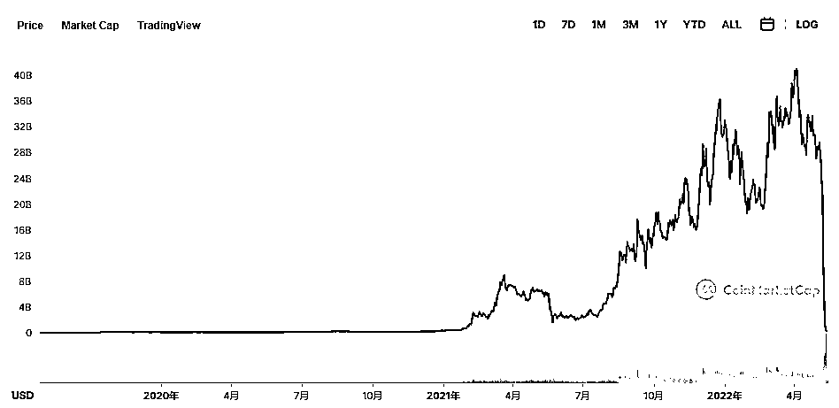
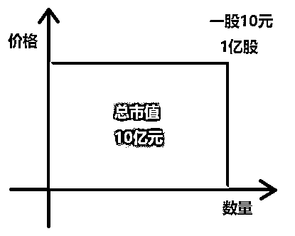
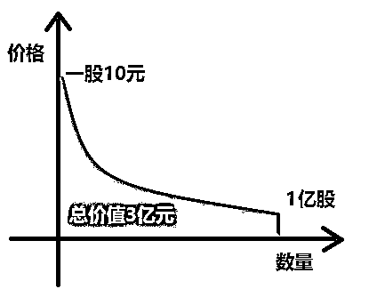

# 4.3.3 崩盘真相：LUNA为何填不了UST的坑？

UST的用户规模不断扩大，LUNA价格也被一路推高；在脱锚之前，其总市值曾冲到400亿美元的高点。

而到5月9日脱锚前夕，LUNA总市值为204亿美元，UST总市值为187亿美元。

这套双币机制藏着一个致命缺陷：LUNA账面上的市值，并不代表背后真有等额现金支撑；UST却锚定美元，并承诺可按1:1兑换。那么，204亿美元的LUNA究竟能变现多少？若市场快速上行，或许能全部兑现；若市场急速下挫，可能只换得出2亿美元。这和股票、房地产的市值逻辑如出一辙。

假设某小区共有100套房，其中10套挂牌。第一套以1000万元成交后，其他业主便认为自家房子也能卖到这个价，小区总市值于是被算成10亿元。可若想真正完成10亿元的交易，必须让100套房全部以1000万元左右的价格换手。

市场情绪高涨时，第二套可能卖到1100万元，买家看到一周涨了100万元，也急着入场。极端情况下，100套全部卖出，价格还会不断往上走。

可一旦市场转冷，1000万元就成了顶点。剩下9套想卖的人先挂900万元，一个月没人接，再降到800万元、700万元、600万元，最终成交价可能只有500万元，小区总市值随之缩水到5亿元。房产可交易的套数少、流动性偏弱，所以更容易看懂。股票和加密货币同理，只要把房子的套数替换成股票股数或代币数量，逻辑就通了。

当UST与LUNA的市值比例变成这样，LUNA显然填不上UST的窟窿。行情一旦转差，204亿美元的LUNA实际可能只套得出20亿美元甚至更少的真金白银来承接UST，而UST的市值却高达187亿美元。用户把这里当成银行，却发现无法提现，信用瞬间坍塌，UST遭到大量抛售，价格随之脱锚。

同一时期，Terra创始人在LUNA市值高位以虚增的LUNA换取真实资产，套现40亿美元，转而买入比特币等硬通货，并兑换成其他稳定币。