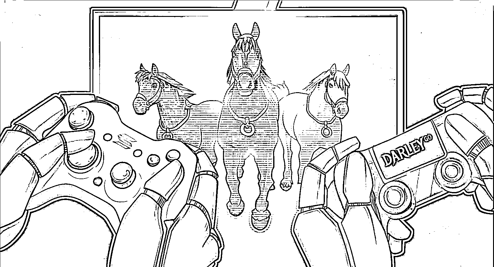
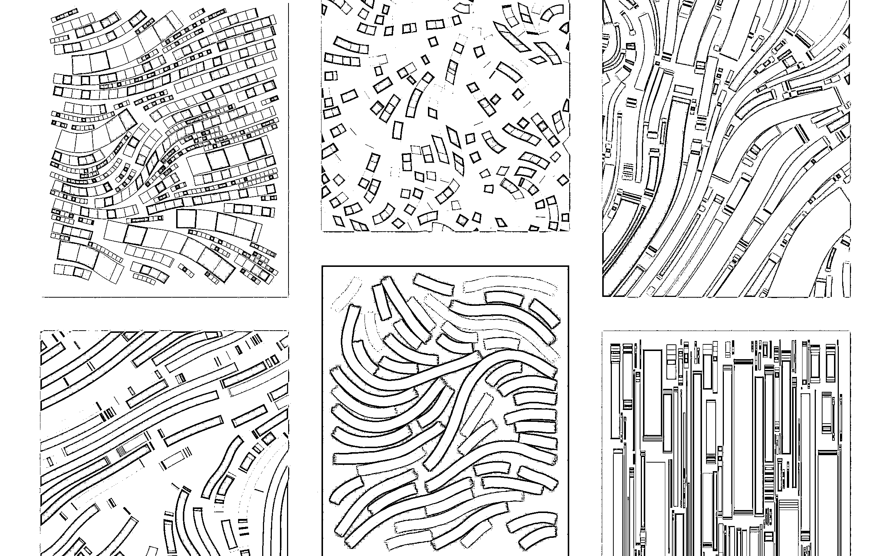

# 5.3 不止头像：NFT 的八种打开方式

提到 NFT，多数人脑海里先浮现的是社交头像（PFP）：把 NFT 设为个人资料图，在各社交平台展示。但除了换头像，它还有哪些用途？下面八个方向，正是 NFT 已经或正在落地的场景。

1）游戏：游戏是 NFT 最早试水的方向。借助区块链，NFT 能记录玩家的游戏状态与成就，也能保存游戏内获得的物品清单。因为这些记录难以篡改、可以顺畅转移，游戏物品的归属和真实性都能得到验证。设计上，物品还能跨游戏使用，或具备一定兑换价值。传统游戏的短板在于物品通常不能转让，允许交易或出售收集品的游戏都很少，跨游戏使用更少见；NFT 正好补上这一环，让游戏资产有机会迁移到其他游戏中。

2）艺术：数字艺术是 NFT 日益受关注的用例。艺术家可以保留自己作品的版权，买家也能确认入手的艺术品真实、权威，减少盗版和造假。区块链能够解决所有权证明问题，艺术家无需再靠第三方来保护作品，中间环节被省去，收入空间也有望扩大。数字艺术代币化后，创作、交易以及从 NFT 获取版税都变得更方便。就原生加密艺术品 NFT 而言，目前海外最知名的平台是 Art Blocks。

3）音乐：音乐人最头疼的问题之一，是歌曲被播放后难以拿到应得报酬。过去几年，非法下载一度十分猖獗，流媒体播放又变得极其容易，音乐产业每年因此损失数百万。现场演出门票销售是许多音乐人的主要收入来源，而疫情让行业处境更加艰难。区块链进入音乐行业后，使用或收听艺人在链上发布的音乐，会通过加密、安全且不可更改的智能合约完成支付。区块链如同一本透明账本，一首歌的每笔交易和动向都能显示出来；在公共区块链上，艺术家和粉丝都能查看歌曲在何时何地被播放。

4）门票：伪造门票和大量囤票，一直是票务市场亟待解决的问题。NFT 将记录保存在分布式账本上，且记录不可更改，因此票据可以在区块链上独立验证和认证，降低作弊空间。为了抑制大规模囤积，还可以把购票资格与基于区块链的特定身份绑定，从而实现销售限制。

5）域名：以太坊名称服务（ENS）会把可读名称映射为区块链及非区块链资源中机器可识别的标识，例如以太坊地址。简单理解，ENS 就是把 .eth 域名解析成以太坊地址。它让以太坊地址更容易记忆，ENS 域名也能在二级市场买卖。如今还衍生出不少 DID 赛道，如 .bnb、.bit、.sol、.nft 等。

6）身份验证：NFT 含有特定商品或资产的独特信息，这让它很适合用于区块链上的识别与认证。每个人都有自己的独特属性和身份信息，NFT 可以把病例、个人档案、教育信息、地址等数字化，让数据由用户自己轻松管理。随着区块链应用不断增多，用 NFT 存储个人数据的人也会越来越多。

7）实体资产和文件记录：现实中的资产和证明也能通过 NFT 代币化，例如房产、股票、文件、资质、执照、病历、出生和死亡证明等。以房地产为例，传统行业记录土地所有权和财产登记时，文书工作十分繁杂；NFT 能把整个流程数字化。房产可在区块链网络上被代币化，成为可交易的代币，在二级市场中轻松流转。这样一来，经纪人、银行、代理商和律师等中间商便可省去。

8）DAO 组织和社群权益：随着社区发展，许多传统运营模式正在向完全去中心化的自治组织（DAO）转变。NFT 可以作为 DAO 或社群的唯一证明，持有者能够接触社群私密信息、参与互动，还有机会获得收益分红。

