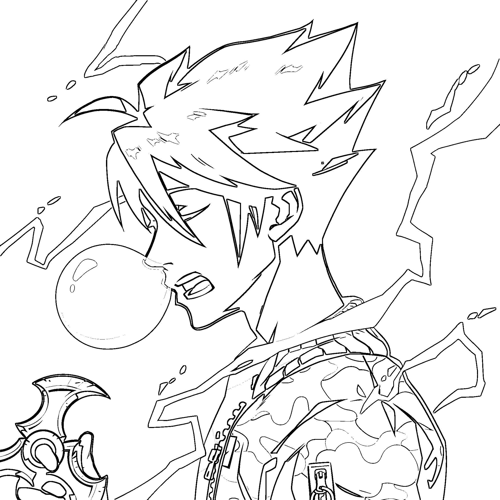
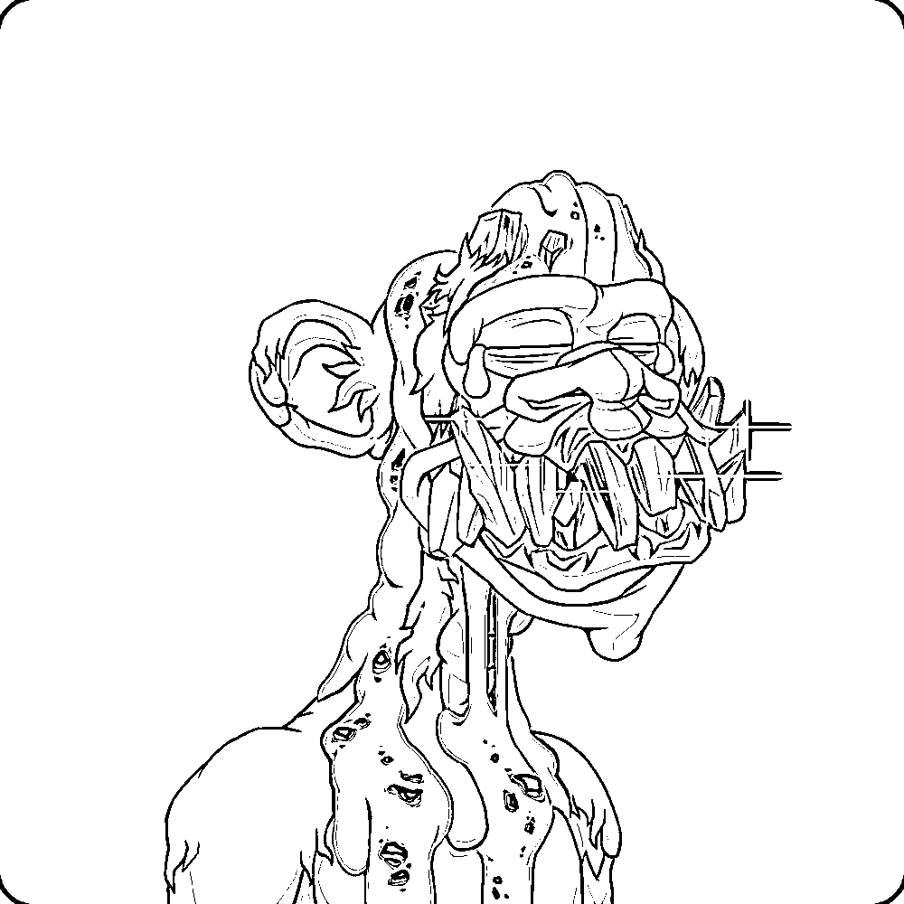
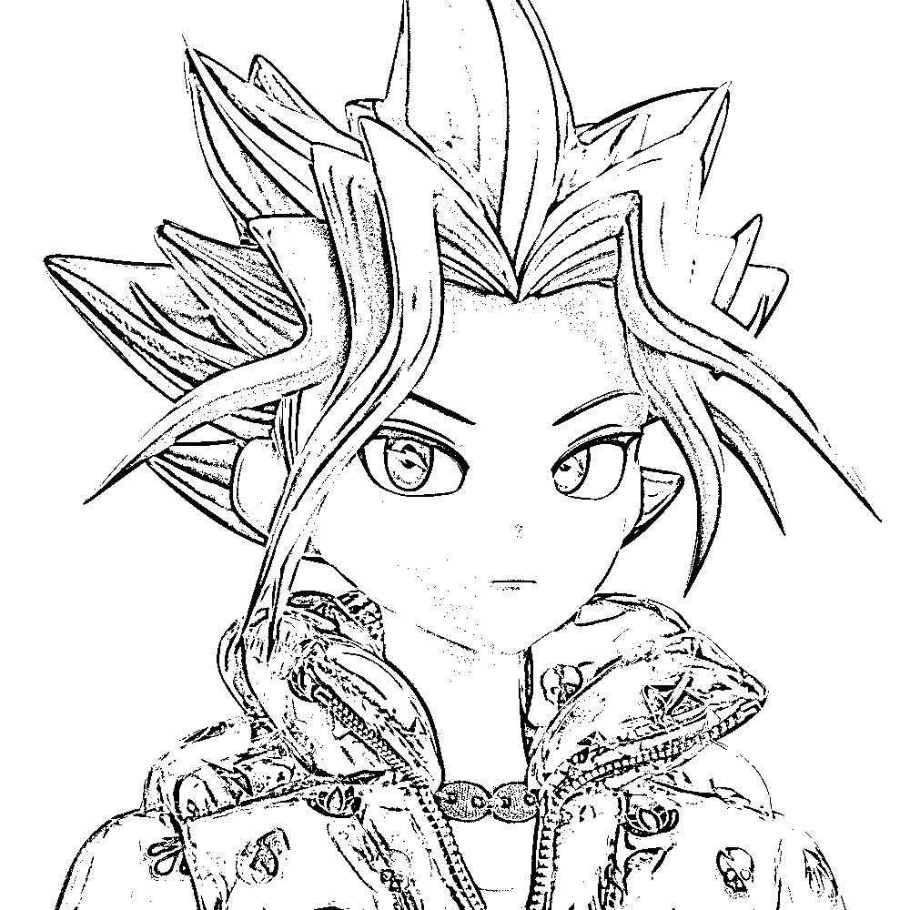
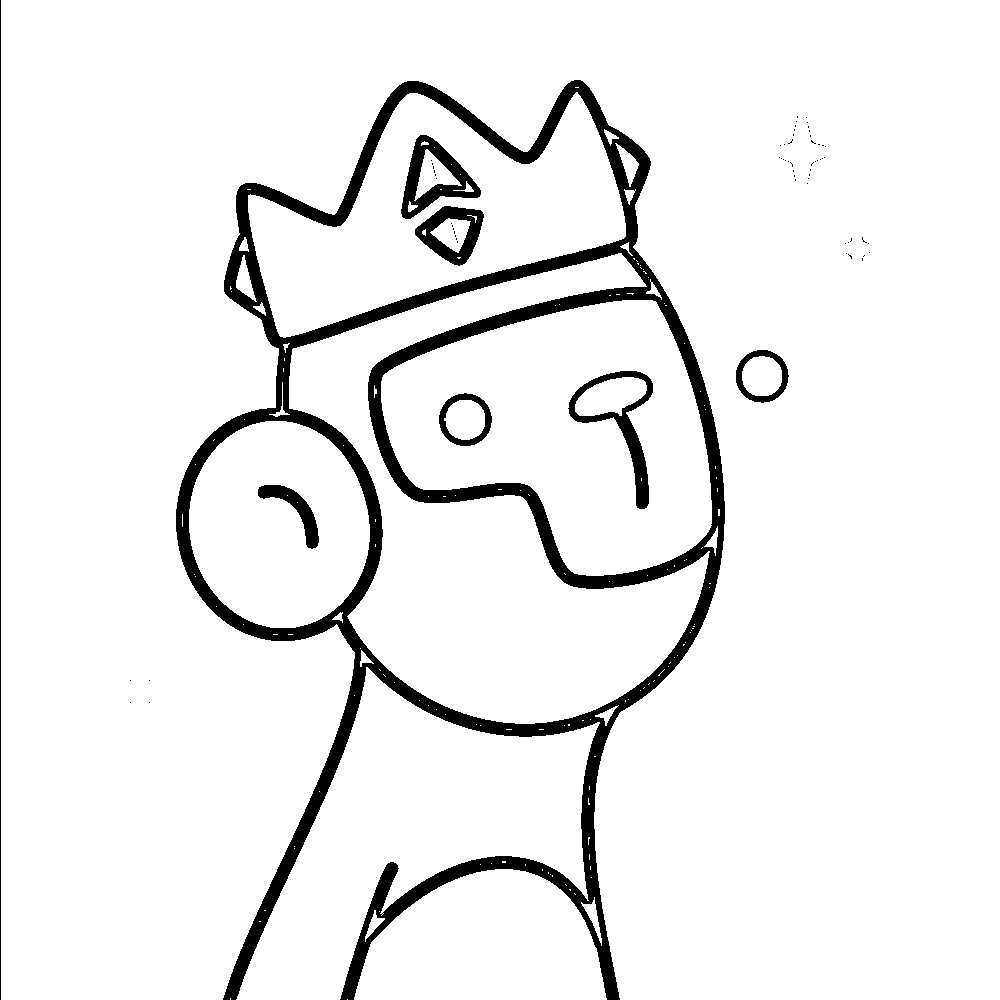
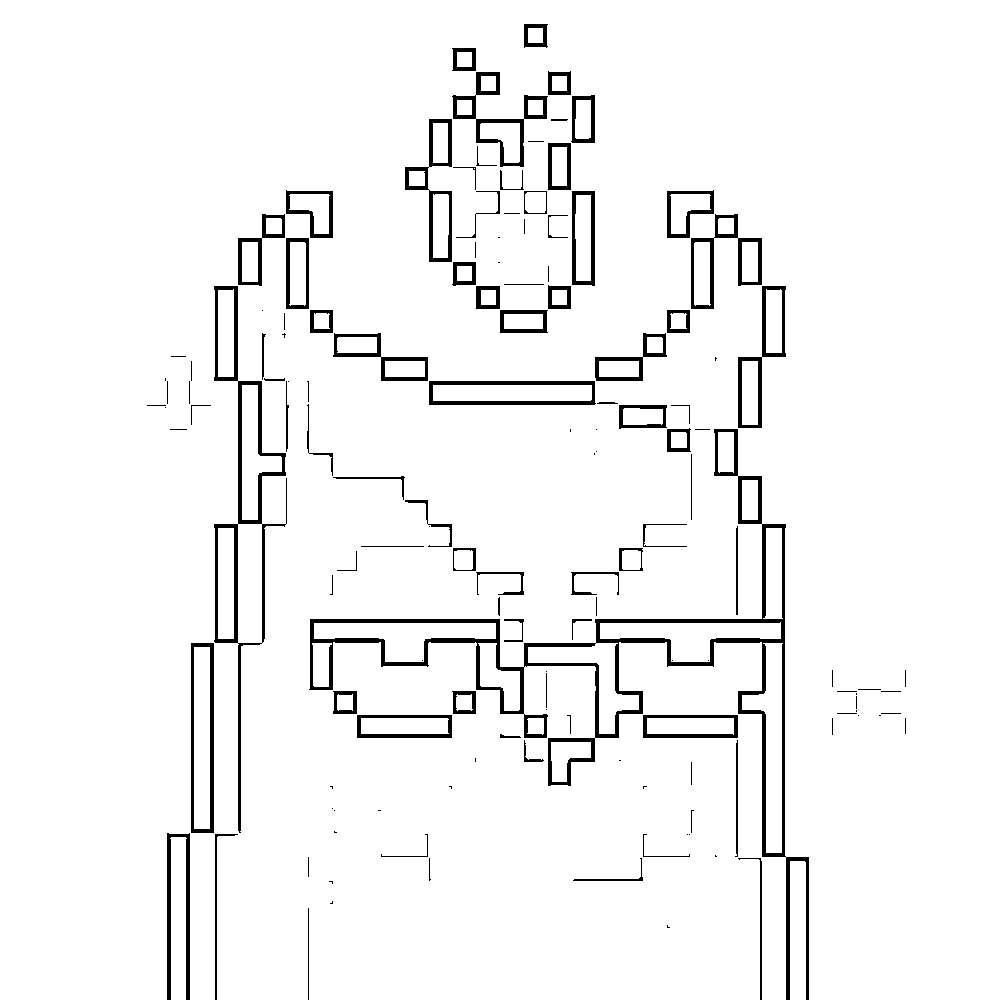
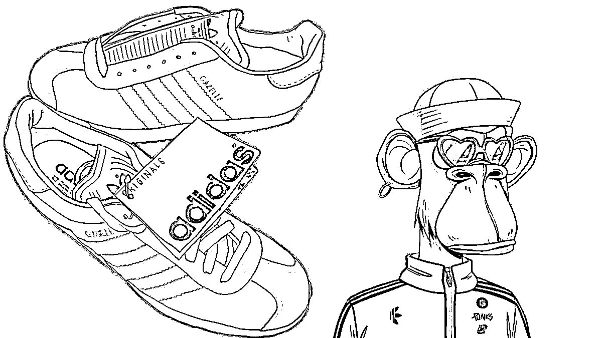

# 5.10.3 蓝筹 NFT 还有哪些熟面孔？

聊完前文提到的两个项目，蓝筹 NFT 的名单里还有一批被市场广泛认可的名字：Azuki（红豆），社区里有人用它的稀有款做头像，价格相当可观；MAYC 即变异猿，由无聊猿系列衍生而来；CLONEX 是 RTFKT 打造的 3D NFT，后来被耐克收入麾下；此外还有走卡通路线的 Doodles、像素风的 Moonbirds，国内常叫“月鸟”等。

不只原生 NFT 项目热闹，越来越多海外大牌也在往这个赛道加码。耐克借收购 CLONEX 切入 Web3.0 运动品牌版图；阿迪达斯发行 3 万枚 “Into the metaverse” NFT，价格不低仍被迅速扫空；Gucci 牵手 Crypto Janky NFT，推出限量合作款；星巴克则打算把会员体系与 NFT 深度绑定，用 Web3.0 方式放大品牌价值；保时捷、雷诺等汽车品牌的 NFT 计划也在推进，很快会揭开面纱。

国内一些 Web2.0 公司同样选择“品牌出海＋Web3.0”，把 NFT 当作切入点。B 站、映客起步较早，之后有王老吉，近期百度（Crypto Simeji、Dudulabs）和爱奇艺等也加入其中。明星主题项目也不少，比如周杰伦的 Phanta Bear、伊能静的 Theirsverse。

市场里一直有“NFT 泡沫迟早破”的声音。确实，短期过热带来了不少泡沫。但回看互联网和移动互联网早期，类似质疑同样存在。通常只有跑得快的领域才会起泡沫，而一轮轮出清之后，NFT 的价值反而会更清晰：只想赚快钱的、没形成共识的项目会被筛掉，真正有长期价值的蓝筹 NFT 会留下来，并聚成一个个共识社群。

截至 2022 年，全球加密资产持有比例平均约 4.2%，加密用户超过 3.2 亿；而在这 4.2% 的人群中，接触过 NFT 的目前仅约 1%。NFT 的天然属性让它比加密货币更容易破圈，也更能承载多样价值。换句话说，增量空间仍然很大，未来几年很可能迎来 NFT 市场的快速扩张。

元宇宙常被说成虚无缥缈，但 NFT 作为元宇宙的基础与核心元素，这一点基本没有争议。因为 NFT 承载的是数字资产所有权，外界无法夺走；也只有这样的资产，才可能成为你穿梭不同平行元宇宙的通行证。

各大公司和品牌正在加快用 NFT 提升知名度、扩大影响力、沉淀社群共识。可以预见，NFT 的发行与运营能力，会逐渐成为多数公司或组织的常规配置。

不少 Web3.0 项目——包括公链、DAPP 等——也会用 NFT 来吸引早期用户。等项目后期发空投，持有相关 NFT 的用户往往也能分享空投收益。近期 GAL 银河女孩 NFT、Aptos 测试网 NFT、Hashflow 的 NFT 等，都带来了不错的回报。这也是我们会重点挖掘的机会。

部分内容来源：12 月 7 日《聊聊 Web3.0 里 NFT 的机会》@焦波｜水镜

