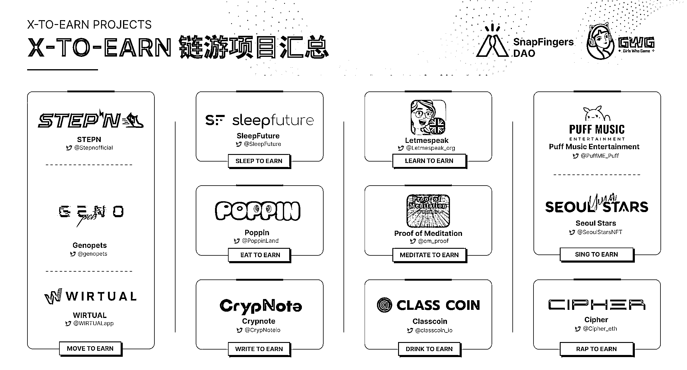

# 6.5.2 思考：链游的下一种形态在哪里？

先来盘点一下，当前 Web3 世界已经有几种链游路线正在试探中：

1. 一种是给 DeFi 穿上游戏的外衣，本质还是挖矿、质押那套逻辑。
2. 另一种更看重游戏本身的体验，只不过把游戏资产和币改成 NFT、代币来承载。但放在今天来看，这类产品和 Web2 游戏相比，差距依然很明显。
3. 还有一类，就是 STEPN 带火之后的各类“X to earn”。跑步能赚，之后又冒出开车赚、跳绳赚、唱歌赚，甚至连睡觉都能赚。然而，这些跟风项目基本都没有跑通。

不妨停下来想一想：这些路线为什么始终走不远？除了它们，未来的链游还有哪些值得期待的新可能？

