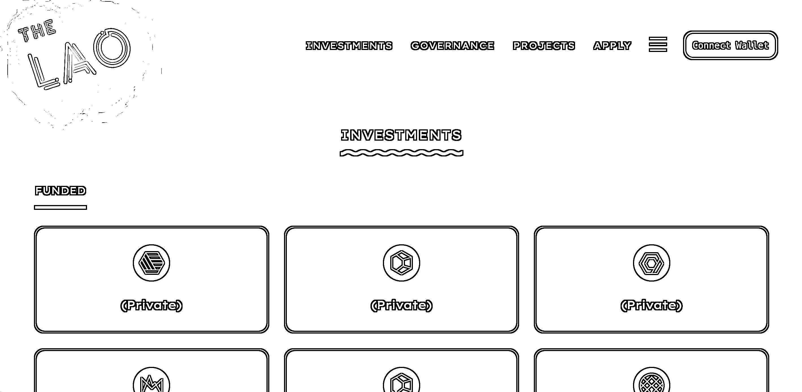

# 7.5.1 The LAO：99 席名额的 Web3 投融资组织

The LAO 可以被看作一个体量不大的私募型组织，面向 Web3 项目提供资金支持与融资对接。它背后的运营主体是一家注册在美国特拉华州的公司；虽然带有 Web3 去中心化组织的标签，但实际运作仍被纳入当地监管与合规框架。

它的 DAO 机制并不复杂：成员规模封顶 99 席。想加入的人需要投入 310 枚 ETH，按当时价值约合 300 多万美元，这笔资金会进入投资池，参与者由此获得会员身份，并能提交项目提案、参与投票。310 枚 ETH 大约对应 0.9% 的治理权或股权；投入越多，投票权重越高，项目盈利后的分配也越多。

有融资需求的项目方同样可以提交自身资料，由 DAO 成员发起投票，决定是否出资。项目官网为 [`www.thelao.io/`](https://www.thelao.io/)，相关文档见 [`docs.thelao.io/`](https://docs.thelao.io/)。

