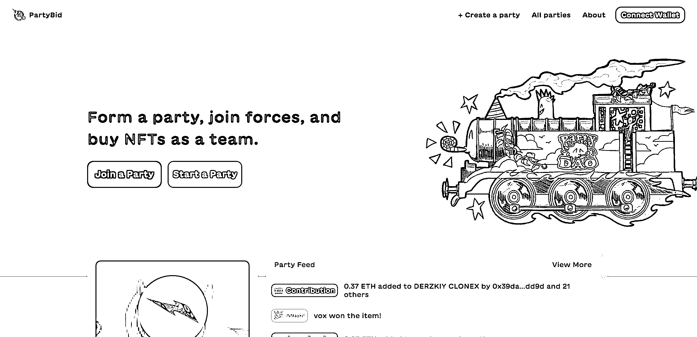

# 7.5.4 PartyDAO：给 NFT 来一场“拼单”众筹

官网：[`www.partybid.app/`](https://www.partybid.app/)

在 Web3 世界里，不少玩家手里的资金并不宽裕，但看到心仪的 NFT 时又不愿轻易错过。PartyDAO 正好提供了一个办法——把一群人的小额资金汇集起来，共同完成一次购买。

这种玩法说白了很像“团购”：大家合伙出资，一起拥有一个 NFT。比如无聊猿，单个价格接近 100 万，普通人很难独自拿下；但如果能凑到 1000 个人，每人出 1000 元，就能合力买入并共同持有。

