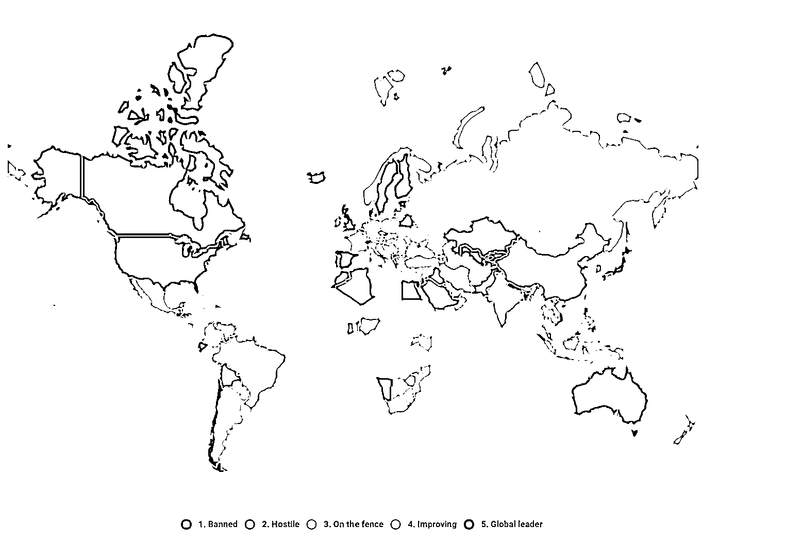

# 8.1 Web3 为何绕不开监管？

监管合规，是各行各业都躲不过的一道必答题。放到 Web3 身上，这件事更值得细聊：它既在金融领域掀起革新，又处在高速增长期。这一节，我们就一起梳理 Web3 的监管逻辑、不同国家的政策取向，以及眼下与监管紧密相关的 Web3 公司。

先站在政府视角想一想：为什么一定要监管？大致可以归为三件事——金融管控、民众维权、税收。

金融管控并不难理解。比特币和区块链最初要解决的，就是去中心化、点对点支付。可一旦资金能够点对点流转，就很容易进入监管难以覆盖的地带，例如洗钱、赌博、黑市交易、传销等。这些问题原本就在传统金融监管范围内，无论处在 Web 几，都不该成为例外。围绕它们，Web3 内部也有两种声音：一方强调彻底去中心化，认为任何资产都应自由交易流转，个人产权和隐私更优先；另一方则主张合规，认为去中心化同样要接受监管约束。

再看民众维权。Web3 自带金融货币系统，参与其中的人自然会关心资产安全。以 UST 这类稳定币为例，很多人把它当作美元使用，可一旦这种“美元”价值归零，大量民众就会转向政府寻求维权。Luna 崩盘之后，韩国政府也对 Terra 公司展开了调查。正因如此，一些 Web3 企业从起步阶段就把合规放在前面，比如 USDC，就是在政府监管背书的基础上推进相关业务。

税收同样绕不开。Web3 的组织形态是 DAO，组织内部通常使用加密货币流通，这会牵出不少税务问题，而税收本身建立在法币体系之上。各国也开始陆续制定相应法规：有的国家对 Web3 行业征税，有的则免税，政策并不统一。

接下来，可以看看全球对加密货币的监管态度。图中用颜色区分立场：红色代表禁止，橙色代表敌对，黄色代表中立，浅绿色代表支持，深绿色代表全球领导者。这样便能形成一个整体视野。

