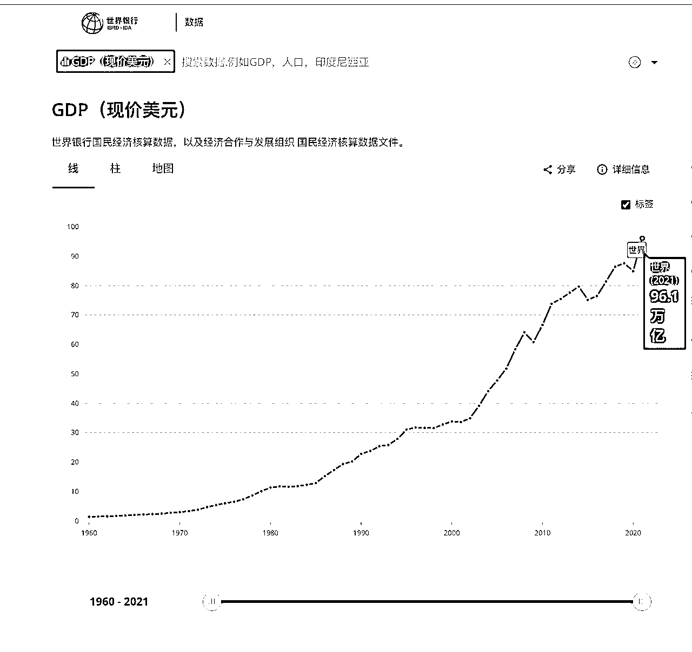
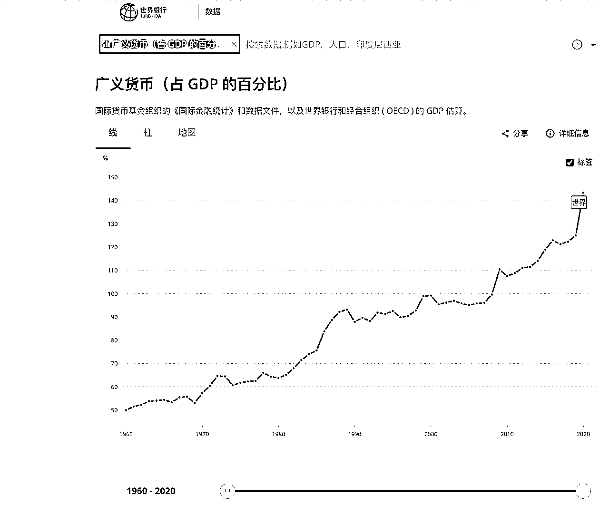

# 9.1 想清楚这笔钱从哪来

如果你做一门生意或投一个项目，却说不清自己到底在赚什么钱，那八成就是等着被收割的那个。

在我看来，参与 web3 能赚的钱，本质上来自两条线：

## 第一条线：金融层面，吃的是先发优势的红利

很多人看不懂比特币、以太坊的价值，根源其实是没想明白“价值”和“金融”这两个词到底是什么。想搞懂，不妨先回答这几个问题：

1. 货币解决了什么难题？
2. 黄金凭什么值钱？
3. 金融到底在做什么？
4. 当今世界的货币有什么用处，又在解决什么问题？
5. web2 时代我们赚的是什么钱？
6. 比特币解决什么？以太坊又解决什么？

我分享一下自己的理解。

**关于问题一：**
在货币出现之前，任何东西都没有统一的“价格标尺”。一旦货币给物品标了价，物品就有了价值。这个物品可以是实在的，也可以是虚拟的；可以是实用的，也可以没什么用。人类偏偏更容易对看不见、摸不着、没什么实际用途的东西达成一致共识。

**关于问题二：**
几千年前还没有货币，大家以物易物。比如我有两把多余的斧子，想换你两头牛。但问题来了：那个拿斧子的人如果想换点别的，却发现不是人人都需要斧子。这时候，黄金慢慢杀了出来，大家愿意拿自己的东西去换这种金属。于是黄金就成了通用的交换媒介。为什么是黄金？因为它符合人性：稀罕、数量有限、性质稳定、不怕时间、方便携带、容易分割。

**关于问题三：**
当货币本身变成一种商品，它就成了资本。货币可以给不同东西定价：给风险定价，变成保险和期货；给企业定价，变成股票或债券；给房子定价，变成房产。这些被定价后的稀缺资源，就是我们常说的资产。金融产品用“借本生息”的玩法，把钱从闲置的人手里集中起来，再借给需要的人，整个社会的资源利用效率一下子提高了。这种模式一旦出现，就很难消失。

**关于问题四：**
当铸币权被中心化的政府控制后，货币除了定价，还有一个几乎必然的动作——通胀。因为执政者任期有限，用印钞来刺激经济是大概率事件。于是每一次新钱发行，最早拿到钱的人最受益，最后拿到的人悄悄吃亏，可普通人根本察觉不到。通货膨胀是双刃剑：好处是经济能快速繁荣，坏处是普通人的劳动成果被偷偷稀释。

**关于问题五：**
按照货币的逻辑，你原本有1000元，现在又多印了100元送给你，你是赚还是亏？直觉上像赚了，其实恰恰相反。上一波互联网浪潮，钱从美联储印出来，流向华尔街，再撒向全世界。为什么很多互联网公司根本不赚钱，也能撑到高估值上市？因为市场上的钱太多了，这就是一场“货币击鼓传花”的游戏。过去两年那些垃圾互联网概念股暴跌，本质就是这个原因。

**关于问题六：**
web3 的起点，比特币和区块链，作为点对点的电子支付系统，解决的就是主权货币的种种弊端——仅此而已。以太坊则是把这种金融理念扩展到其他场景的工具平台。细节就不展开了。

如果把比特币当作数字黄金，那么当它的总市值和黄金打平时，一枚比特币值多少？有文章做过简单估算，大概是50万美元一枚。而当时价格不足2万，相当于25倍空间。

再看总量对标：按世界银行2021年数据，全球GDP接近100万亿美元。

各国政府广义印发的货币，2020年大约是GDP的1.4倍。这两年疫情大放水，我估计实际可能到了GDP的2倍，也就是200万亿美元左右。

假设未来加密资产能占到广义货币市场份额的30%，而现在加密总市值才1万亿美元——这么算下来，整个大盘还有差不多60倍空间。

赚这一部分钱，靠的就是认知上的先发优势。先形成共识的人，赚后来形成共识的人的钱。web3和crypto的出现，第一次让普通人也有机会成为“最早的货币使用者”。

## 第二条线：商业层面，赚的是生态里优质公司的增长钱

什么商业活动才叫创造价值？生产也好，创新也好，本质上都是在解决人的问题、提升效率，所以它们值钱。

那 web3 到底在解决什么问题？互联网把信息流动成本砸到近乎为零；web3 则把资产信息的流动成本也砸到近乎为零——这可能是互联网变革里最后一块拼图。

到今天为止，互联网只提升了信息网络的效率，价值网络的效率没有被真正突破。在这样的赛道上，细分领域里一定会跑出百倍以上的增长机会。

价值一旦被创造出来，货币就会给它打上价格标签。最终体现出来的就一个字：利。

所以判断一家公司，不管它叫 web1、web2 还是 web3，只要它能回答清楚这四个问题——为谁做？提供什么？收谁的钱？收多少？——那就是好公司。答不清楚的，放到哪儿都是垃圾。

还要看它在客单价、人群规模、转化率、复购率、转介绍率、毛利率这些指标上，有没有长期优势。

比如币安，表面是交易所，本质上跟腾讯没有区别。赌场和游戏的运营逻辑本来就很像，最后都是高毛利。毛利高，平台就能吸引更多用户，用户多了就有更多项目来发币，形成生态垄断，然后还能投资更多初创项目。这是典型的双边市场玩法。

我之前参加活动拿到一组数据：web3 目前全球开发者月活不到2万，国内活跃的投资用户估计不到20万，全球所有用户加起来也就几百万量级——看看关注以太坊创始人V神粉丝数也能感受到。放在全球互联网用户的大盘子里，这个增长空间巨大。

像币安这种已经跑通模式的平台，以后一定会更多。这类公司不发股票，只有web3世界自己共识的token，也就是我们说的加密资产。

web3 世界，现在还极早期。

