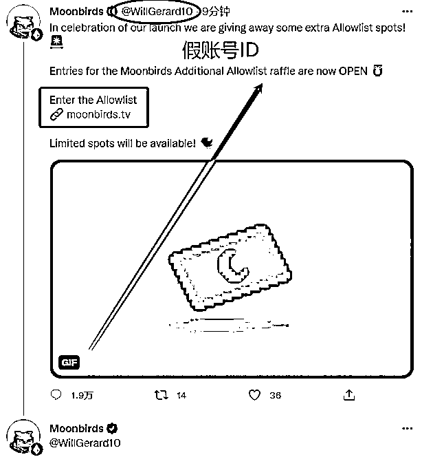
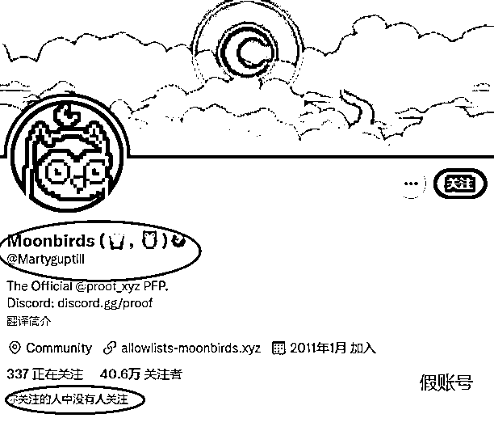

# 10.2.1 案例一：认证标识也会骗人

对权威的天然信任，是很多人共有的心理弱点。放到 Web3 里，这种倾向常常表现为：一看到大 V，就丢掉独立判断，跟着对方走。

下面这个例子就很典型：行骗者先靠购买虚假关注，把自己炒成 Twitter 上的大 V，再在发布内容里夹带钓鱼链接。不少人因此中招，钱包里的资产被转走。

这几点务必警惕：

1. 带蓝 V 认证，不代表一定可靠。
2. 粉丝数量和对方是不是骗子没有关系。Twitter 的关注数很容易造假，成本也很低。判断一个账号，更该看它的历史内容和互动情况，粉丝数不必太当真。
3. 来路不明的网站，不要点。