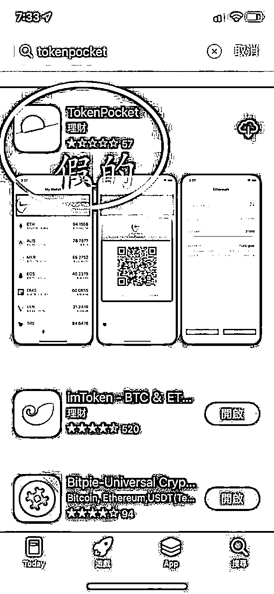
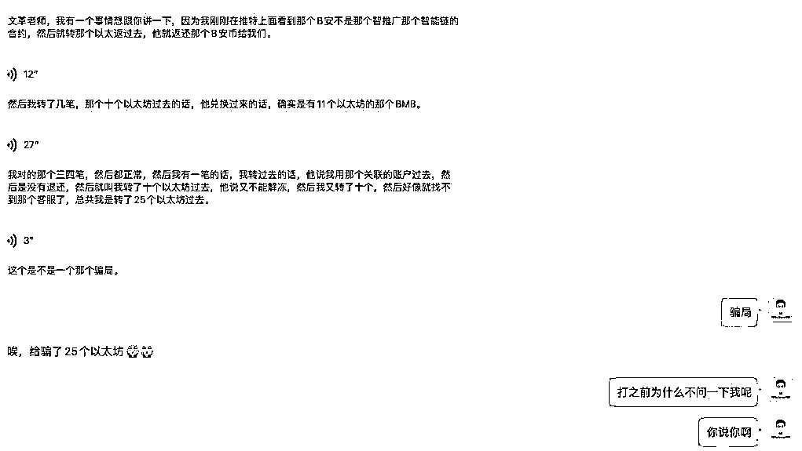

# 第三条：授权后，别忘撤销

只要钱包参与过链上交互，就应尽快把不需要的授权清理掉。

2020 年以来，链上应用持续增多，交互行为也随之频繁。为了降低协议合约漏洞可能引发的资产损失，参与过链上项目的人，最好及时撤销授权。这里整理了两个常用查询入口，建议收藏：

[`revoke.cash/`](https://revoke.cash/)

[`etherscan.io/tokenapprovalchecker`](https://etherscan.io/tokenapprovalchecker)

当然，除了高频出现的授权风险，还有几类安全细节同样值得留意：别拿钱包去扫来路不明的二维码；不熟悉、看不懂的空投不要领取；App Store 里也可能混入假钱包。

不少人会觉得，苹果商店总不至于有假应用吧？但在加密领域，TokenPocket 的仿冒版甚至比正版做得还精致。可以先看下图：

更离谱的是，现阶段正版 TokenPocket 在 App Store 竟然搜不到。

另外，YouTube 上也存在骗局，尤其是带有资金盘特征的套路。前几天，我社群里的成员就碰上了：

