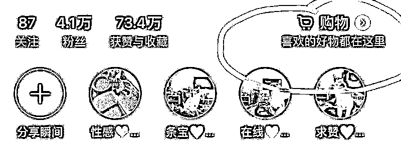
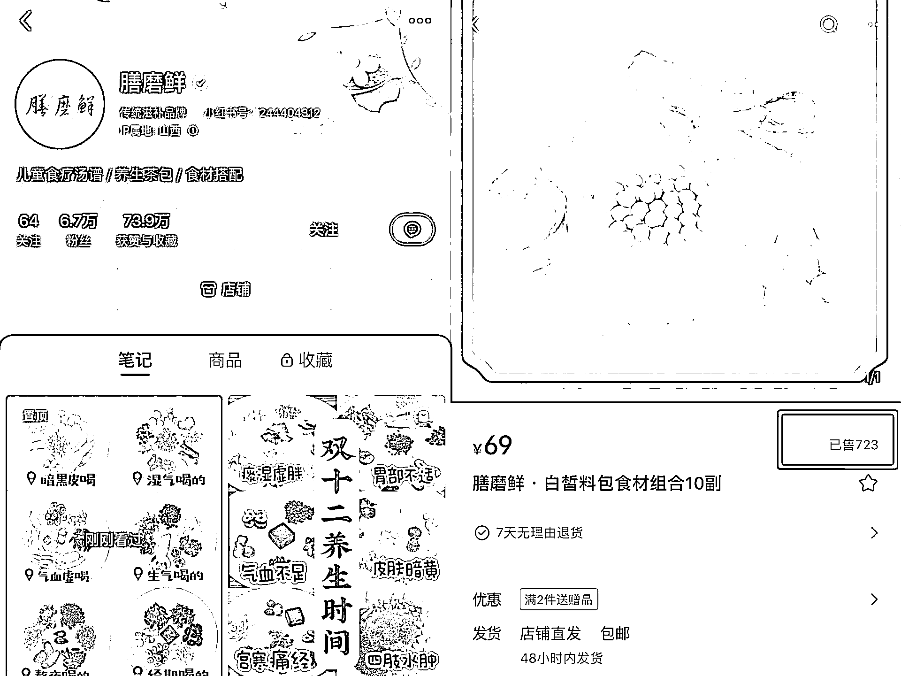
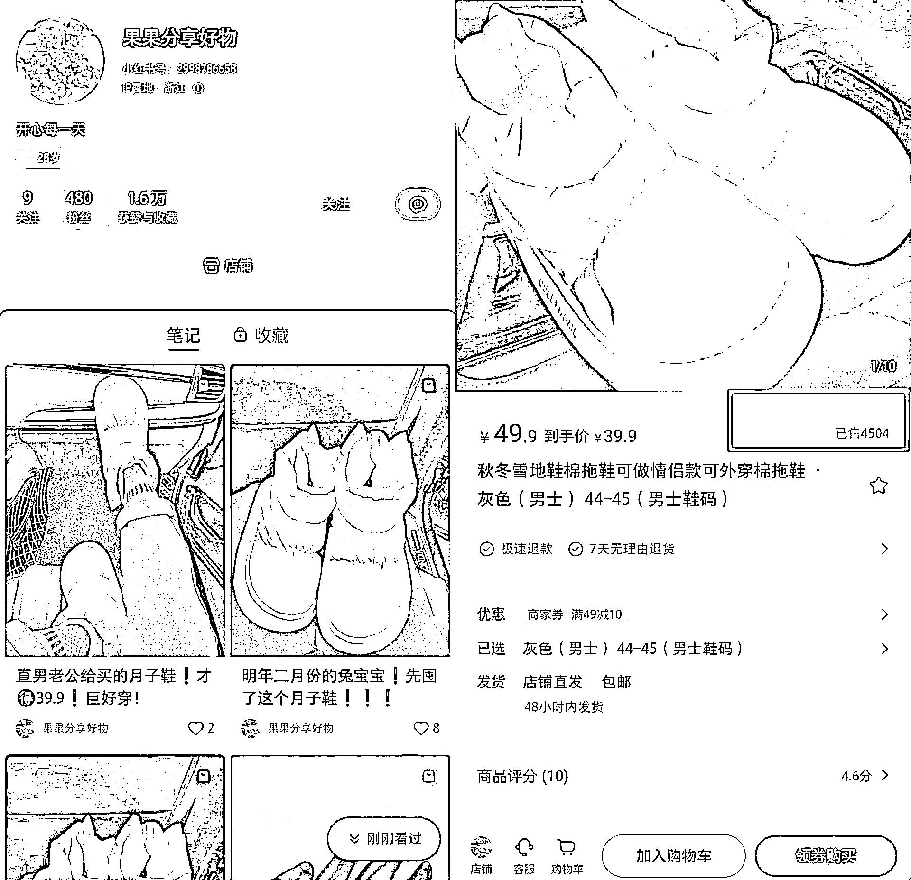
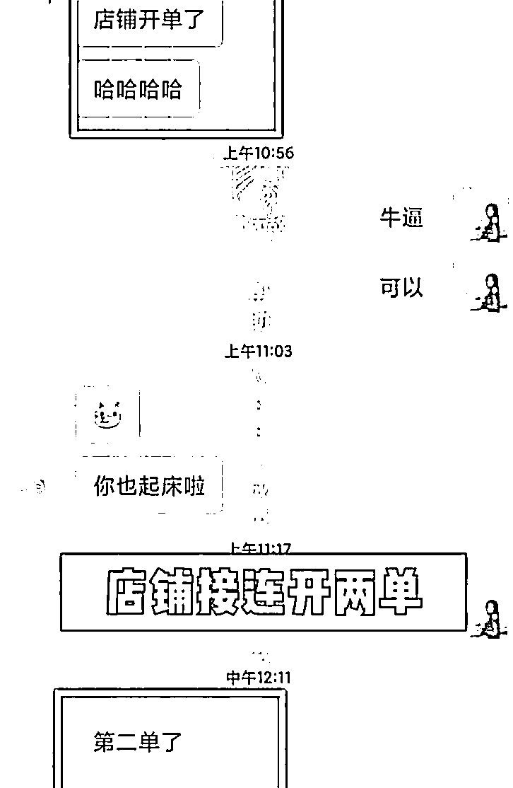
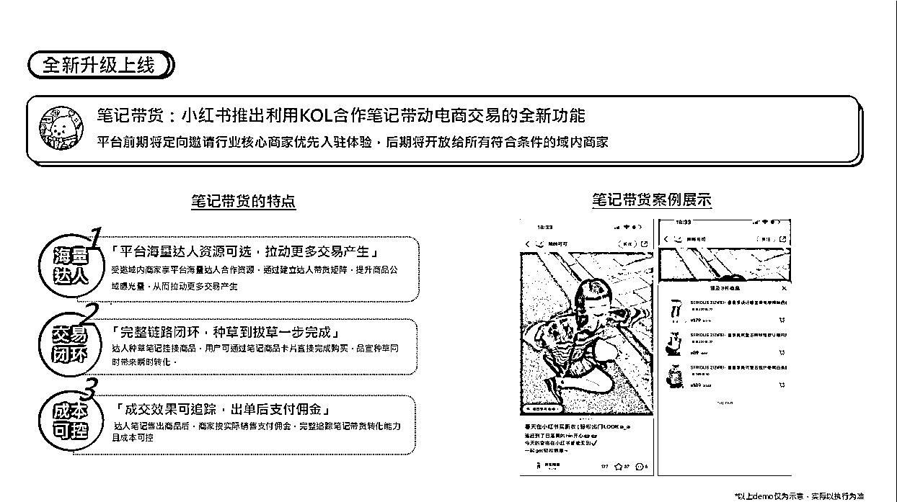

# 2.1 机会已来 @谢无敌

如今，📕早已融入许多人的消费决策流程：从吃饭、购物到旅行，大家常先来这里找参考。平台离交易场景并不远，但过去很长一段时间里，用户最后还是习惯去传统电商平台完成下单。为了把商业链路真正跑通，📕一边严打站外导流，一边持续补强站内电商能力。

2021年8月，官方推出“号店一体化”规则，把账号体系统一成专业号和非专业号，开店粉丝门槛也从1000降到0。想开店，前提只是开通专业号；而专业号的申请流程并不复杂，通常提交就能通过（医疗等特殊身份除外）。

2022年10月，有博主注意到个人主页多了购物入口：此前看过的企业号或笔记里的商品，会集中展示在这里。不过该功能当时仍在内测，并非所有账号都能看到。

平台释放的信号很清楚：希望大家在📕内部完成商业转化，也在想方设法吸引商家开店。与此同时，用户的消费习惯也在悄然改变。

比如下面这家企业店铺，单个商品销量已经突破700+：

再看这家个人店铺，粉丝虽只有几百，单品销量却冲到4000+。她的IP打法并不复杂：把同款产品的不同颜色放到不同场景中拍摄，围绕这一个单品反复做种草内容：

其实早在2022年10月，我就提醒大家要抓住这波机会，尽快把店铺开起来。有朋友按我说的方法立刻行动，店铺刚上线，第二天就连续出单：

2023年4月，📕官方上线【笔记带货】新功能，借助KOL合作笔记来推动电商成交。

笔记带货有三个特点：

1、博主资源丰富

平台可选的博主数量多，能带动更多交易。受邀的域内商家可以对接平台海量博主合作资源，搭建自己的博主带货矩阵，提高商品在公域的曝光，进而促成更多成交。

2、成交链路闭环

从种草到拔草，一步就能完成。达人发布种草笔记时挂上商品，用户点开笔记里的商品卡片即可直接购买，品牌宣传和即时转化同步发生。

3、投入成本可控

成交效果可以追踪，出单后再支付佣金。博主通过笔记卖出商品后，商家按照实际销售支付佣金，既能完整追踪笔记带货的转化表现，也能把成本控制在可接受范围内。

内容来源：[《博主必看！2023 年📕八大运营趋势解读 》](https://wx.zsxq.com/dweb2/index/topic_detail/584284422141544)[【笔记带货】产品手册-商家版（可对外）](https://doc.weixin.qq.com/doc/w3_AVIAAQa-AGk5Dd5z7u4TamqWkZv0P?scode=ANAAyQcbAAg0DdhJXrAdcAIQYvAKY&force_open_in_wx=1)

