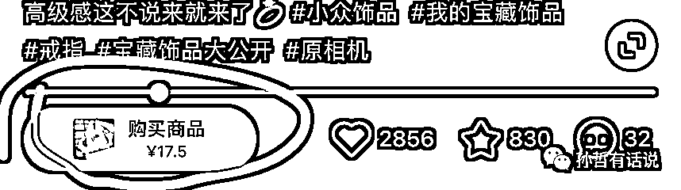
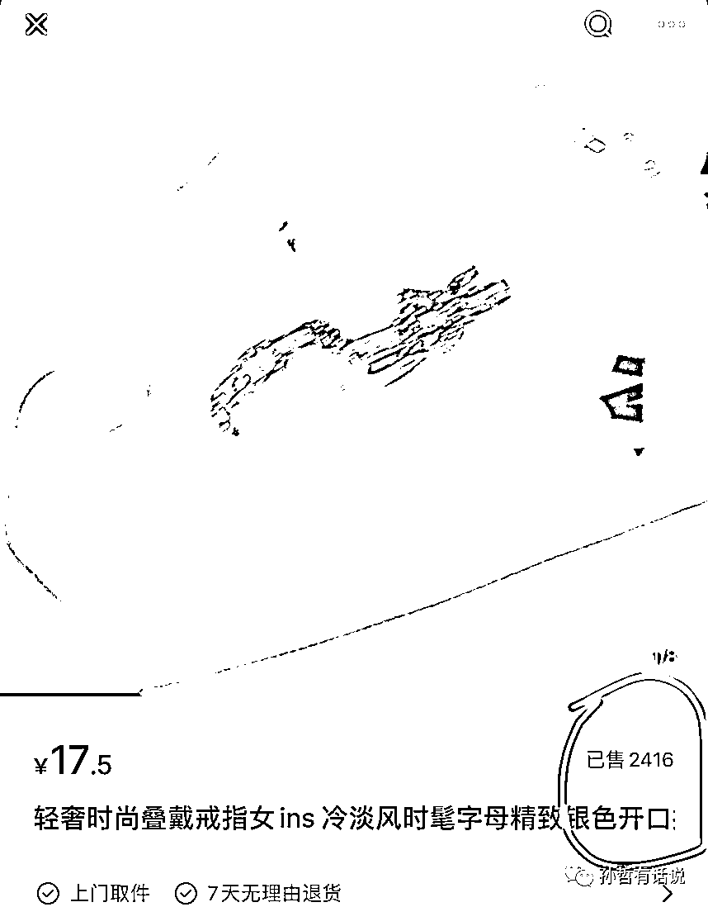

# 2.2 入场门槛 @孙哲：没资金别硬上

当下，小红书的笔记已经能挂商品带货标识，平台正一步步朝内容电商演进，也在把自身生态里的交易链路做成闭环。

开设薯店后，商家可以自己卖货：有品牌或手里有货的，走自营；没有货源的，则能做无货源模式——把拼多多、淘宝、阿里巴巴、京东等平台的商品上架，等小红书产生订单后，再去对应平台下单发货。这条路需要自己先垫钱，订单越多，占用的资金就越大。

尤其要提醒刚步入社会、手头没有积蓄的人：不要贸然扎进电商。这个行业普遍存在账期，短则 7 天，长则 15 天；前期投入的时间和资金都不算低。没赚到钱，等于白耗精力；真迎来爆单，反而可能因为垫资不足而卡住。别只盯着赚钱的大卖家——他们要么有供应链资源，能由供货方直接出货并压住货款，要么有足够资金周转。

普通玩家一定要先盘算资金。若手头能匀出一笔钱，不妨尝试这个方向：目前小红书薯店仍处在蓝海阶段，对商品进入的需求很急。

内容来源：《小红书 10 种赚钱方式，6 种引流技巧，详细指南》

