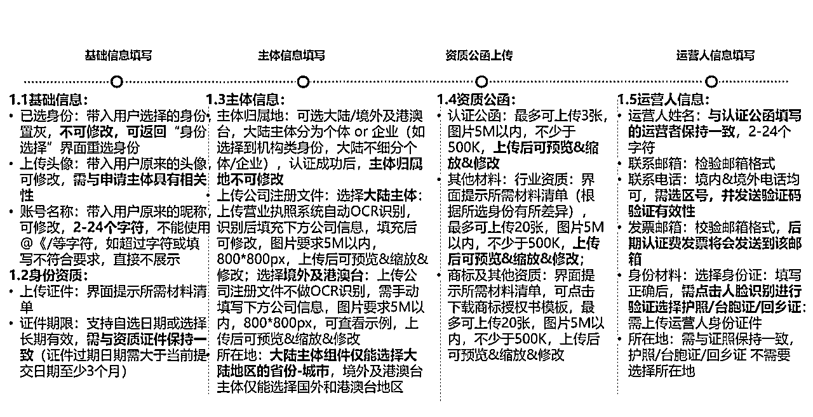

# 3.1.2 企业型：认证与开店速览

想开通企业型专业号，营业执照是必备材料，同时要支付600元认证费，账号会展示“XX品牌”这一身份标识。

操作路径可以这样走：进入创作中心，打开更多服务，选择开通专业号，再点“我是企业”；随后填写基础信息与主体信息，上传资质公函，补齐运营人资料，支付600元，最后等待审核。

填写时有哪些细节要留意，可对照下方图片：

提交后请尽快推进，因为申请有效期只有30天；若到期仍未走完流程，已交费用不会退还。审核通过后也不是一劳永逸，每年都要年审，并续费600元。

企业号能承载普通企业店、专卖店以及旗舰店。店铺名称会对应为“XXX专卖店”或“XXX旗舰店”。保证金方面，境内店铺起步为2万元，境外店铺则为3500美金。如果当月营业额不足1万元，技术服务费为零；一旦超过1万元，只对多出的金额抽5%作为技术服务费。

同一张营业执照的额度是：专业号最多3个，店铺最多3家。同一品牌旗舰店只允许一家；不过不同类型店铺能并行开设，例如旗舰店、专卖店、普通企业店各开一家。

营销权益上，企业号比个人专业号更丰富；但两者不能兼得，只能二选一，建议按实际经营需要决定。

