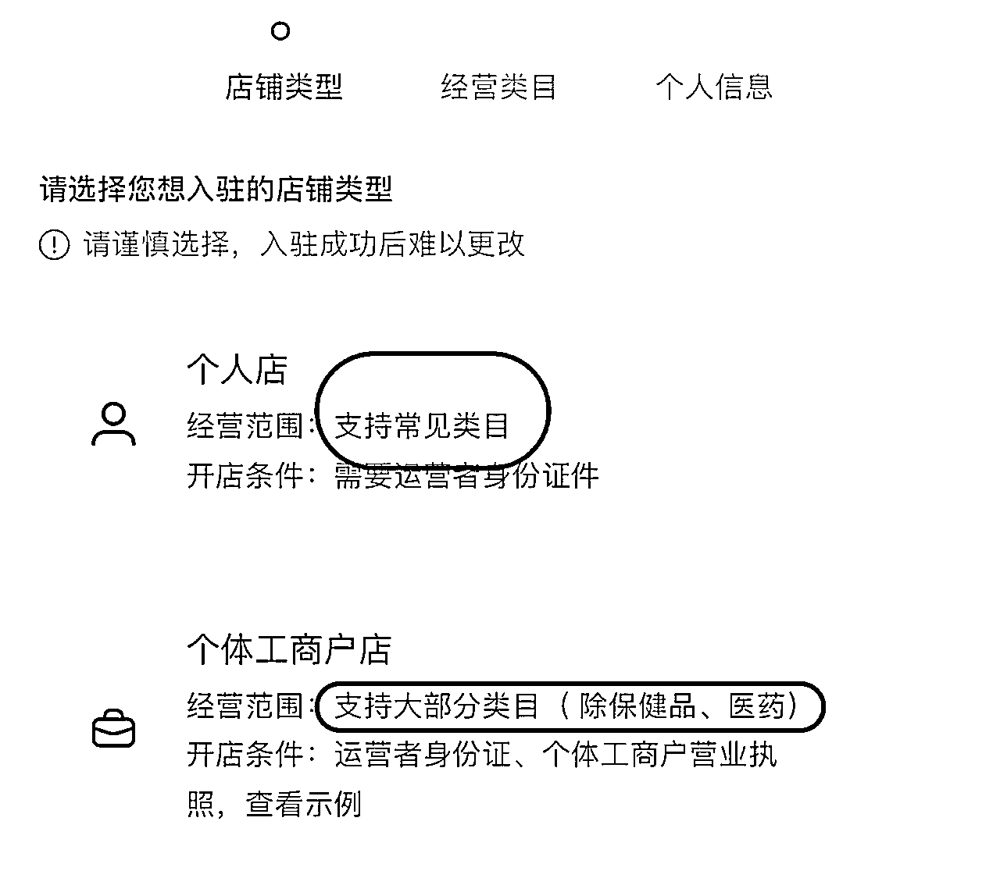
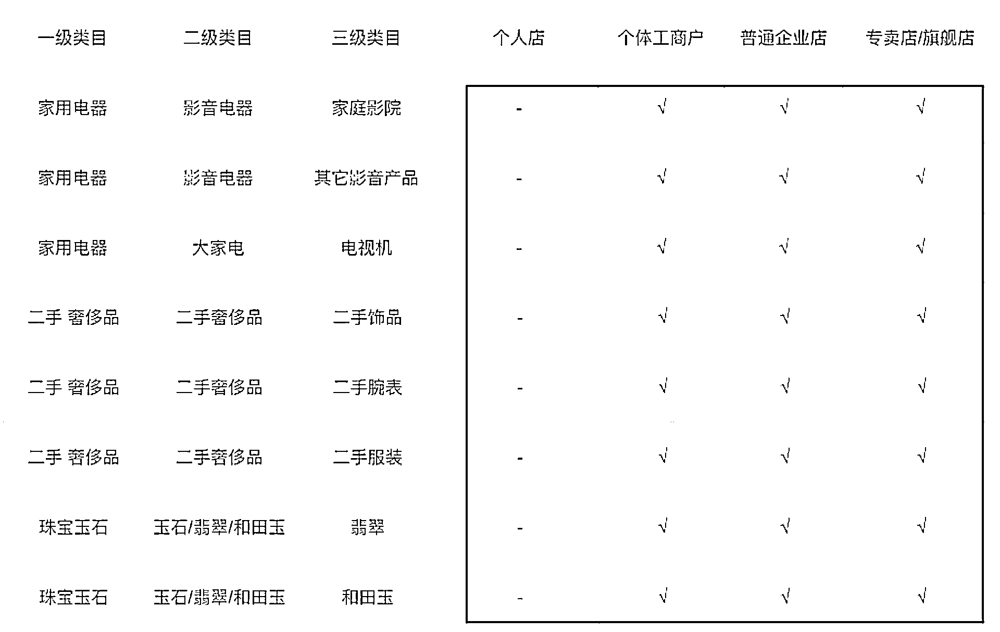
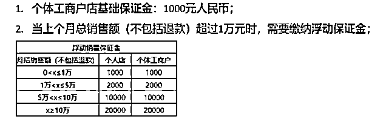
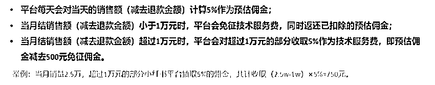

# 3.2.1 个人型

个人型店铺其实就是两种：个人店和个体工商户店。

个人店能做的类目比较常规，比如服装、百货这些；而个体工商户店除了常规类目，还能申请卖奢侈品、珠宝这类高客单商品。

不同类型的店铺，允许经营的类目范围也不一样，表格里打了勾的都可以做。想查具体类目，可以去小红书学习中心，依次进入“规则中心-经营总览”就能看到。

开店的时候还要交保证金，这两种店都是1000元。不过如果卖的是保健品、奢侈品这类特殊类目，保证金就会相应上调一些。

客服这块，个人店铺可以选平台代运营，也可以自己做。需要提醒的是，平台代运营是收费服务，具体怎么选，看自己实际情况就好。

平台佣金也就是技术服务费，每个月销售额在1万以内不抽成，超过1万的部分按5%收取：

现在小红书为了降低开店门槛，个人店和个体工商户店入驻后可以先不交保证金，直接发布商品卖货。等到店铺累计交易额超过1万元，下个月月初再补缴保证金。这样一来，基本算是零门槛起步了。