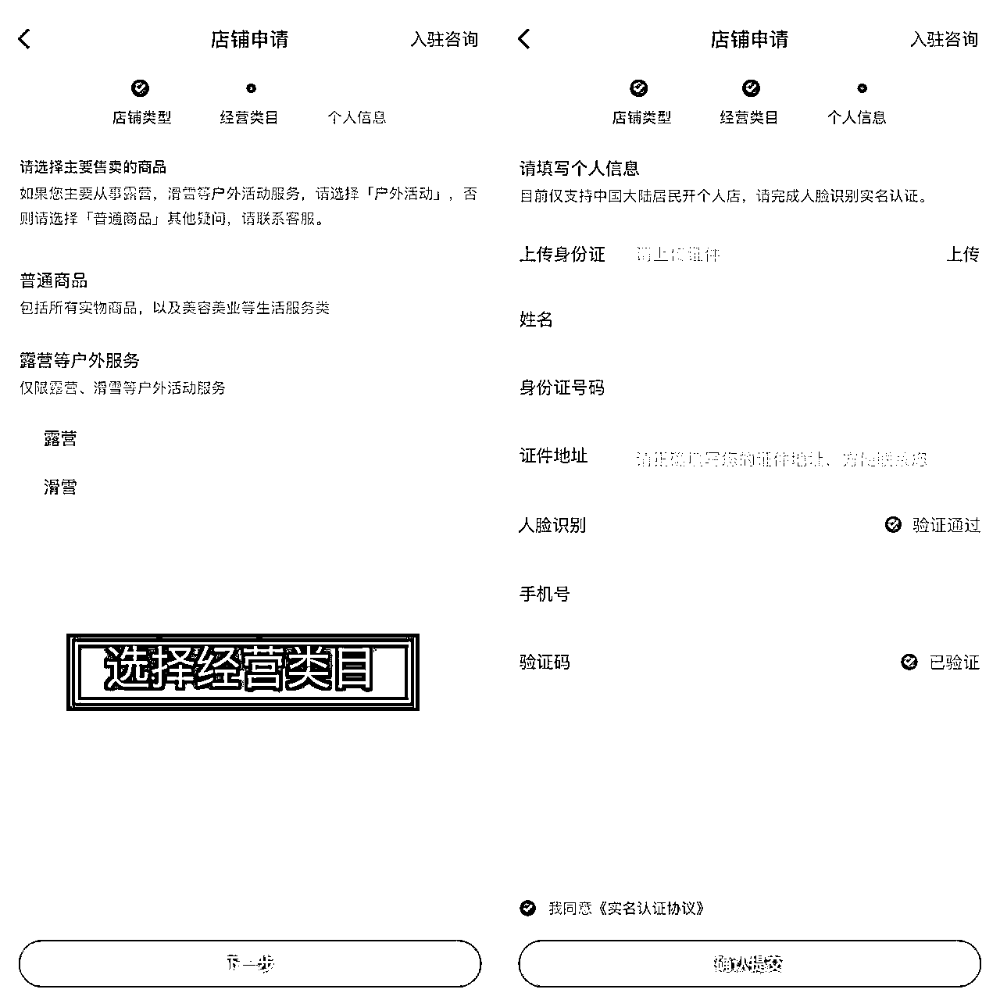
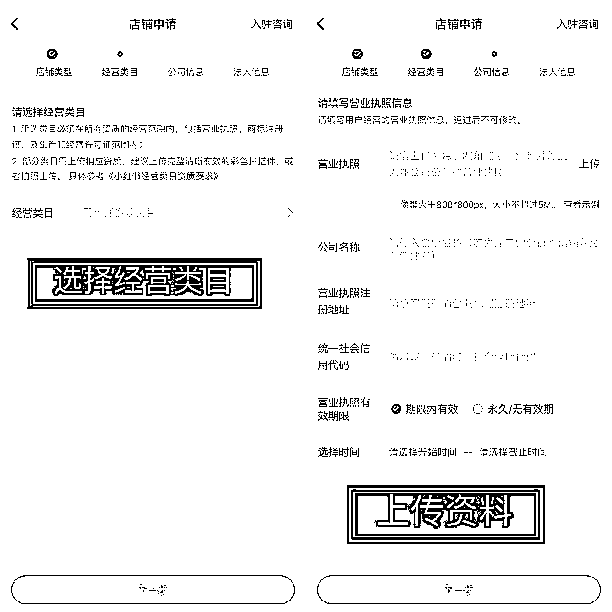
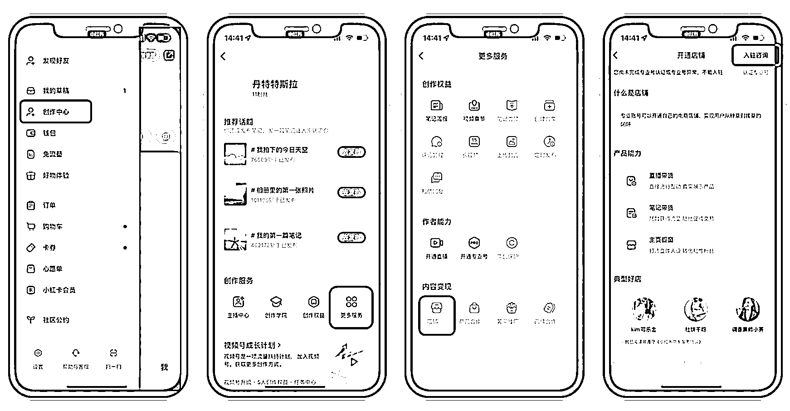

# 3.3.1 个人店，几步开通

选定个人店铺后，先确定经营类目，再填写姓名、身份证号码与手机号，并完成人脸核验。核验通过，店铺即可开通。

个体工商户店铺则要提前备齐这些材料：

（1）营业执照照片、公司名称、统一社会信用代码、经营地址及执照有效期；
（2）店铺运营授权书。

办理时同样是先选定经营类目，再按页面提示上传对应资料。

与个人店铺不同，个体工商户店铺一般要审核2至3天。等待期间，你可以登录入驻系统自行查看进度。入驻过程中若碰到解决不了的问题，每天9:00—24:00都能直接找人工客服咨询。

