# 3.3.2 企业型：开店全流程

企业型店铺要准备的材料相对更多，建议直接在电脑端登录📕入驻系统办理，入口为：[gaia.xiaohongshu.com](http://gaia.xiaohongshu.com/)

先把普通企业店走一遍，登录后大致分六步。

第一步，店铺类型选“普通企业店”。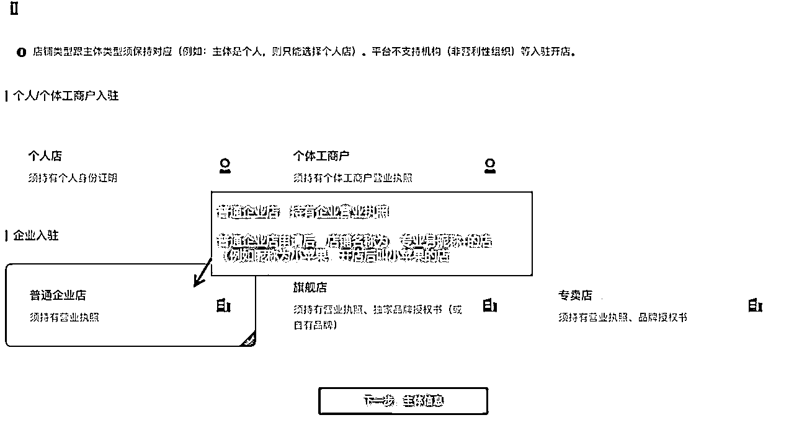

第二步，录入公司资料并上传营业执照。照片要清楚、边角完整，别让扫描识别出错。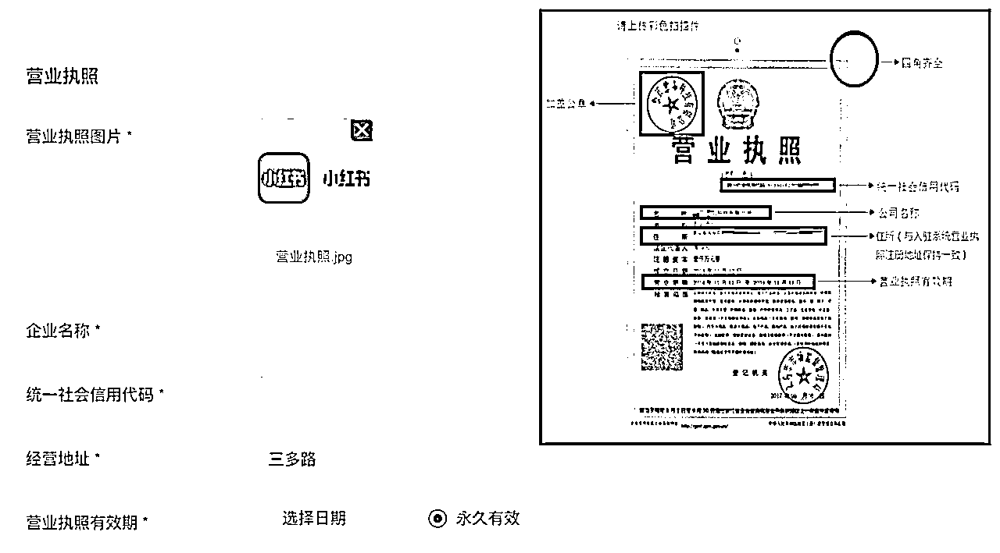

接着补法人或店铺运营人的信息；这里要留意，联系人得和营业执照上的法人对得上。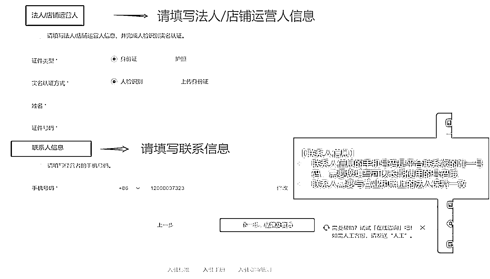

第三步是店铺名称。系统会自动抓取，规则是“昵称+的店”，所以名字跟账号昵称绑定；想换店名，先去专业号中心改昵称。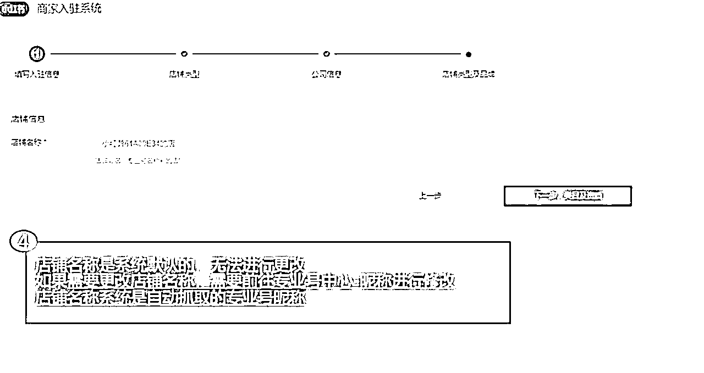

第四步，选经营类目。所选项务必落在商标注册证核准的类目范围里。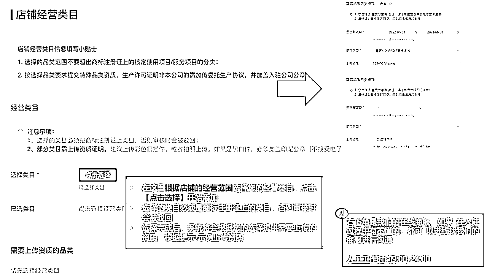

第五步，提交后等审核，通常3个工作日内出结果；若没通过，会有电话或邮件通知。期间遇到疑问，也可找在线客服。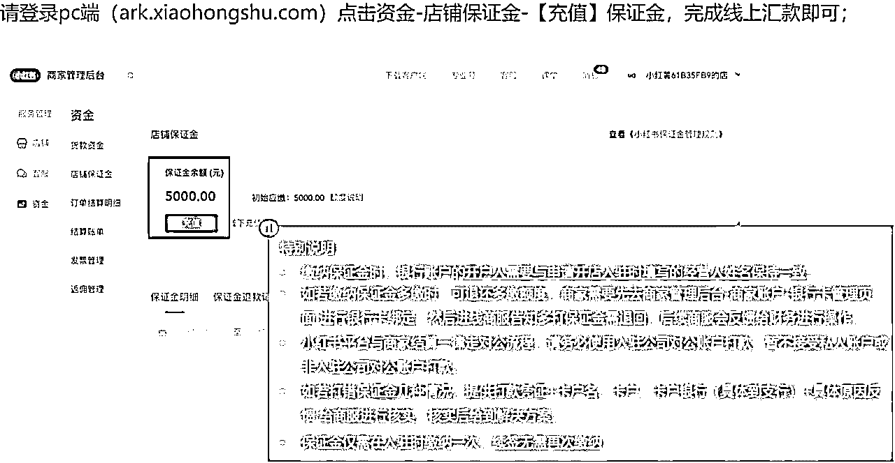

审核一过，最后一步就是交店铺保证金。开卡账户须为对公账户，开户人姓名要和入驻时填写的经营人一致。

再说旗舰店和专卖店。整体流程与普通企业店相近，但有四件事要特别注意：

一是品牌资料。若系统库中没有该品牌，选择“新增品牌”补录；logo图片须与商标注册证保持完全一致。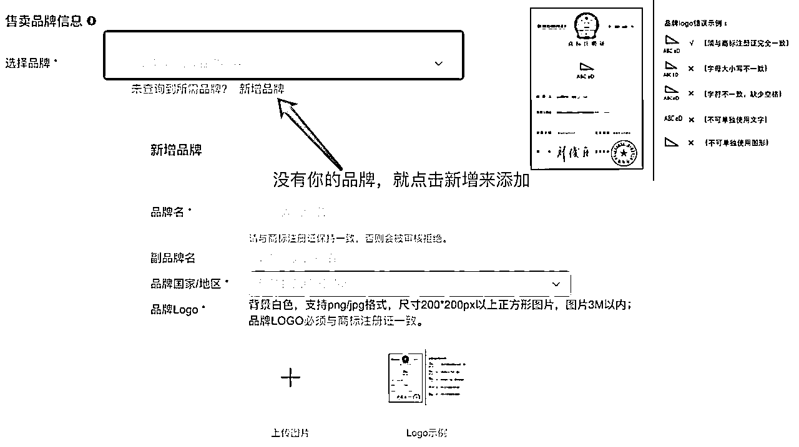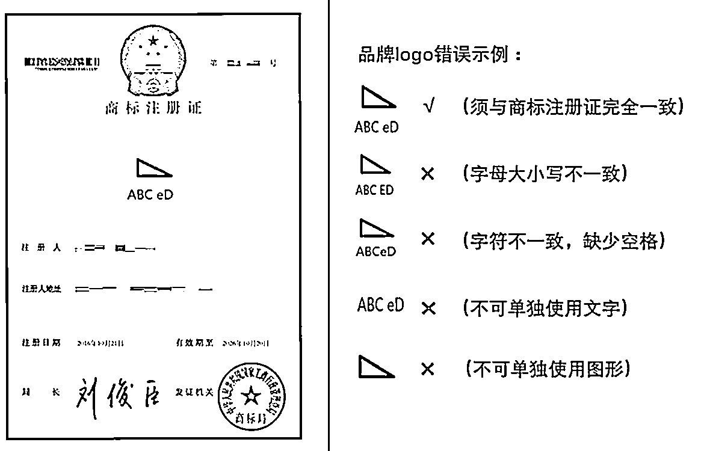

二是分清自有品牌与代理品牌。代理品牌要具备完整授权链路，公司名称按营业执照上的写。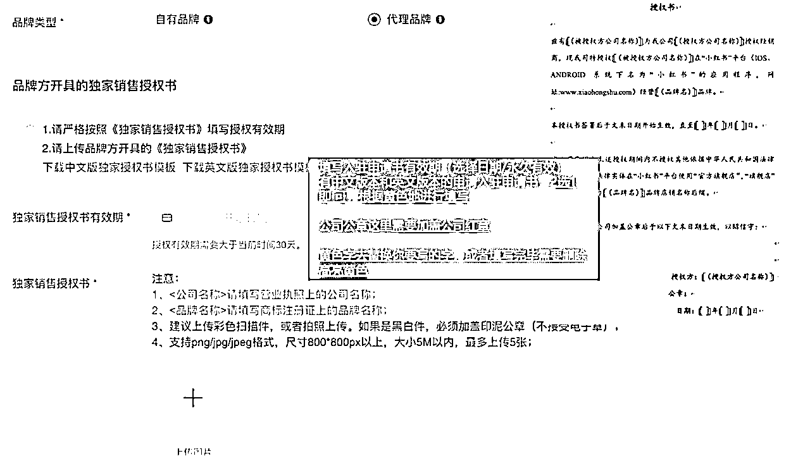

自有品牌指商标归自己公司或公司法人的情况，注册类型分R标和TM标：R标是注册商标，TM标是商标注册申请受理通知书。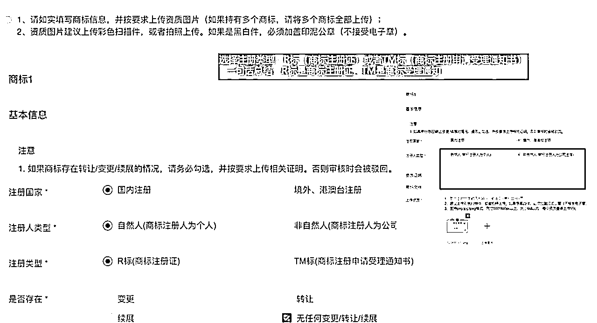

遇到个人型R标，材料包括商标注册证，以及商标权利人的身份证或护照复印件/扫描件。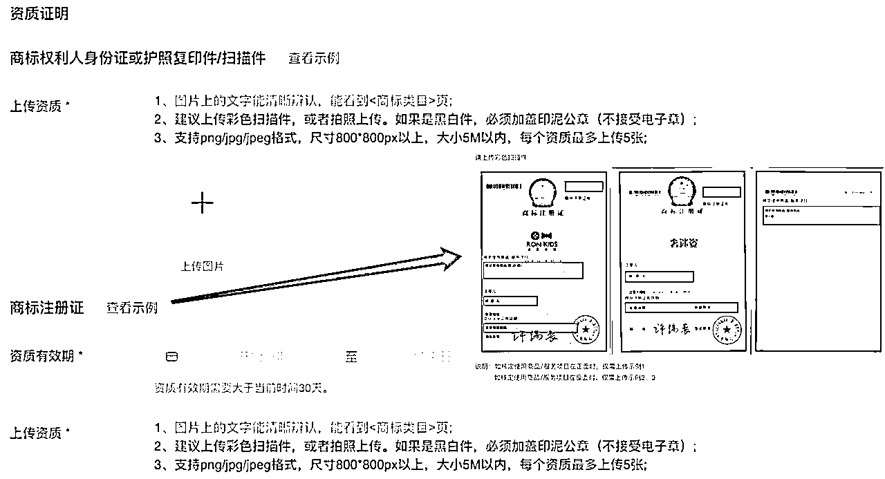

个人型TM标也一样，需提交商标注册申请受理通知书和权利人的身份证或护照复印件/扫描件。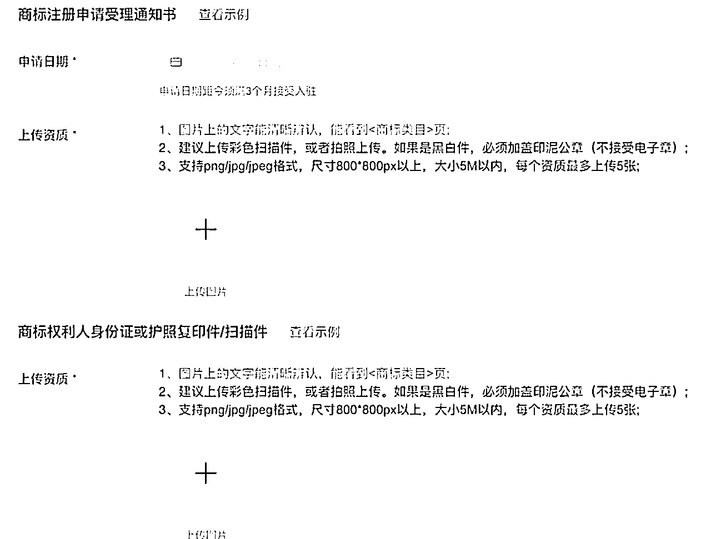

若申请的是企业型R标或TM标，交商标注册证或商标受理通知书即可。

三是挑选销售品类时，“定制”选项别急着勾选，要谨慎判断。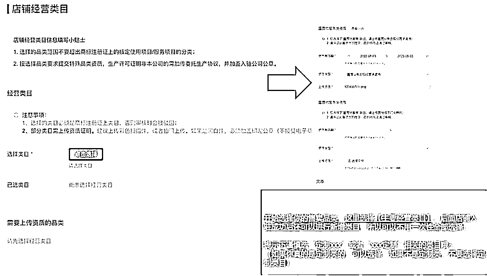

四是审核通过后还要签合同。平台会以线上邮件发送合同，签署时需通过电话或验证码完成确认。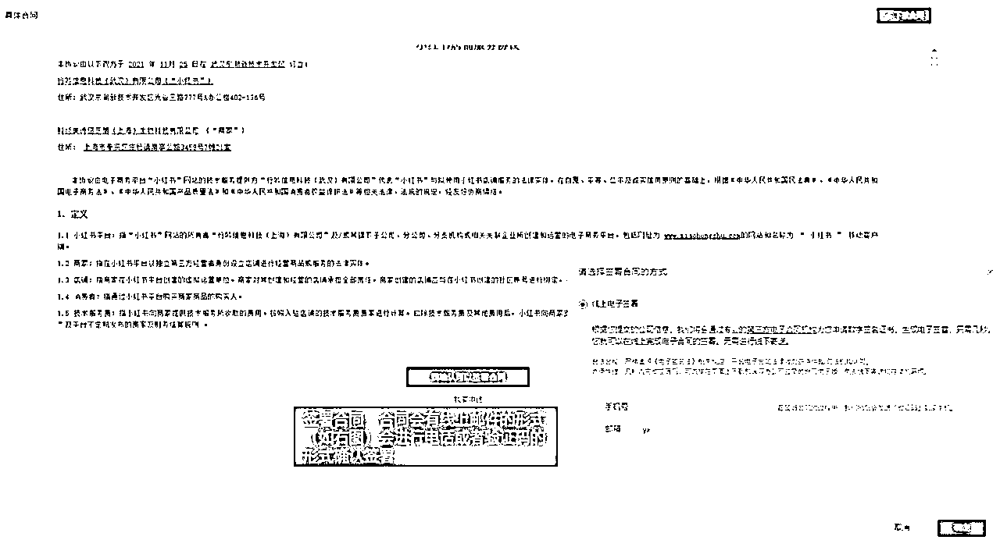

之后同样是缴纳保证金，注意事项和普通企业型店铺一致。

最后是集合店：集合店属于邀约制，未获平台邀请无法申请；收到邀请后，后续步骤与旗舰店、专卖店相同。

待各项申请审核完毕，商品即可上架，店铺正式开张，你的账号主页会自动展示店铺入口和商品入口。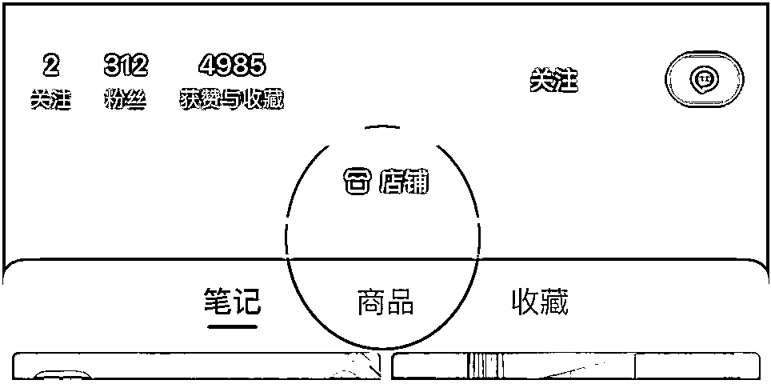

从权益来看，企业型店往往比个人店拿到更多商业支持，不过相应维护开销也更高，大家结合自身情况选择。入驻类目、审核等有不明白的地方，建议第一时间联系“人工服务”咨询，客服响应一般比较快，问题通常能及时得到处理。更多店铺入驻信息，可前往（[`school.xiaohongshu.com/helper/list?ctg=238&jumpFrom=cn`](https://school.xiaohongshu.com/helper/list?ctg=238&jumpFrom=cn)）自行查询：

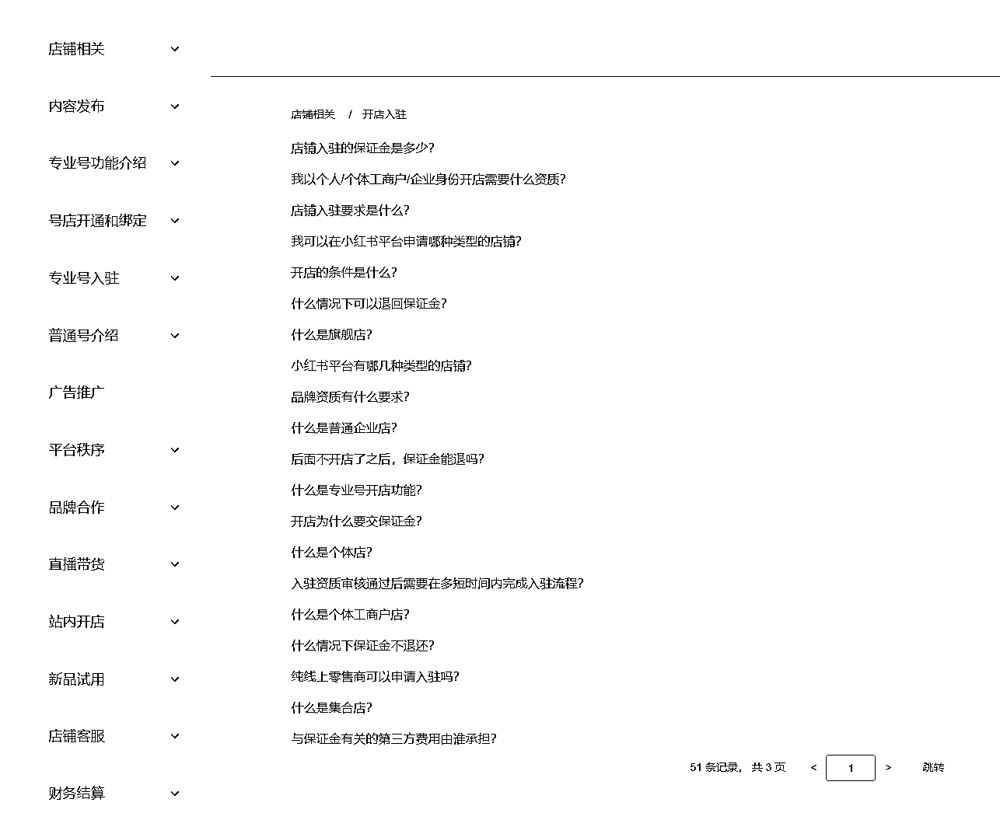

