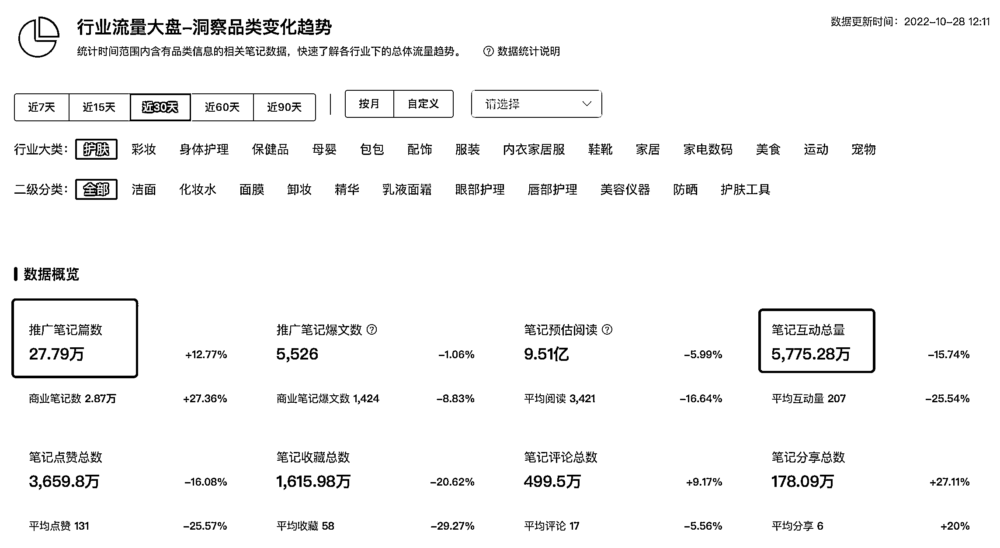
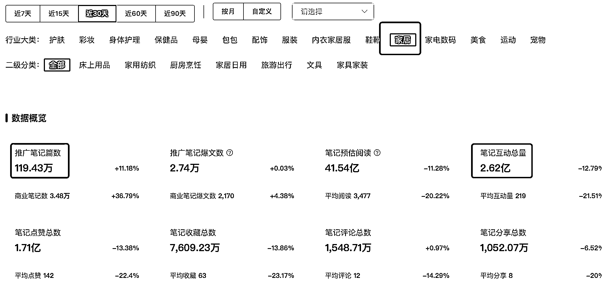
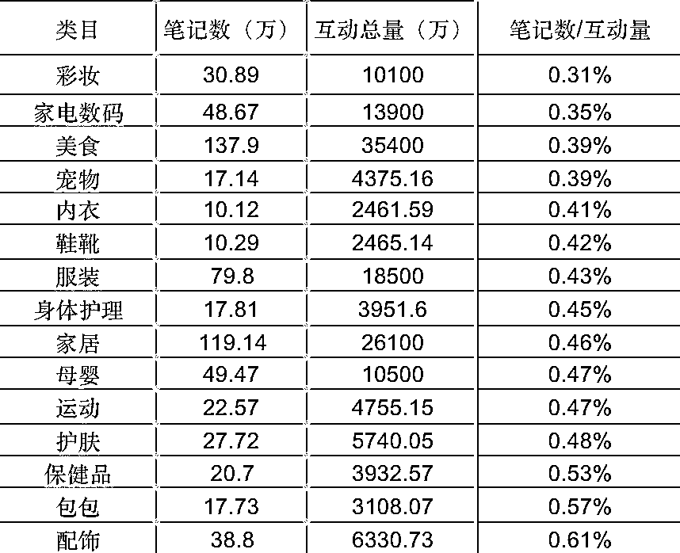
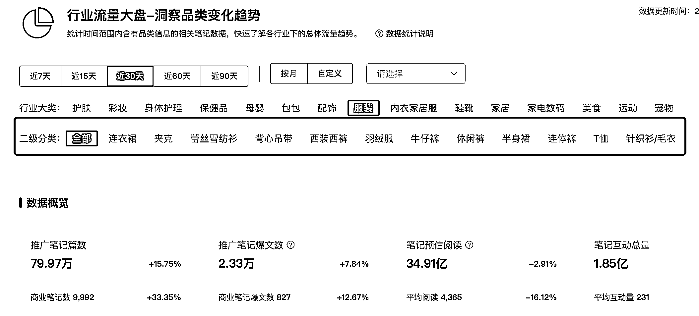

# 4.1.1 千瓜流量大盘：用数据锁定蓝海 @谢无敌

想找蓝海赛道，先别靠感觉，也别听谁随口推荐。所谓蓝海，说白了就是入局者不算多、市场需求却不小的方向：竞争相对轻，增长空间还在。要判断这种机会，最稳的办法还是做市场调研，让数据开口。

第一个入口，就是千瓜数据的行业流量大盘。在这里能看到近30天小红书各行业的笔记表现。

重点盯两个指标：推广笔记条数和总互动量。

推广笔记越多，通常意味着做这个方向的人越多，赛道越挤。比如近两年热度上升的家居类目，月笔记量已经到119w+，把护肤、彩妆的30w+甩在后面。

总互动量则代表用户买不买账：数值越高，说明内容更容易被认可、更容易跑出爆文，也说明关注这类内容的人多、需求旺。像家居赛道的互动总量就有2.6亿。

所以真正要瞄准的，是“笔记尽量少、互动尽量多”的赛道。

不过，两个数字单独看参考意义有限：笔记少的类目，互动往往也不会太高。那怎么拆解？把各赛道的笔记数和互动总量记录下来，整理成表，再计算“笔记数÷互动总量”的比值，按比值排序，就能看得更清楚，如下图。

比值越小，说明笔记量相对更少、互动却相对更高，这类方向更接近我们要找的蓝海。结果有点反直觉：大家常觉得竞争激烈的彩妆赛道，反而排在第一位。可见主观印象经常靠不住。

我这次只列了15个主流类目的流量情况。每个类目下面还有二级分类，仍然可以用这套方法继续往下拆。比如服装类目里，就包含连衣裙、夹克、背心等十几个细分方向。

