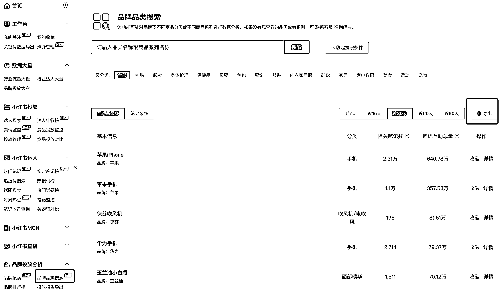
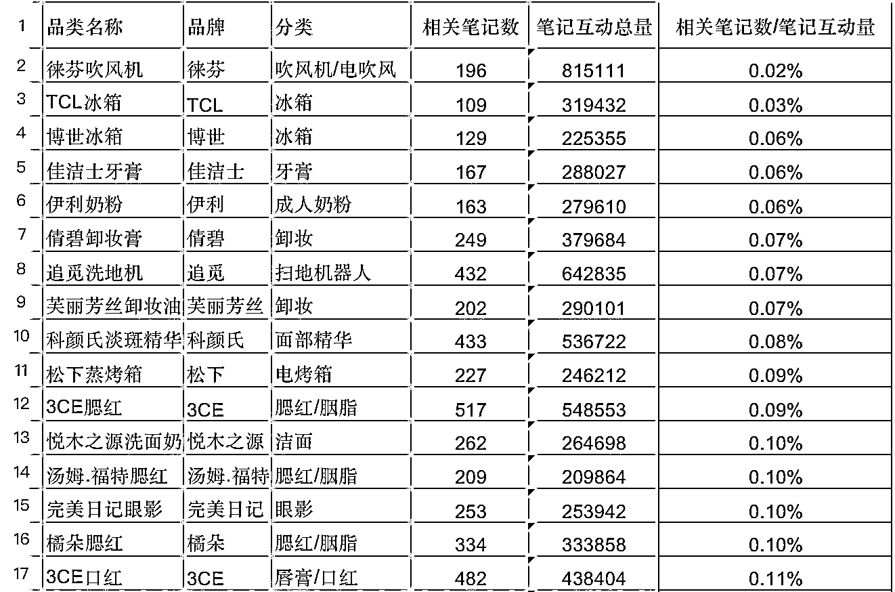

# 4.1.2 千瓜筛蓝海品类 @谢无敌

第二招依旧借助千瓜。进入左侧工作台后，点开【品牌品类搜索】。

页面会直接列出100个品牌与品类维度，每一项都配有对应的笔记数量、笔记互动总量，还支持直接导出成文件，相较上一招操作更省事。

接着同样可以在Excel里把这两个数值相除，再按算出的比例排序。百分数越低，说明该品类越有潜力，属于蓝海品类。目前排在前三的是徕芬吹风机、TCL冰箱、博世冰箱。

这份表里共有100个品，因篇幅较长，这里只截取了一部分，完整表格稍后我会发到星球里。

和上一招相比，这个结果中品牌与产品信息兼有，指向也会更具体。