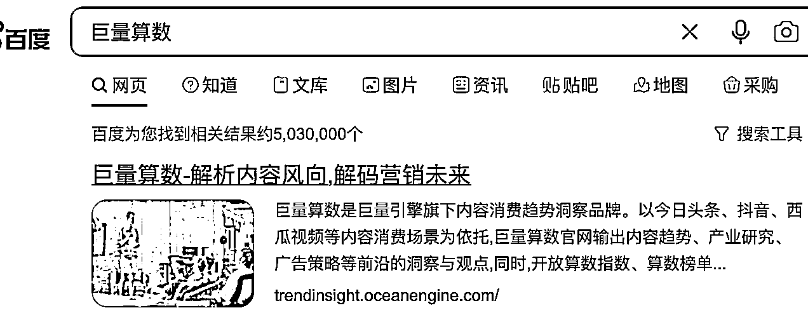
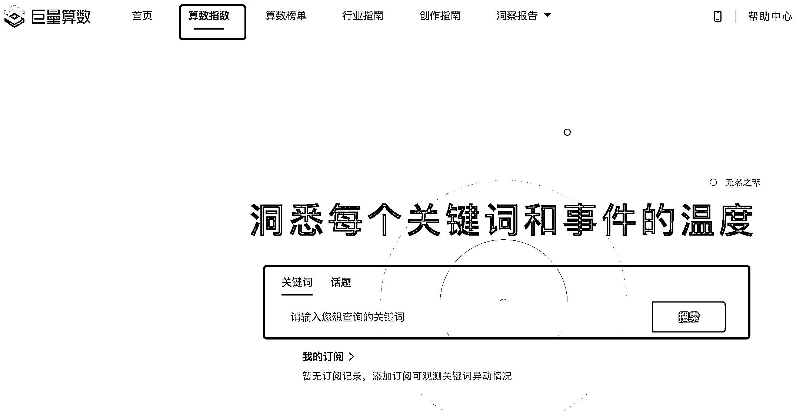
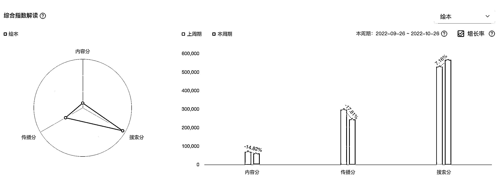
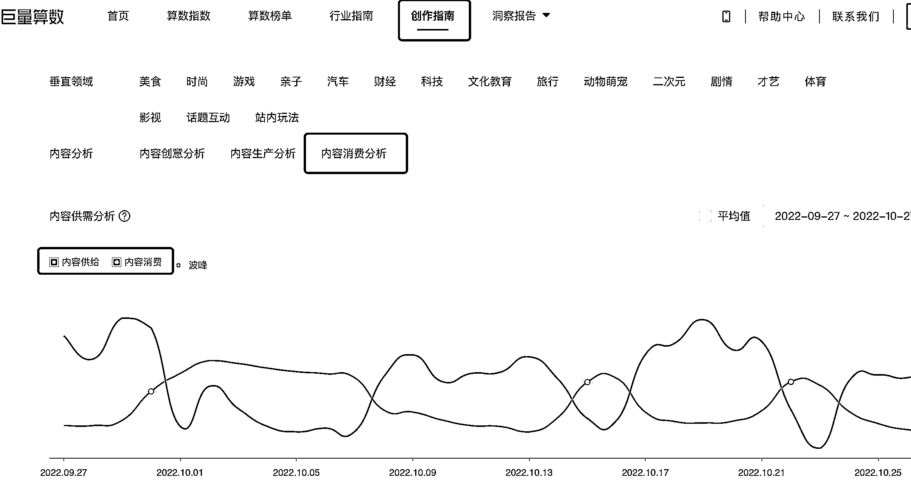
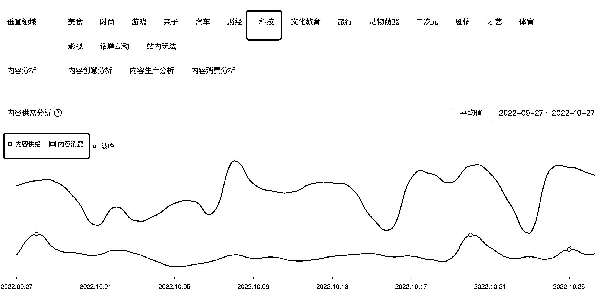
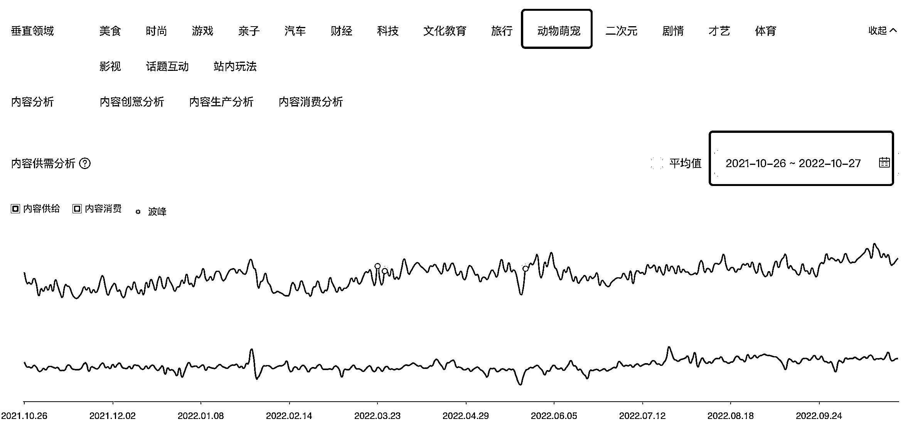

# 4.1.3 用巨量算数锁定蓝海赛道 @谢无敌

第三种工具，还是免费的，就是巨量算数。电脑端打开网页，直接搜“巨量算数”就行。

虽然它的数据主要来自抖音和头条，但自媒体行业的趋势方向基本同步，📕的博主完全能拿来做参考。关键是，不用花一分钱。

进入页面后，点顶部“算数指数”，会看到一个关键词输入框。

把你打算做的品类填进去。比如我们试一下：绘本。

按下搜索键，就能看到这个品类相关的数据表现，包括搜索指数和综合指数。接着往下拉，有一块“综合指数解读”，这部分是我们要仔细看的。

图里左侧那个圆形图，包含三个核心维度：内容分、传播分、搜索分。

内容分，衡量的是围绕该关键词产出的内容总量，数值越大，说明写这个方向的人越多。

传播分，反映的是内容的播放量和分享热度，数值越高，代表内容越受大家欢迎。

搜索分，则代表真正去搜这个关键词的人数。

可以这样理解：当一个赛道的内容分越低，而传播分和搜索分越高，就说明需求远大于供给，机会更多。

刚才搜的“绘本”，搜索分和传播分都明显胜过内容分，换句话说，用户的需求量已经超过了市场上已有的内容数量，这就算是一个蓝海赛道。

另外，巨量算数还有个挺好用的板块：顶部的「创作指南」→「内容消费分析」。

里面提供了十几个不同垂直领域供你选择。选中某个领域后，页面会展示两条走势曲线。

蓝线表示内容供给，也就是这个领域里已经有产出的内容总量。

绿线表示内容消费，也就是实际有多少人在看这些内容。

比如上图中选的是游戏赛道，两条曲线上下波动，整体来看供需相对平衡。

如果看科技领域，则会出现蓝线在上、绿线在下的局面，说明内容过剩，关注的人没那么多。这两种情况，都不太适合下注。

最好的是绿线在上、蓝线在下的情形。而且时间范围还能自定义，比如动物萌宠赛道，我们可以把时间调到最近一年。

出来的结果里，绿线明显高出蓝线一大截，意思是现有的内容根本喂不饱消费者，这个赛道就是蓝海。

所以，我们要找的，就是那种绿线远远压过蓝线的领域。

当然，这个方法也有局限：目前只能查看平台给出的15个固定赛道。

实际操作中，建议把这几种方法结合起来用。比如千瓜数据虽然精准，但价格偏高，一个月差不多3000块，如果预算有限，可以找其他博主拼团分摊。

内容来源：《（附选品清单）如何选择📕蓝海赛道和产品？3 个方法搞定！》

附选品清单：📕产品清单（from 千瓜数据）.xls （下载请跳转：📕航海｜实战工具包）

