# 4.1.4 选品前，先看搜索数据 @云端行走 @雄

传统电商是先把货摆上架，再围绕货去生产内容；小红书恰好反过来，先用内容吸引人，再把交易接上。

所以挑品时，建议多借助传统电商平台自带的官方数据工具。原因有两点：官方口径通常比第三方更准；还能更快捕捉正在蹿升的搜索词和转化词。

准备做内容时，不妨翻翻自己感兴趣类目的热搜词，围绕这些词去策划，命中率会更高。要是预判某个产品未来一两个月会起势，提前铺内容就更容易抢到市场位置。反过来，应季爆品若在工具里显示搜索热度或成交转化开始下滑，后面再跟做内容，效果往往也会走低。

这类官方分析工具费用不低，淘宝、京东的数据软件还要求有店铺才能开通。这套办法只是补充，有条件的同学可以拿来参考。

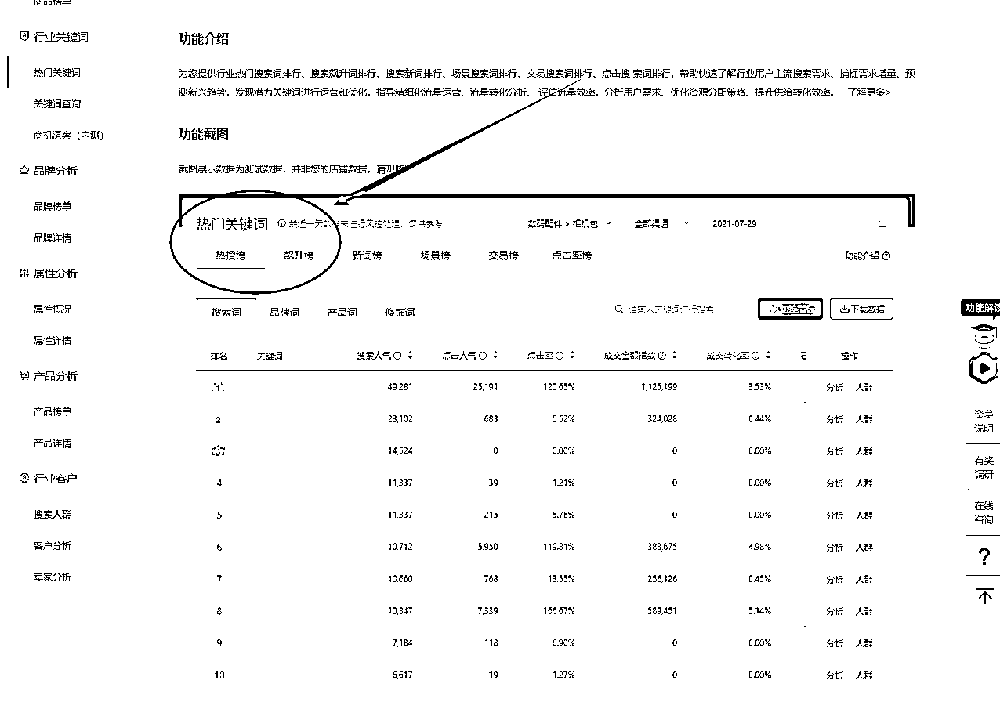

要是暂时开不了这类工具，也别急。圈友@雄还给了两个替代思路。

1）别纠结，先铺量

不知道怎么选的时候，先别困在选品里，直接动手写，各种款式都去试。把选品链接主图的前两张，加上拼多多上家或买家秀的三张主图，凑成五张图文素材，导入剪映生成视频。发出去后会有数据反馈，再根据反馈筛出值得继续写的内容。别纠结，多写就行。

案例：女装
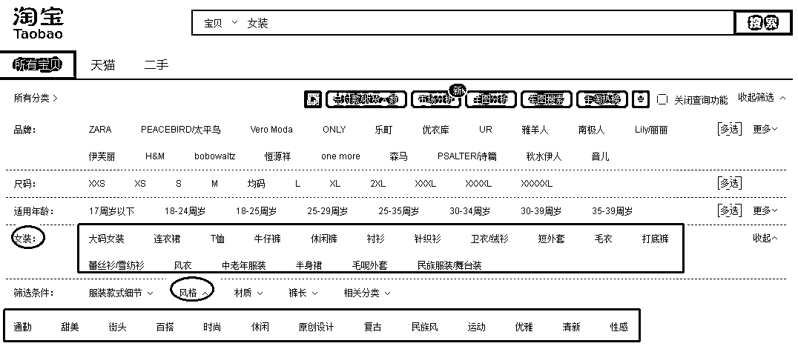

比如确定做女装，却不知道具体做哪款，就先按女装风格铺内容；搜索女装并把筛选维度设为时尚，会出现不少相关商品，挑销量高的放到小红书测试。

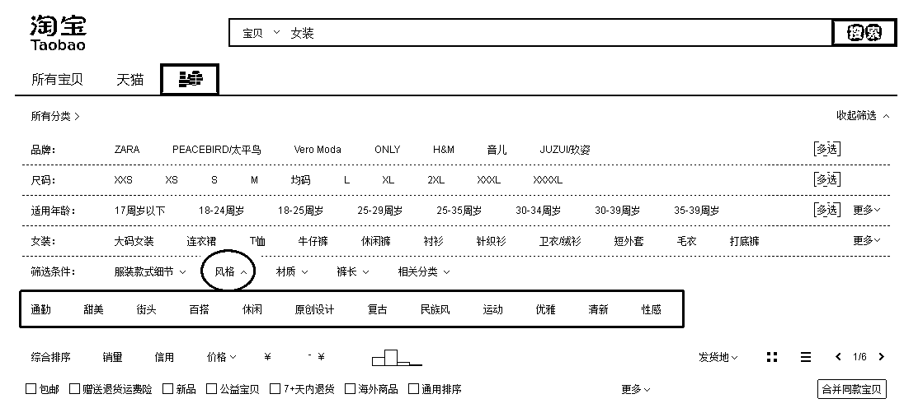
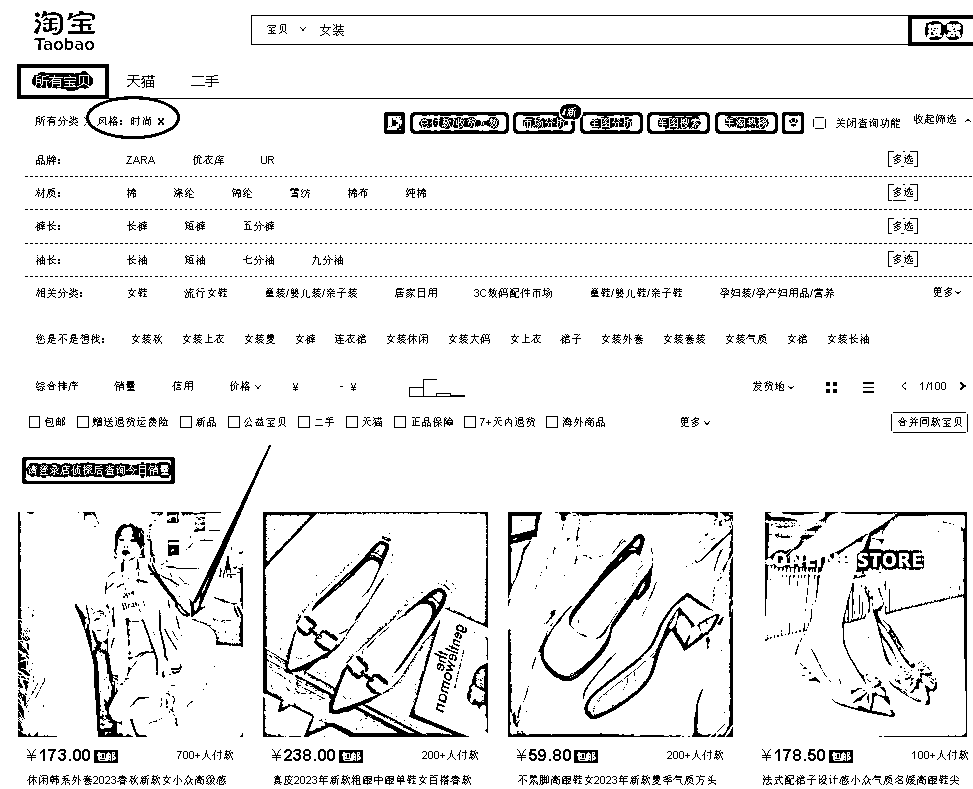
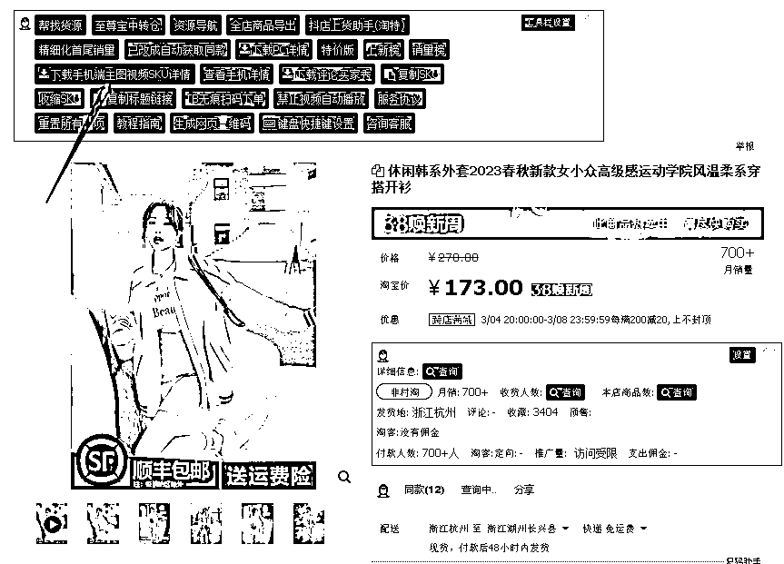

操作上，取产品主图1—2张，再加拼多多上家和买家秀照片3—5张，导入剪映剪成视频即可。

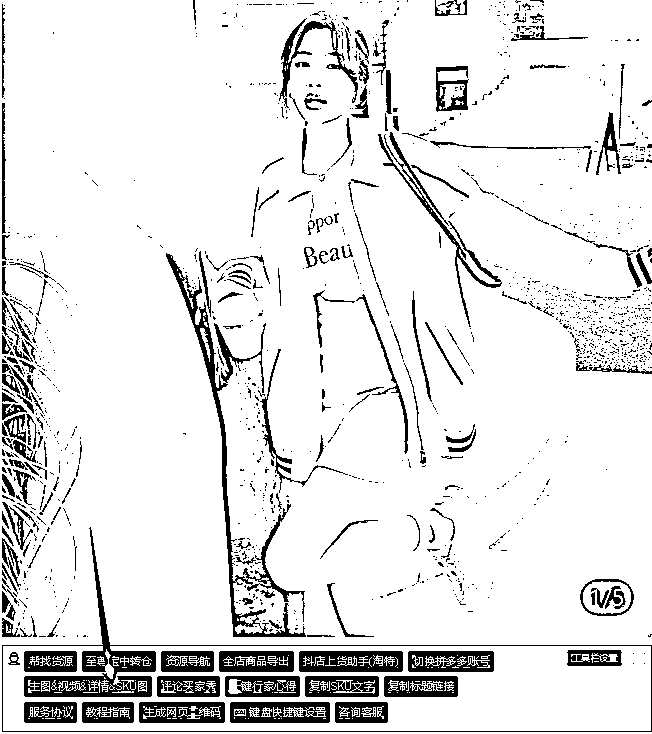
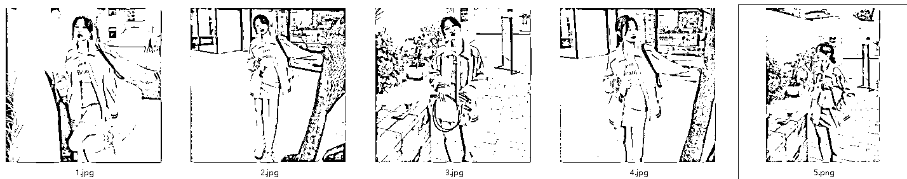
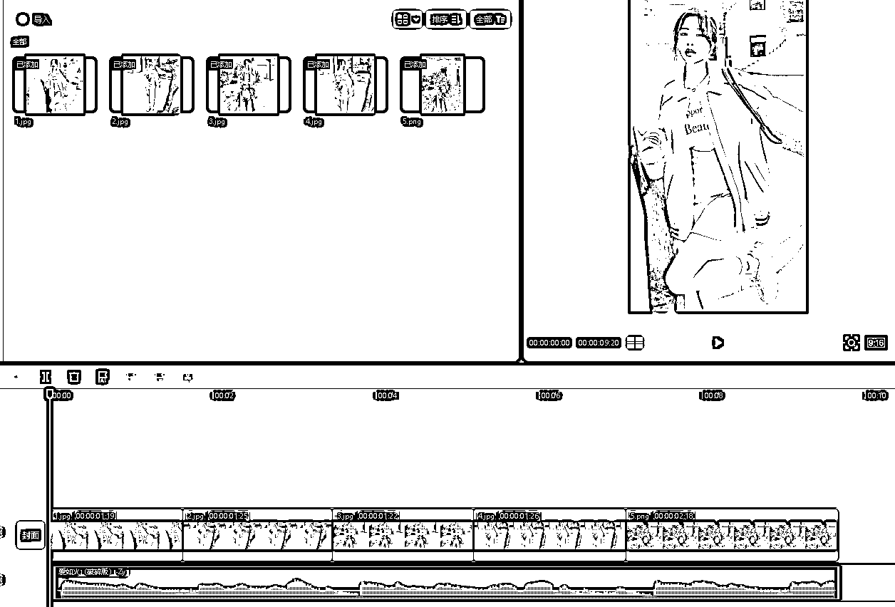

[模板.mp4](https://search01.shengcaiyoushu.com/upload/doc/T8Zfd0iJjoSKEnxEWJXcZFCen2Y/UU1AbCiVNokBkhx1xRkcdqsunme)

2）从拼多多榜单挑潜力款

拼多多排行榜不是让你把榜上商品全盘照搬。要找的是同时满足几个条件的品：在榜单内、销量高、评价还不多。这通常意味着它近期才起量，潜力不小。

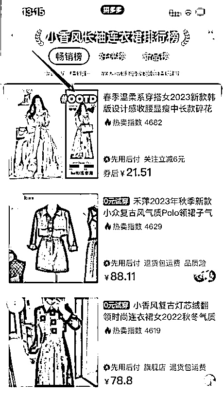

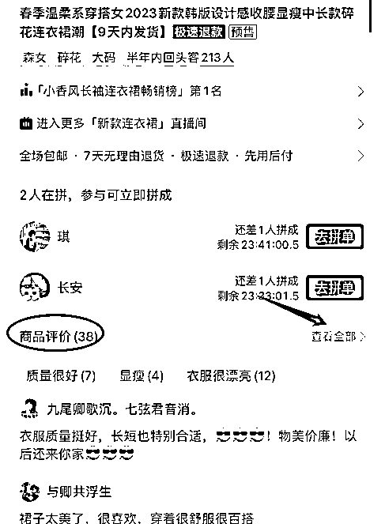
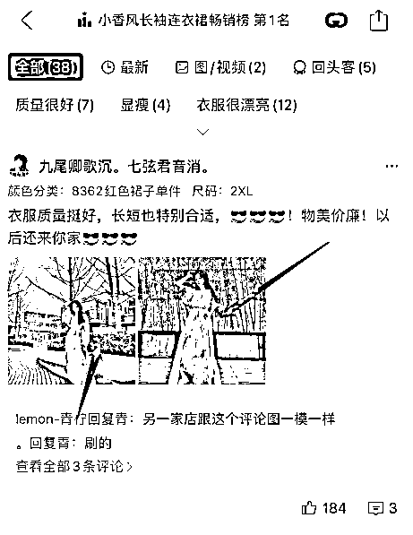

在拼多多挑品时，评价区要重点看，尤其买家秀；买家秀里的款式必须和商品款式对得上，否则容易踩到货不对板。

内容来源：《小红书选品方法论》
