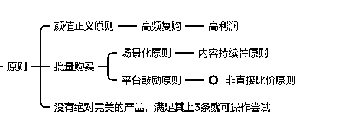

# 4.2 热门选品怎么挑？这几类更快起量 @杉木

做电商，谁都明白货盘是第一步。放到📕带货，哪些产品更容易跑出来？

先给结论：不存在哪款商品能面面俱到，选品阶段别反复纠结；数量不是重点，精准才关键。先盘自己手上已经稳定、靠谱的供应链，不少产品只有真正上架试过，才知道能不能跑通。

下面几类方向，通常更容易快速拿到反馈：

1）**功能性半标品**：比如瑜伽服（我带的品就是这个）、防晒服。它们往往对应某个明确诉求，像防晒、减脂，都是真实且强烈的需求。

2）**红海里的蓝海**：从成熟赛道里切出细分人群，只服务某一类人。例如内衣聚焦大罩杯或小胸，女鞋聚焦小个子。

3）**美妆护肤品**：如果有稳定货源，资质也齐全，很建议放到📕带。

4）**自带流量型产品**：例如情侣内衣、JK服、汉服等。

5）**大牌平替**：让用户少花钱，还能买到品质接近的替代款。

6）**新奇特且有真实需求**：只靠新奇撑不起转化，背后得有真实需求才行。

7）**知识付费类**：落到一个具体明确的项目，但不是其他平台培训内容（你在📕写“抖音赚钱”，官方不会给流量），也可以是咨询服务。

另外，产品最好尽量符合下面这些原则：

常规思路之外，再给一个方向：蓝海产品。之前@陈铭老师的文章里提过，@盗坤老师也反复讲过蓝海思维，我从中受益不少。

蓝海就是竞争没那么激烈的市场。比如开头提到的📕男性用户占比不高，这反而是机会：太多品牌在抢女生市场，男生市场被忽略。占比虽低，基数仍摆在那里，依然是千万级流量池，部分男性向产品竞争并没有那么拥挤，可以考虑。

再比如小众但客单价高的产品，面向高端客户的服务也属于蓝海。前几天我刷到“焚火台”，户外露营用品，做的人少，借露营热度近期流量不错，也是不错的选品。

还有一条大原则：无论选哪个类目，我都建议在📕把产品往中高端做，敢定高价。当然，高价的前提是卖点足够突出，不能没理由地贵，要精准挖到用户痛点。

资料参考：《我是如何通过📕，两个月带货营收 30 万＋》《📕选品方法论》

