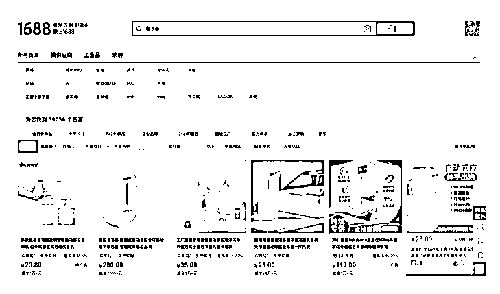
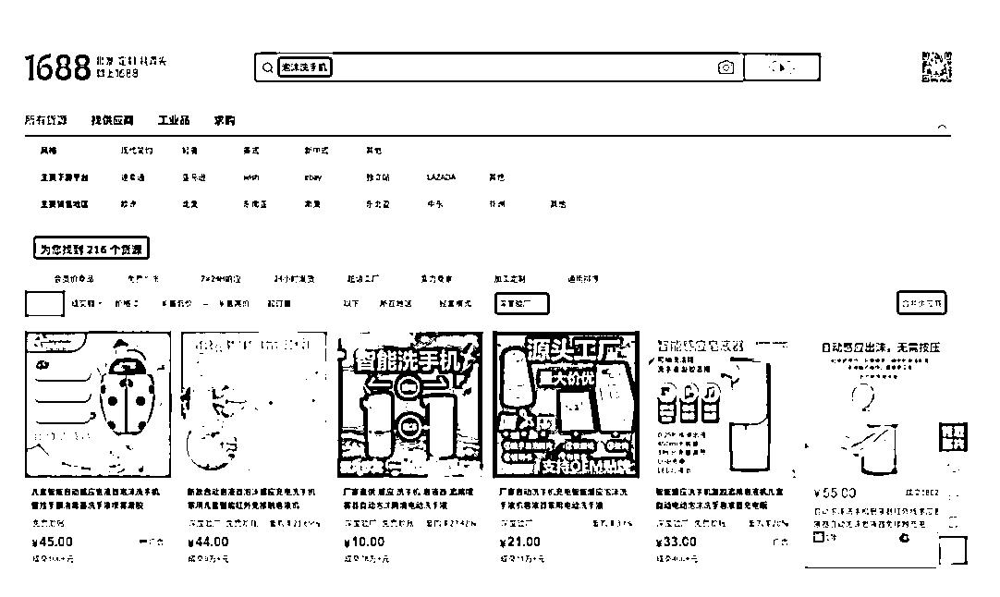
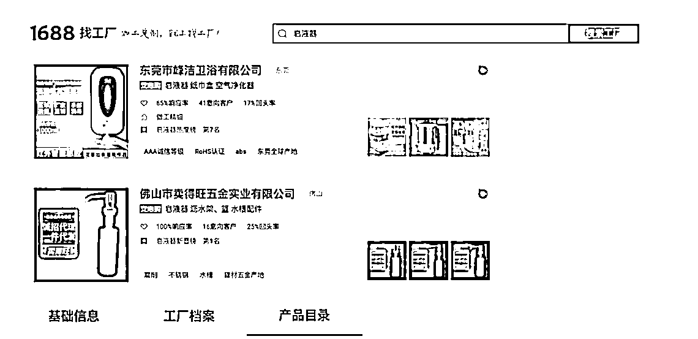
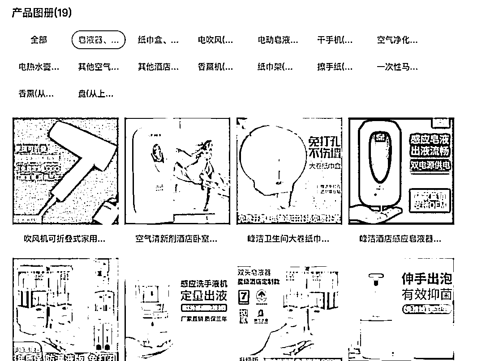

# 5.3 工厂怎么挑？照着这几步走 @Bryce @Jennifer @Jing

先拿去年日本站卖得不错的皂液器做例子，在1688上走一遍找厂流程。

1）平台上的工厂类型

代理商：自身没有生产车间，店铺往往铺十几个小类，报价高低不一。

组装工厂：主要做整体结构设计，但芯片方案、外观模具多向外采购，性质接近代工厂。

产研一体工厂：也就是ODM，掌握部分或全部方案专利，研发能力相对更强。

2）怎样找到匹配的工厂

很多产品名是从外文直译来的，和工厂后台标注的词未必一致。用现有词先搜，顺藤摸瓜找常用别名，能减少漏搜。比如搜皂液器时，系统把“皂液器”和“洗手机”当成同义词并标红，那洗手机也值得搜一轮，覆盖面会更大。

① 先定产品再找厂

首页直接搜进入货源模式，满屏是产品。按需求把筛选条件收紧，再选品下单。

确定“泡沫洗手机”作为关键词。在深度认证里勾深度验厂，并选合并供应商，把大量小代理过滤掉；价格区间和地区也可按需设置。

② 先定工厂再找品

回首页点“找工厂”并输入关键词，进入工厂模式。品类排行榜能看热门工厂，但要留意有工厂花钱刷榜。点厂名进详情页，可查工厂档案和产品目录。

③ 拿样品

对比后挑3—5款合要求的，下单通常要选2个，再用阿里旺旺联系卖家沟通拿样和改价。

④ 实地看厂

样品比过一轮，再有针对性地走访厂家。重点问产品工期、质检标准、海外认证和专利；确认大货起订量、首批价格；聊返单后的降价空间和账期方案。

3）筛选工厂的标准

可参考这些条件：

• 公司名里带“XX厂”“XX工厂”“XX公司”；
• 归纳产业带分布，把该地区的工厂尽量找全；
• 看店铺各项指标与经营年限：至少1年经验，货描相符为红标，回头率高于30%。

筛完再询盘，问清产品图片、材质、尺寸、做货要求、数量与包装要求。

4）避坑提醒

① 打样

别急着下单打样，先摸工厂底子。沟通中判断：产能跟不跟得上，大货能不能流水线做，任务下到车间后流程和标准是什么，有没有案例可看。样品是大货标准，那它究竟是质量上限还是下限？确认样品后，要在合同里写清楚。若是下限，样品就是最低标准；若是上限，工厂如何保证每件都达到样品水平甚至更好？

② 品控

品控流程怎么走，抽检还是全检，不合格品会不会发出，收到货有问题怎么处理，这些都要提前谈。我的做法是大货前让工厂寄5个大货样品来确认，品质过关再出货；不过关就指出问题、退回修改，等工厂重做后再寄。一般简单产品打样两次就够。若正常出货后又出瑕疵，退回让工厂做好补寄。

③ 交期

交货时间必须写进合同，延期出货的违约金也要列明。

内容来源：3月22日《小红书店铺运营——有货源模式的玩法》@Jing

