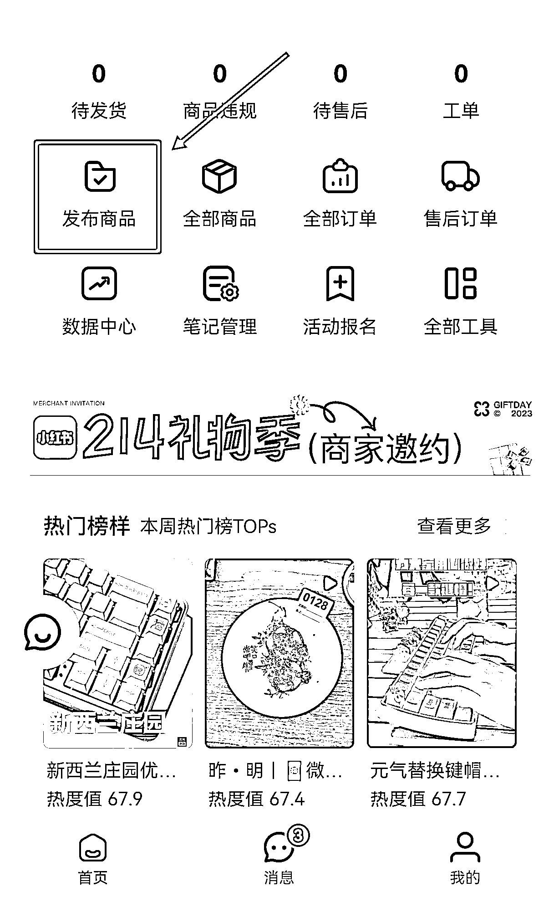
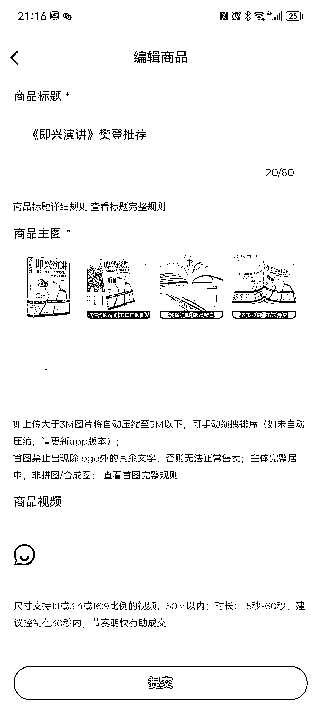
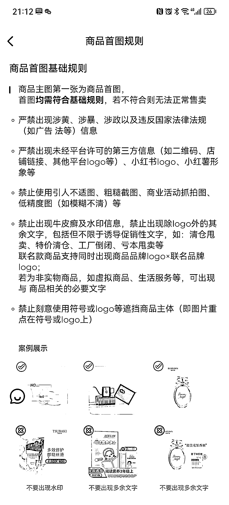
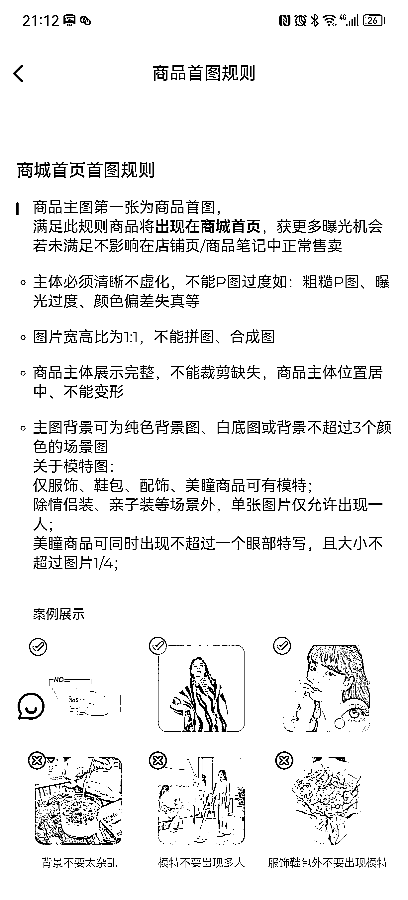
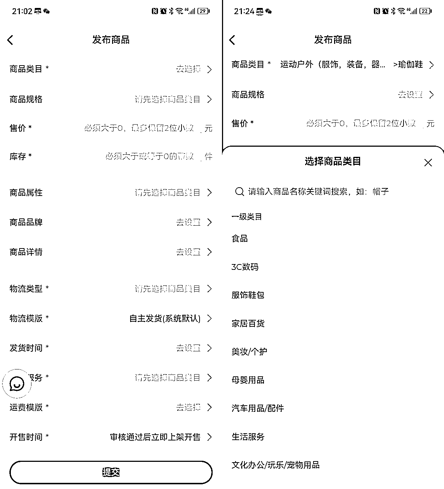
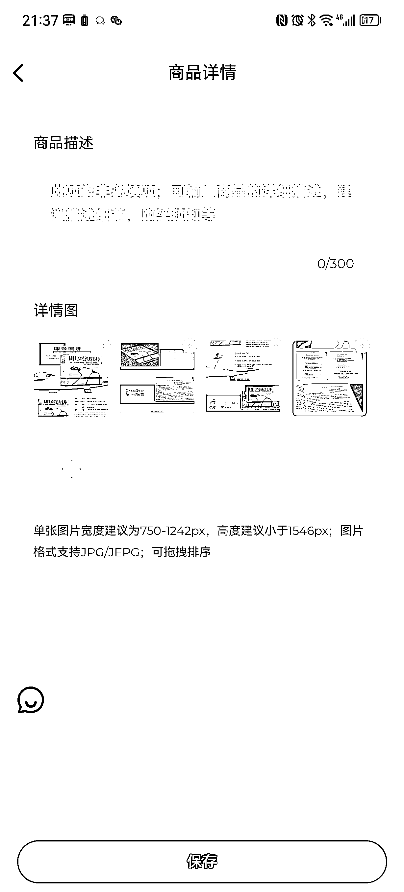
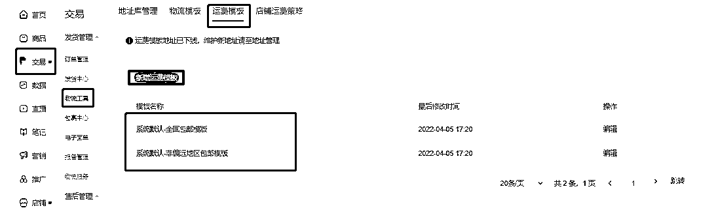
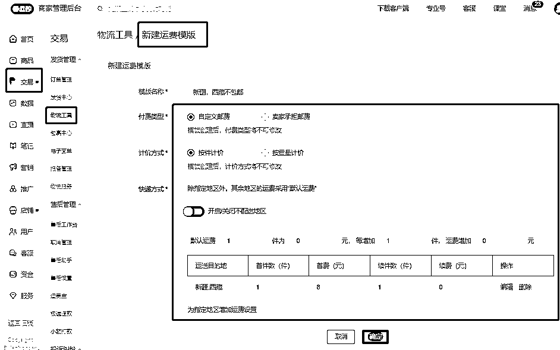

# 6.1 手机端商品上架简明教程

在📕 APP 或📕商家版 APP 中上架商品，整体操作逻辑相近，步骤也不复杂，顺着页面提示完成即可。

具体上架环节如下：

**1. 完善商品信息**

需要留意：
- 商品名称与商品头图属于必填项。
- 官方对商品主图规格有明确要求，画面尽量干净清爽，避免叠加过多说明文字。
- 若首图未达到规格要求，商品会上架失败；若不符合首页推荐规则，则无法进入商城首页推荐位。

**2. 选择商品类目**

页面中展示的是当前个人店铺能够上架的类目，也可通过搜索框查找。但部分类目仅面向企业店铺开放，并且需要具备相应资质。不同店铺类型对应的可经营类目并不相同，具体可到📕学习中心—规则中心—经营总览中查询。

**3. 填写商品规格**

当同一商品包含多个型号时，需要设置规格；若只有单一款式，则无需处理。

**4. 设置商品售价**

根据实际准备上架的商品填写价格。

**5. 填写库存数量**

按商品实际情况录入库存。

**6. 补充商品属性**

结合商品本身信息完成属性填写。

**7. 上传商品详情**

将商品详情页所需图片上传完整。

**8. 选择包邮方式**

按商品情况决定是否包邮。系统目前默认提供两种方案：
- 全国包邮；
- 偏远地区不包邮（偏远地区包括：新疆维吾尔自治区、西藏自治区、宁夏回族自治区、青海省、海南省、内蒙古自治区、甘肃省）。

也可自行设置运费模板，选择运费金额，并按不同地区配置价格（该功能仅支持在电脑端商家后台操作）。设置时先确定默认运费价格，再针对特殊地区单独定价，计费方式可按件数，也可按重量。

**9. 设置发货时间**

发货时效可自行设定，支持当天发货、24 小时发货、48 小时发货以及预售发货。完成上架后，点击“立即发货”即可。

📕采用机器审核，处理速度很快；只要没有明显问题，发布后通常很快就能完成上架。

