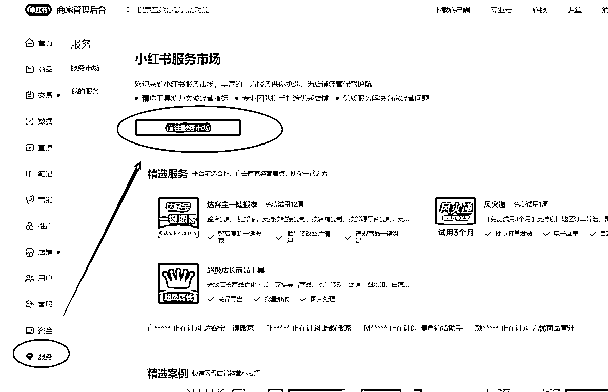
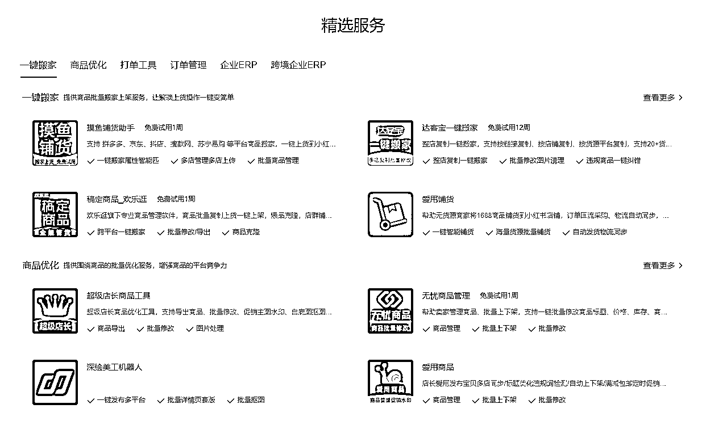
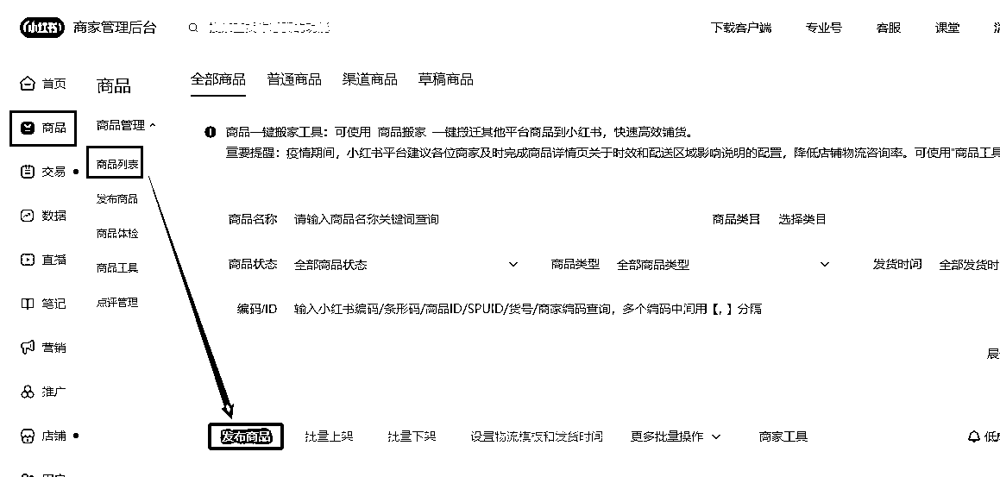
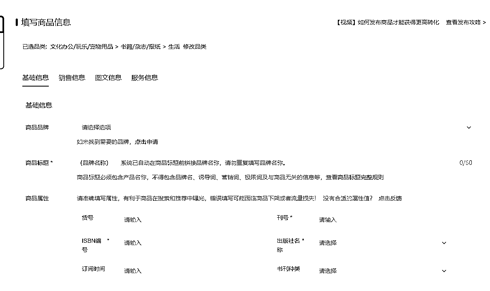
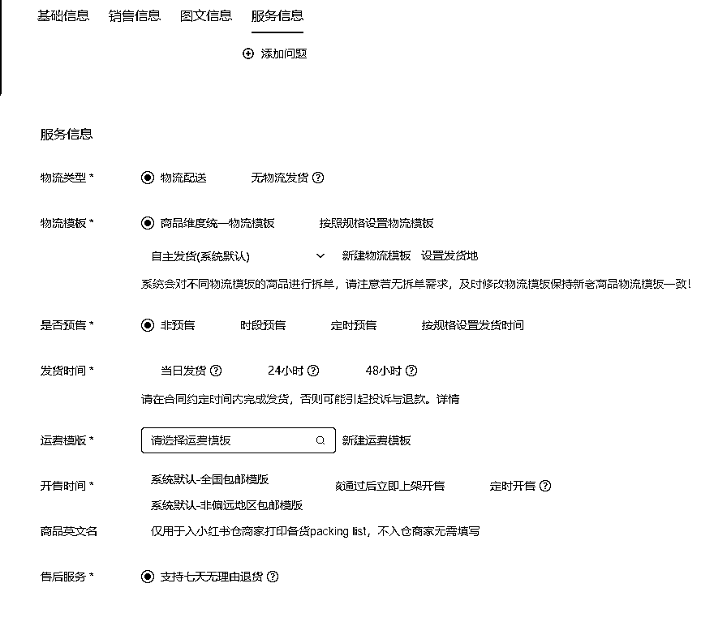
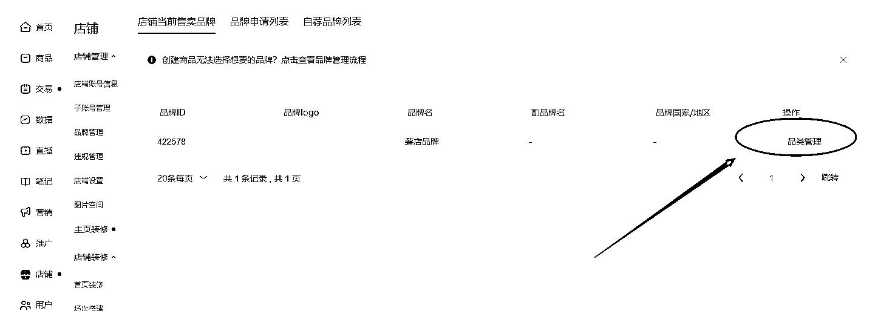
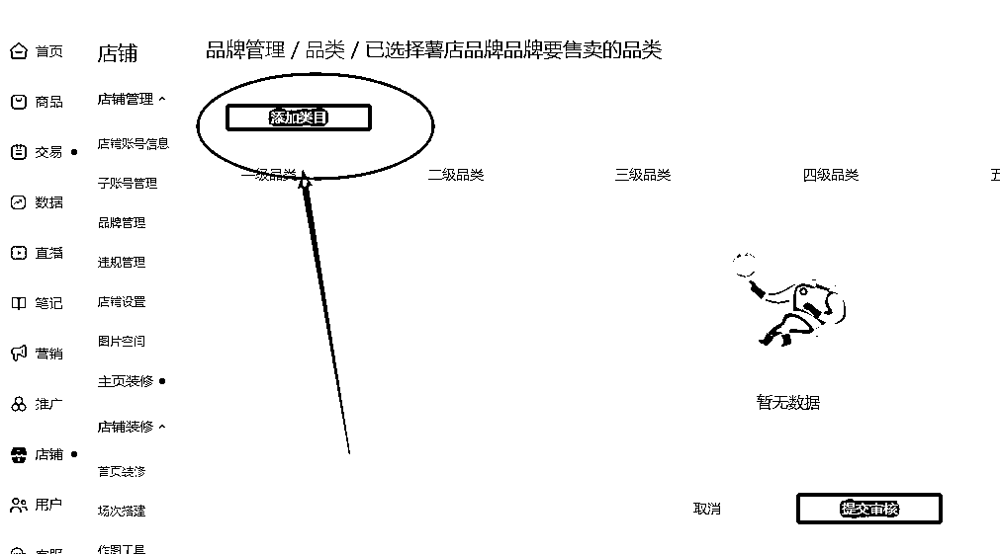

# 6.2 电脑端上架商品，两种方式任选

小红书商家助手网页版入口：`ark.xiaohongshu.com`。

在电脑上发布商品时，商家可以借助工具批量搬家，也可以逐条手动上架。

1）用搬家工具批量上架

先进入店铺后台的“服务”，在服务市场里挑一款搬家软件。这类工具通常支持在后台试用，商家可以按自己的需求选择顺手的软件来完成商品迁移。

搬家软件入口：

2）在后台逐条手动发布

登录小红书商家管理后台后，手动上架流程如下：

① 先按商品所属类目选择对应分类，确认后点“下一步”：

② 接着填写商品属性；带*号的是必填项，其余可按实际情况补充：

③ 若发现所需品类尚未开通（有些类目要提交相应资质，后台会有提示），可直接在后台发起申请：

④ 信息全部填好后，提交审核即可。

想了解更多商品上架相关内容，可到小红书商家课堂继续学习：

[`school.xiaohongshu.com/course/list?jumpFrom=school&categoryNo=20210515002`](https://school.xiaohongshu.com/course/list?jumpFrom=school&categoryNo=20210515002)

