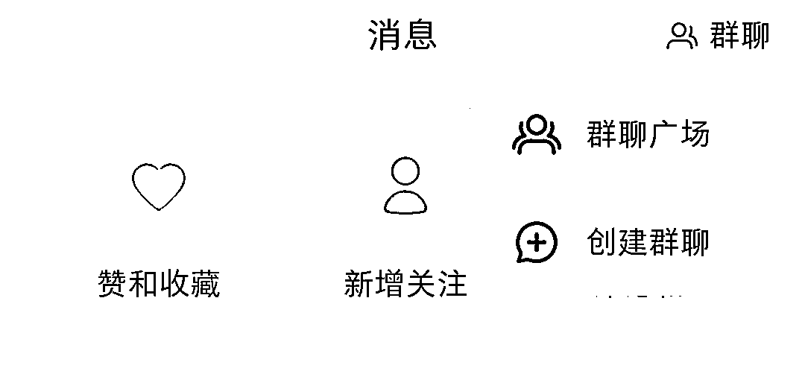
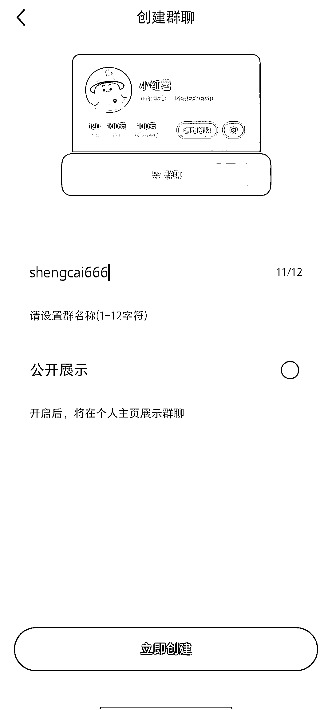
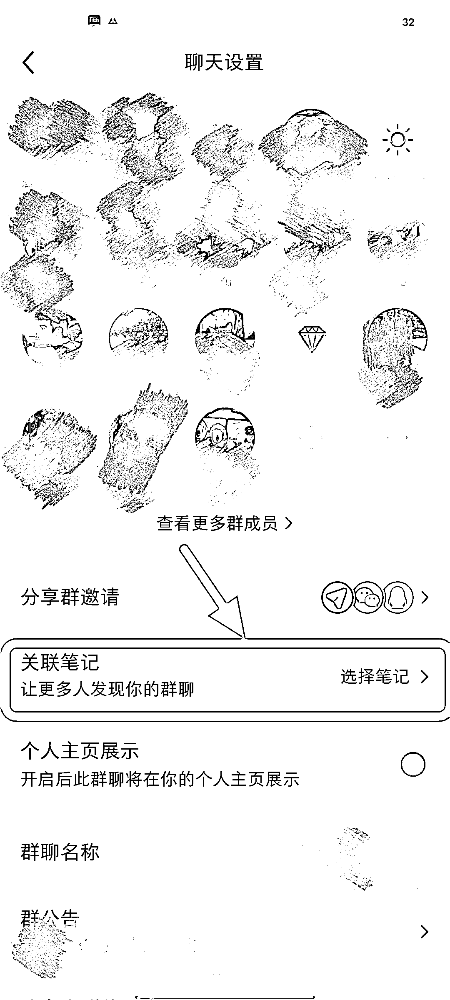
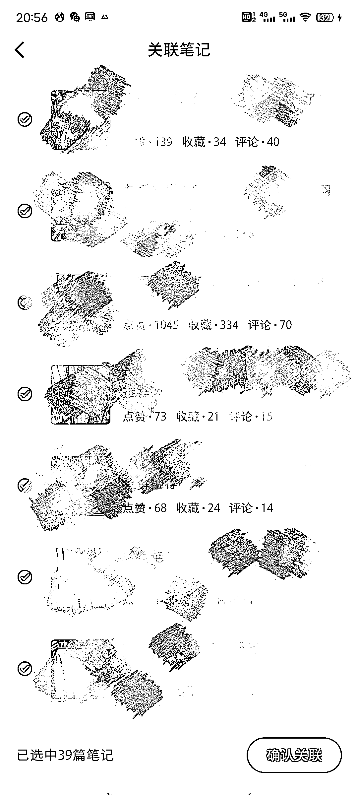
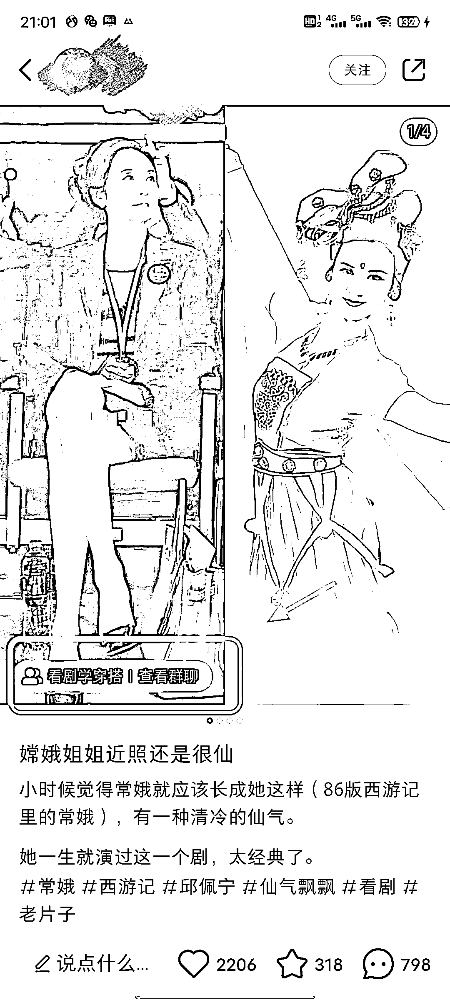
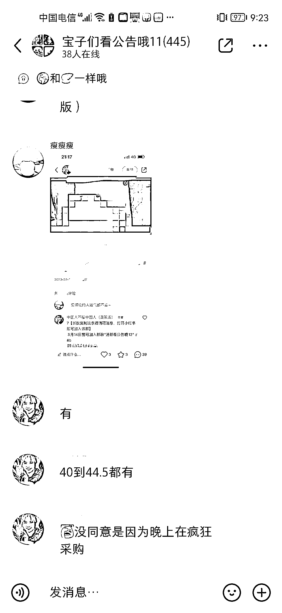

# 7.1.4 笔记挂群聊，引流再提速 @范师傅

想把引流效率再抬高一档？<群聊关联笔记>这个功能值得立刻用起来。趁爆款笔记带动成交的窗口期，尽量把看笔记的人导入群聊，后续复购和转化才能持续承接。

1）关联笔记的操作流程

先建群：打开小红书APP，在“消息”页右上角找到“群聊”，点“创建群聊”即可完成。

接着进入群聊，点右上角的“...”，页面中会出现“关联笔记”入口，点进去勾选需要挂上的笔记。

关联完成后，这篇笔记的图片或视频左下角会显示群聊入口；用户点一下就能申请进群，路径很顺。

2）用粉丝群促转化

笔记更新、营销活动，都能借群聊第一时间通知粉丝；群消息和群公告则可以用来唤醒新老粉丝。对看完笔记却还没下单的人，把他们留在群里，更容易推动成交。群里的提问要及时回应；若碰到平台敏感词，可让管理员小号在群内答复，小号昵称设为“XXX小助理”“XXX秘书”等，可信度会更高。

