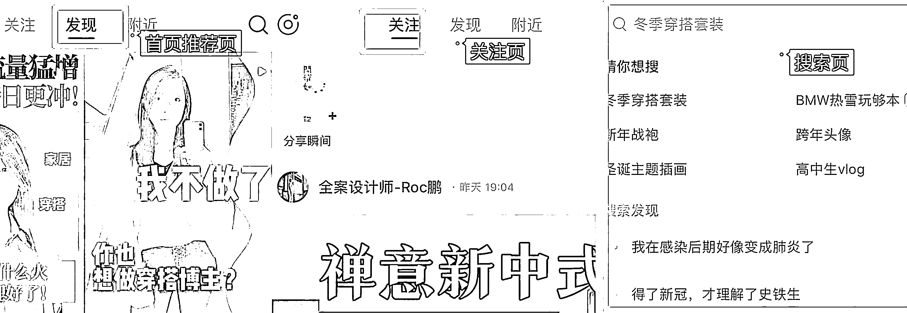
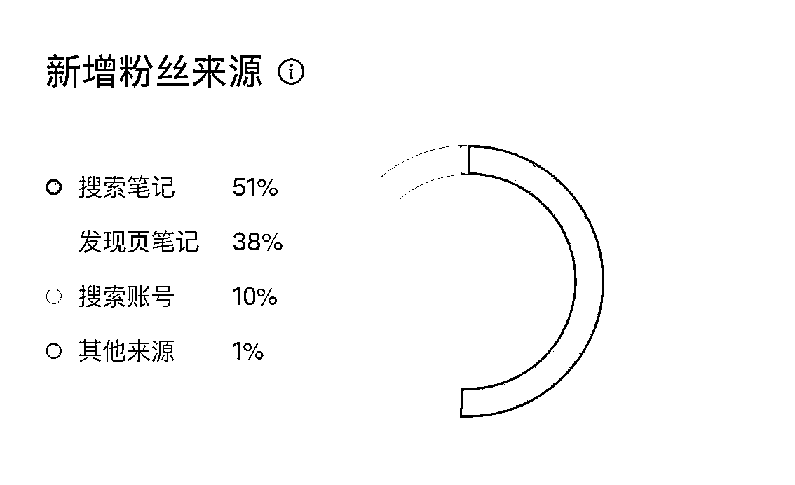
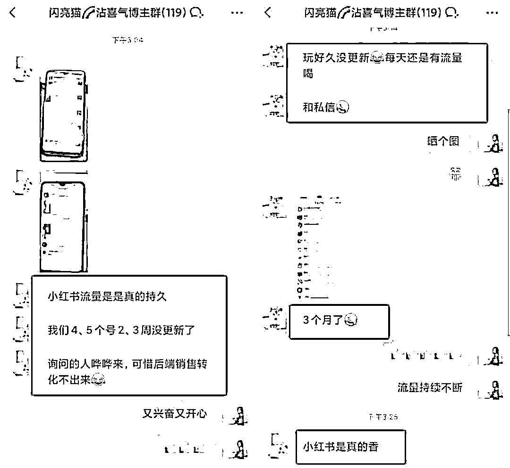

# 7.3.2 📕 SEO 流量，为什么值得做？

讲清了底层原理，再聊一聊做好📕 SEO 能带来的三大好处。

1）带来的流量更精准，变现效率自然更高

无论是内容创作者还是商家账号，最关心的无非两件事：流量和转化。而流量又是转化的前提，能不能把流量玩明白，直接决定了账号的出路。📕的核心流量来源主要是三个：推荐页、关注页和搜索页。

推荐页是打开 App 默认可以看到的页面，流量最大，但竞争也最激烈，普通创作者想登上这个页面并不容易，内容必须足够能打。关注页呢，用户主动点进去的频率本来就不高，尤其当一个人关注了很多账号时，你的内容很容易被淹没。相比之下，搜索页对普通人友好得多——只要有一篇笔记能在搜索结果里排到前面，这个账号就能源源不断地获得曝光。更重要的是，前面我们说过，搜索流量属于用户主动种草，来访者大多带着明确的目标，这样的流量天然更精准，转化表现也更出色。我们自己的不少账号，来自搜索端的粉丝比例就超过了一半。

2）几乎零成本的长期流量，不薅白不薅

通常来说，一篇笔记发出去，系统给的推荐周期大概是三到七天。即便是爆款，热度一过，首页推荐流量也会慢慢衰减。毕竟平台要保证内容的新鲜感，持续给新笔记机会；如果你想让账号在推荐位一直有存在感，往往就得靠付费投放来续命。但搜索流量的逻辑完全不同：只要你的关键词布局没有出错，笔记也没有违规，那么它会一直在搜索结果里等着被用户发现。哪怕这篇笔记已经发布了两三个月，甚至是一年多，依然有机会为你带来新的访客。

换句话说，你相当于在平台上放了一批长期有效的广告位，而且不用花一分钱。这种流量，不薅白不薅！

3）矩阵式铺号，把整个赛道的搜索流量握在手里

我经常跟学员强调，尤其是商家博主，一定要试着做矩阵号运营。原因有两个：第一，分散风险。商家博主普遍有导流需求，但平台为了维护生态和自身利益，对导流行为卡得很严。常在河边走，难免会湿鞋，违规可能还是小事，最怕的是账号直接被封。如果把所有资源都押在一个账号上，风险实在太大。第二，多个账号就是多个流量入口，还能利用用户喜欢‘货比三家’的心理。当你的账号铺得足够多时，用户对比来对比去，最后还是会绕回你的矩阵里。当然，这一切的前提是关键词要铺对。如果用户根本搜不到你的内容，就算有一百个账号也白搭。因此，做好📕 SEO，真的很有必要。

