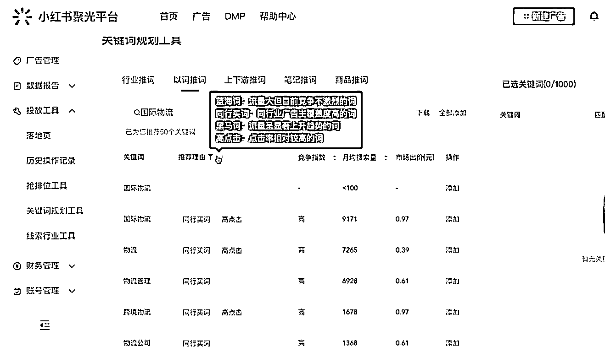
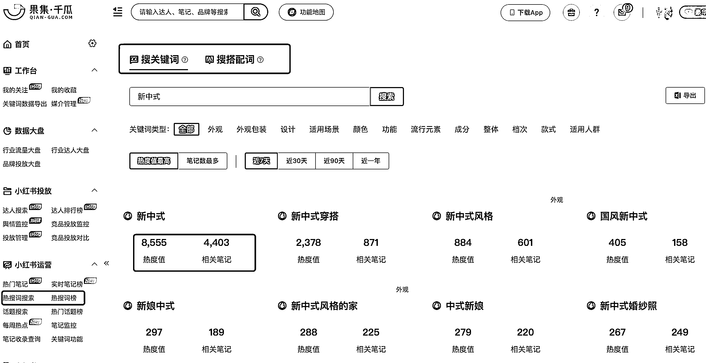
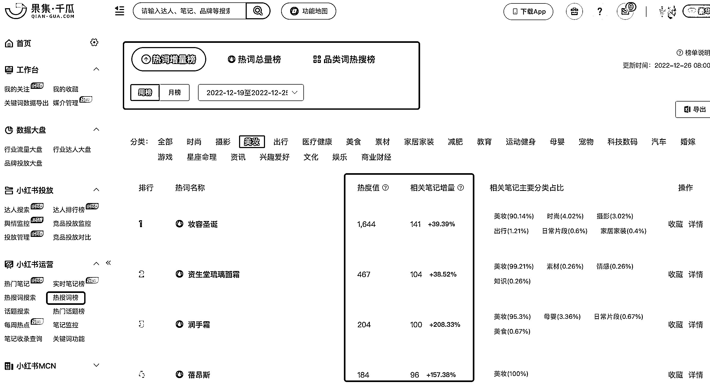
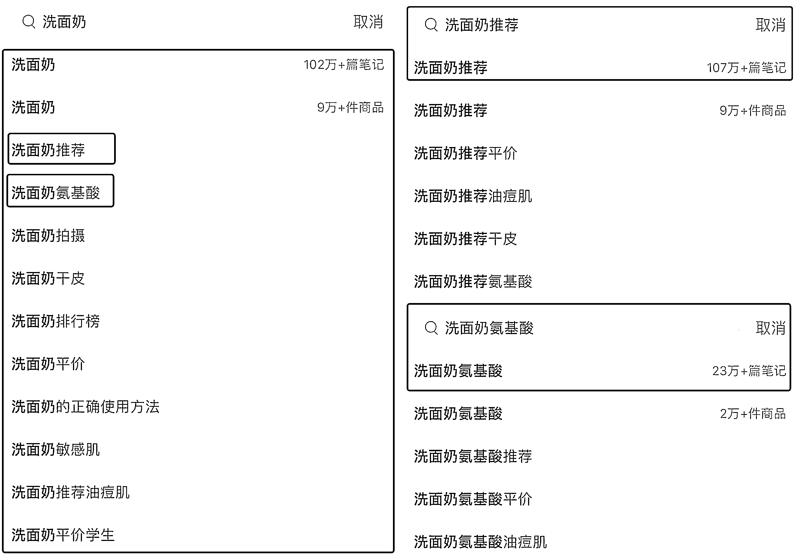
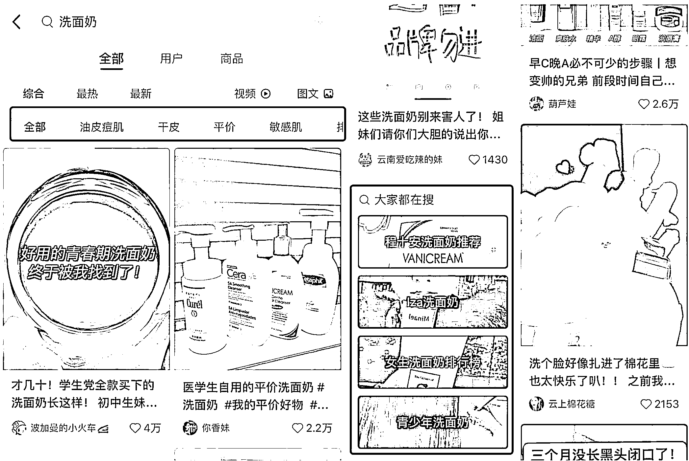
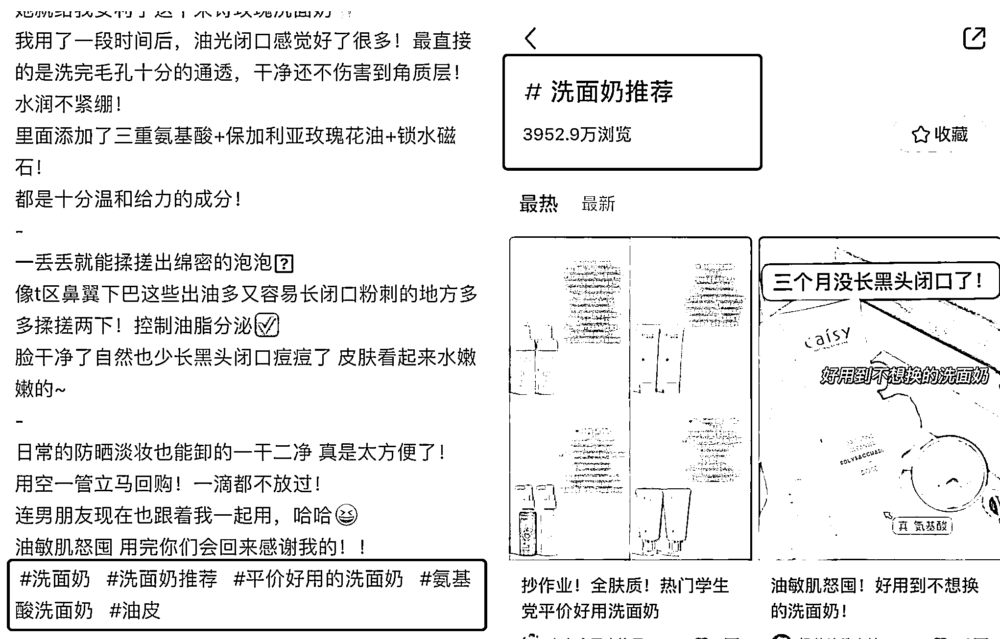

# 7.3.4.2 找关键词的3种方法

想把关键词布局做好，第一步得先把词库建起来。下面这三条路，分别对应官方工具、数据平台和免费人工挖掘，各有各的长处，也各有各的门槛。

1）用聚光平台的关键词规划器

在聚光平台里，关键词规划功能相当顺手，选词入口覆盖五个方向，像笔记推词、以词推词、上下游推词、行业推词等都能用。以“以词推词”来说，输入目标词后，平台会返回蓝海词、同行买词、黑马词、高点击词等结果；其中蓝海词和黑马词往往需求不小、竞争却不大，值得优先留意。由于聚光属于官方平台，统计出来的数据相对更精准有效。它的限制也很明确：目前只有企业号，并且是已经完成认证、开通广告功能的企业号，才能登录使用。

2）借助千瓜数据

千瓜数据把目光放在📕生态，属于数据分析类平台，关键词的排名查看、横向对比和数据下载等功能配得比较全。

点开左侧工具栏里的“热搜词搜索”，输入你的关键词，页面会给出大量相关词，并标出每个词的热度值和笔记数量。建议自己建一张表，把各词数据记录下来，用热度值除以笔记数量得出比例，优先挑比例高的词——这类词搜的人多、竞争压力小，更适合作为目标关键词。另外，“热搜词榜”里还能看到热词增量榜和总量榜。

上面两种搜索方式都支持直接导出，后续统计整理会很方便。但千瓜需要付费，会员一个月要好几千，对普通用户来说成本不低。

3）在📕平台免费挖

这种方式不花钱，但要投入一些时间慢慢找。主要看三个地方：

① 搜索框下拉联想

打开📕搜索页，敲入目标词，比如“洗面奶”，输入框下会展开一长串关联词。

这些词是系统按近期搜索频率汇总出来的，挑适合自己内容的去铺就行。有时也要做取舍：比如“洗面奶推荐”和“洗面奶氨基酸”到底选哪个？通常越靠前的词热度越高，搜“洗面奶推荐”的人确实更多；但把两个词分别输入搜索栏，下方会显示对应的笔记数量。“洗面奶推荐”热度虽高，平台已有107w+篇笔记，竞争压力大；“洗面奶氨基酸”只有23w+篇，竞争小不少，更适合去布局。

② 搜索结果页里的线索

输入关键词并进入搜索结果页，会发现不少位置都藏着相关词。

结果页顶部的标签栏会列出一排相关词，向左滑还能展开更多，可以挑几个与核心词搭配使用。页面继续往下拉，还会出现“大家都在搜”栏目，这些词既能当关键词用，也能直接拿来做笔记选题。

③ 话题标签的浏览量

一般笔记的文本框都会带话题标签，点进话题就能看到该话题的浏览量和相关笔记。可以到同行笔记页面做统计收集。

以上就是常用的几种挖词方法。这样找出来的词比较客观，也经过平台验证，能避免自己凭空造词却没人搜索的尴尬。词找到了，接下来就是关键一步：怎样把关键词正确布局。

