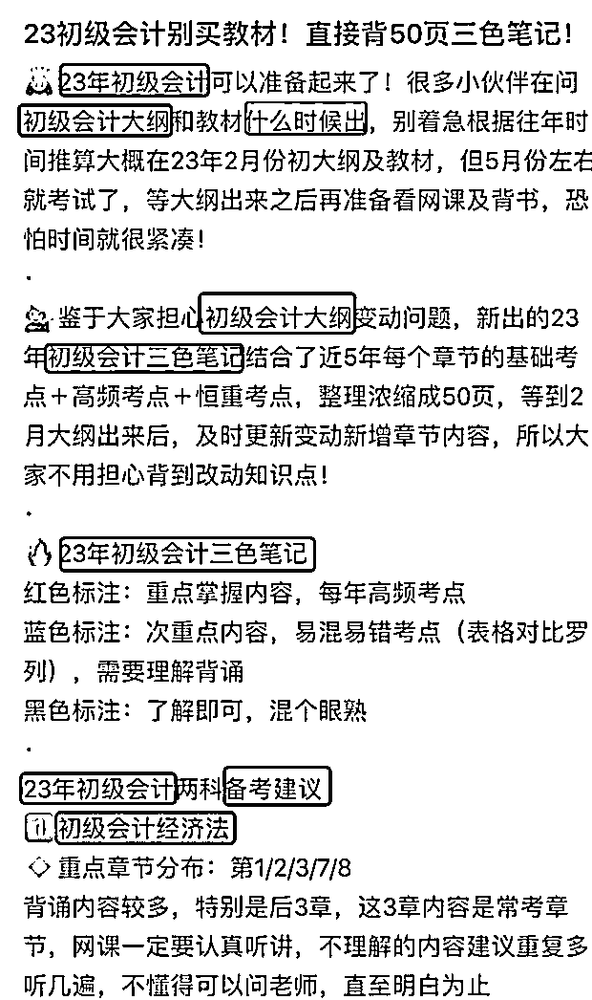

# 7.3.5.5 关键词布局：分层铺开，别硬塞

写笔记安排关键词，只需守住一条底线：让词有层次地出现，千万别一股脑堆在一起。

同一个关键词，尽量拆到不同行、不同段落里去放，参考下面这篇笔记👇👇

一篇笔记里，核心词、关联词、高转化词、热搜词都可以搭配着用。但组合时必须顺着内容自然铺开，不能扎堆硬塞，否则读者读起来会别扭。阅读体验一旦变差，完读率就会下滑，笔记的数据表现和权重也会跟着受影响。

