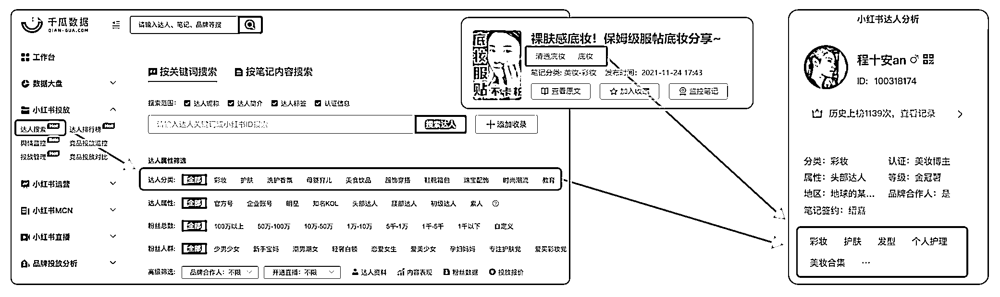
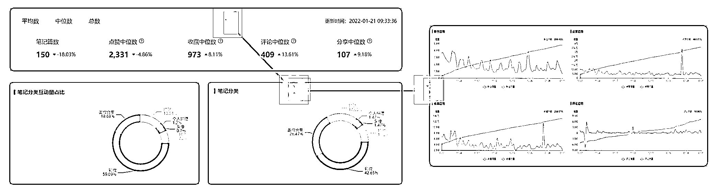
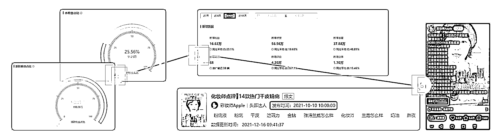
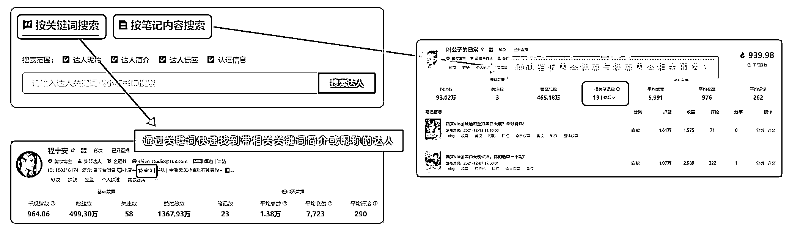
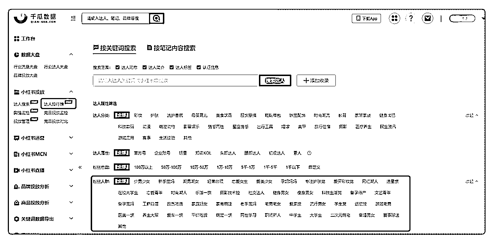
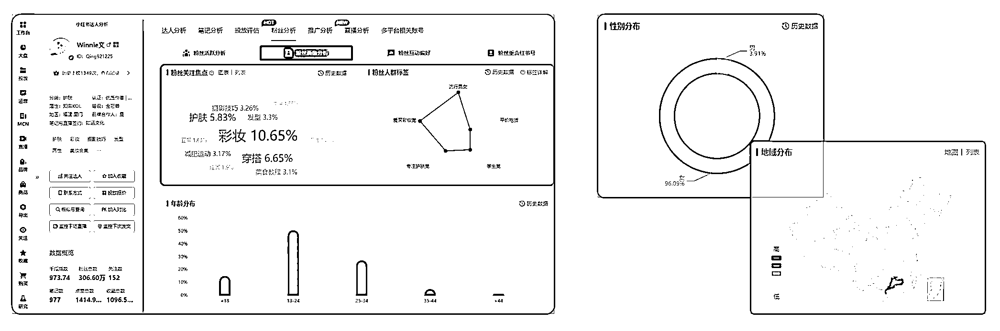
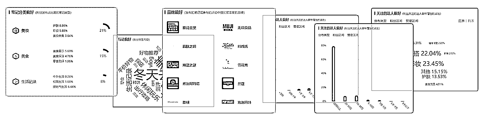

# 7.4.2.1 高匹配达人怎么找？这6招很实用

做种草投放，选对合作伙伴比一味铺量更关键。想找到与品牌方向高度契合的优质作者，可以从创作者侧和受众侧两条线入手。千瓜给出了清晰可操作的六步筛选法。

**1）先看主题标记，锁定擅长领域的创作者**

平台会根据每篇作品的主题领域，自动打上类别标记；如果某位博主持续产出同类内容，他的账号也会沉淀出相应标记。系统再按照这个标记，把作品推送给相关人群；人群越聚焦，流量往往越优质。在千瓜的检索页面，直接勾选按领域归好类的标记，即可快速定位目标行业作者。

**2）判断博主是否靠谱，看这六点**

候选账号筛出来后，还要做一轮质量评估，建议从以下六项入手：

- 先看均值、中位水平，判断数据是否达标。
- 再看作品类型构成，判断作者擅长哪种方向。如果某类作品的数量份额高，同时这类作品带来的互动份额也高于数量份额（比值大于1），说明该方向的市场反馈更好。
- 看点赞与收藏的平均表现，长期曲线平稳，说明受众相对稳定。

- 在“受众画像”中查看“活粉占比”和“水分占比”，千瓜综合关注者在站内的行为表现计算得出，可辅助判断受众是否真实。
- 观察新增趋势：作者是否保持稳定更新？与体量接近的同类博主相比，同时段的点赞增长是否在合理区间？
- 留意是否存在异常：作品是否被二次编辑？内容与所带标记是否明显不符？若存在，要警惕原始内容被替换过。

**3）不同需求，用不同检索方式**

根据应用场景选择检索方式，能找到更合适的合作对象。

- 按昵称关键字检索：利用博主昵称里的关键字配合丰富筛选条件，快速锁定目标账号。
- 按作品文字检索：比类别标记更精细，可以直接找出作品正文中含特定词语的博主。

**4）按受众标签反向筛选博主**

博主的核心价值在于聚拢受众，选对博主本质上就是选对受众，品牌气质是否契合是重要前提。千瓜把受众划分为几十种人群标签；在检索页面勾选对应人群标签，即可找出覆盖目标受众的博主。

**5）看受众画像，判断整体匹配度**

进入博主详情页，右侧的受众画像区域可继续查看受众关注焦点、人群标签，以及受众的年龄、性别、所在城市、常使用时段等基础信息，从而判断这批受众是否符合投放预期。

**6）从受众行为习惯里找同路人**

利用机器学习能力，千瓜能够还原受众在站内的内容互动轨迹，既方便运营者深入理解受众，也有助于挖掘更多相似账号。

- 发帖偏好：汇总受众发布的帖子类型，直观看到他们的内容口味。
- 互动热词：提取受众在评论里高频使用的词语，了解他们的关注重点。
- 品牌相关：整理这些素材中提及的品牌。
- 关注去向：总结受众除了当前博主，还喜欢哪一类博主，以及这些博主的粉丝规模、点赞与收藏数量级。

