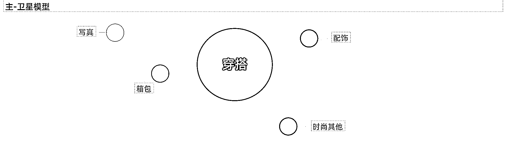
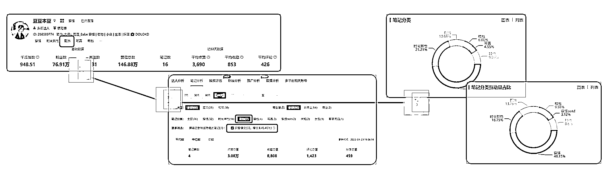

# 7.4.2.2 三步找到弱关联内容达人

先按三维模型的基础数据过一遍，筛出候选达人；接着用三步锁定弱关联内容创作者。

**第一步，看达人标签。** 在达人分类标签的TOP2—TOP5范围内，找出带有目标分类的人，先加入收藏，后续集中筛选会更省事。

**第二步，看爆文能力。** 逐个翻看已收藏达人近90天或180天的目标分类爆文，把笔记分类选好，并勾选“只看爆文”，确认对方是否具备在该分类中持续产出爆文的能力。

**第三步，看笔记分类互动量。** 比较笔记分类互动量占比与目标笔记分类占比，若前者高于后者，说明该达人在这一分类中的数据更有延续性。

以图中穿搭博主“豆豆本豆”为例：配饰在她的分类标签中位列Top3；近180天里，配饰爆文有4篇；笔记分类中，配饰类笔记占比10.61%，笔记分类互动量占比13.79%，高于笔记篇数。她符合配饰弱关联内容达人的基本要求。

