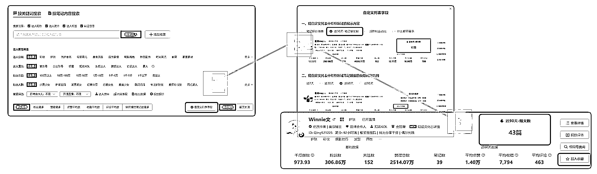
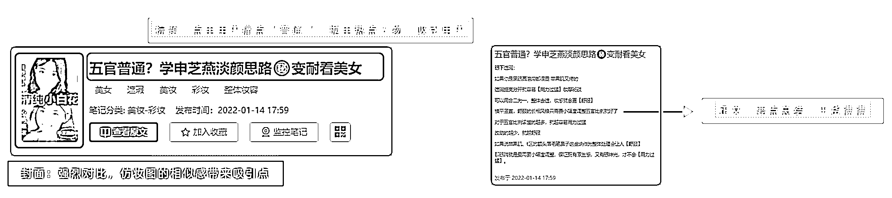
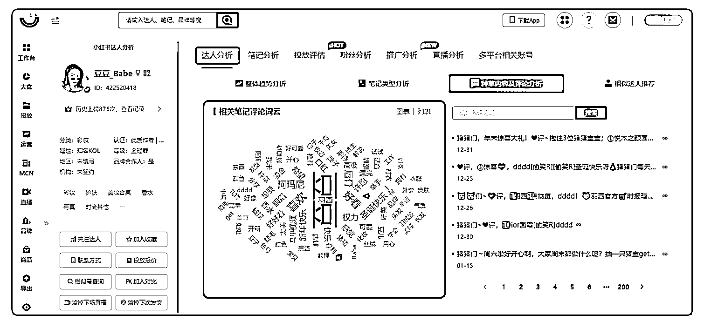
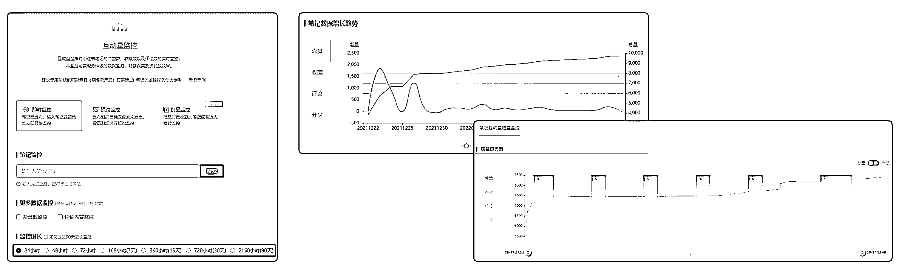

# 7.4.3.1 怎样挑出真正能带货的达人

1）先看爆款产出
在整体数据达标的前提下，优先考察达人的爆款表现。持续出现爆款、爆款占比高，往往就是种草力强的重要标志。借助千瓜自定义列表字段，勾选近90天笔记爆文数，就能看到每位达人产出了多少篇爆文。把爆款篇数靠前的达人先收藏起来，再进行第二轮筛选。

2）再看封面、标题和正文的功力
内容质量是判断带货能力的关键指标，尤其要盯住三处：封面要有抓眼力，第一眼就让人愿意停下；标题要精准戳中用户痛点，同时自然嵌入搜索关键词；正文得能解决用户需求，或给到情绪价值，做到有信息量也有趣味。以“一一只是黑猫”的美妆视频教程为例，封面、标题和正文这三层内容都兼顾视觉吸引力与实用价值，用简单易学的化妆技巧击中用户痛点，帮用户实现“逆袭”。

3）看KOL舆情口碑
📕达人的评论区舆情，会牵动粉丝黏性和私域流量的转化。在达人分析下方的笔记评论词云里，可以较直观地判断达人和粉丝之间的黏性。示例中，粉丝常叫这位达人“豆豆”，评论中还夹着“种草”“想要”这类意向词，说明达人和粉丝黏性较强；而且粉丝讨论品牌、产品多过达人本人，种草力也更有保障。

4）看长尾流量表现
好内容不是发完就沉，发布30天甚至90天后仍可能继续吸收流量，为品牌带来持续曝光。借助“笔记分析-笔记数据增长趋势”，可评估目标达人近期笔记的数据走势；千瓜笔记监控支持同时对多位达人的点赞、收藏、评论、粉丝数据做最长90天的分钟级监控，帮助充分掌握笔记流量趋势的变化。

