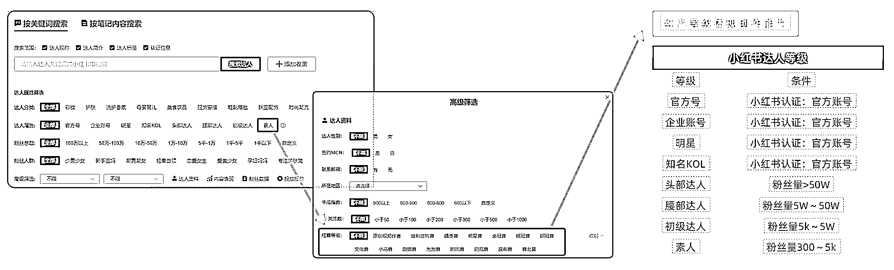
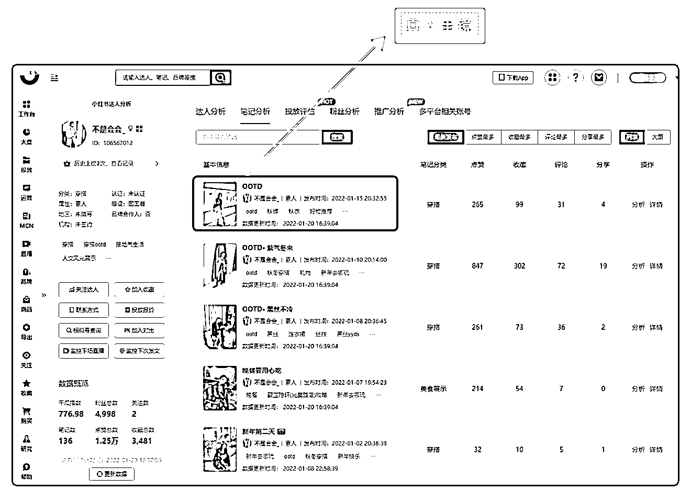
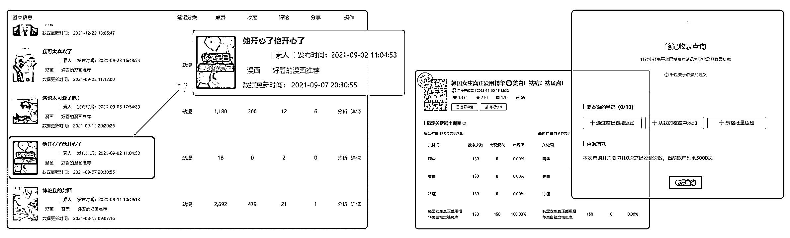

# 7.4.4 素人种草力，筛选看这三点

批量投放素人笔记，最怕投了却收录不了。想找到真正有种草力的素人，筛选时不妨盯紧下面三点。

1）先筛内容产出能力强的素人

铺量投放素人笔记时，想提高收录概率，不能随便选账号，要挑产出效率高、有潜力的素人。判断时可围绕三方面：内容制作能力、人设真实度、流量稳定性。📕官方有红薯等级体系，能侧面体现内容创作水平；粉丝量不大但等级较高的账号，同样有投放价值。

2）账号人设要经得起翻看

初筛之后，进入达人详情页翻看过往笔记，用更主观的方式判断人设：有没有真人露面、是否发过视频、整体像不像一个普通素人。真正有真实感的素人，内容像身边朋友一样有日常气息，不会全是干货或广告，这类账号带货时更容易让人信服。反过来，从公开渠道招募来的素人往往商业味较重，软文比例高，后续笔记被系统收录的难度会越来越大。

3）流量稳定才容易被搜到

投放素人的基础要求，是笔记发布后能在📕搜索页有较大概率被搜到，也就是实现收录。如果素人的笔记经常被删除或被系统隐藏，他发布的内容也会越来越难被收录。想快速确认，可以用“笔记收录查询”功能检测笔记是否已被收录。

