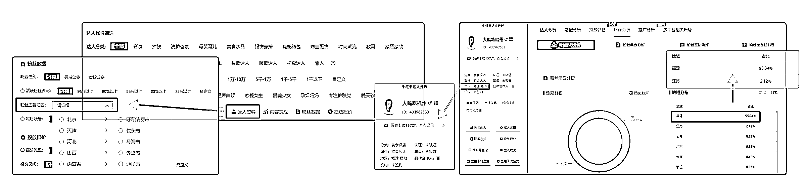

# 7.4.5 锁定本地优质达人，关键看这一步

想找到真正能触达本地用户的达人，不能只盯着达人自己身处哪里，更要观察他的粉丝分布在哪里。达人常驻某座城市，并不意味着关注者也会集中在当地；只有长期围绕地方内容持续创作的账号，才更可能积累出较高比例的同地区粉丝。借助千瓜对达人粉丝所在地的分析，可以把候选账号放在一起直接比较、筛选。

操作可以分两步走：

① 进入达人资料，在“高级筛选”中使用粉丝地区条件，先圈定目标区域的达人。

② 再查看达人粉丝分析里的地域分布，挑出粉丝所在地与达人所在地一致的账号。这样的账号所产出的内容，才更有可能被真正属于该地区的粉丝看到并关注。

