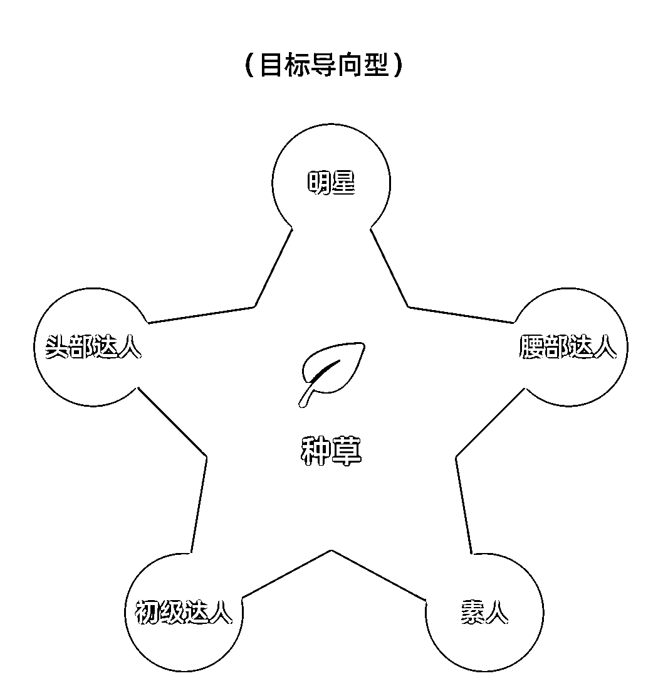
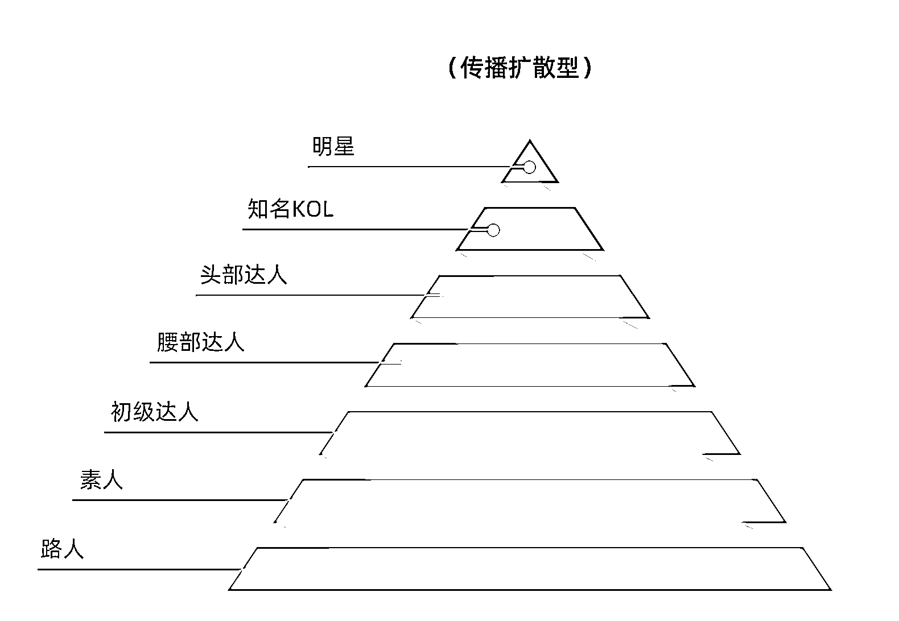
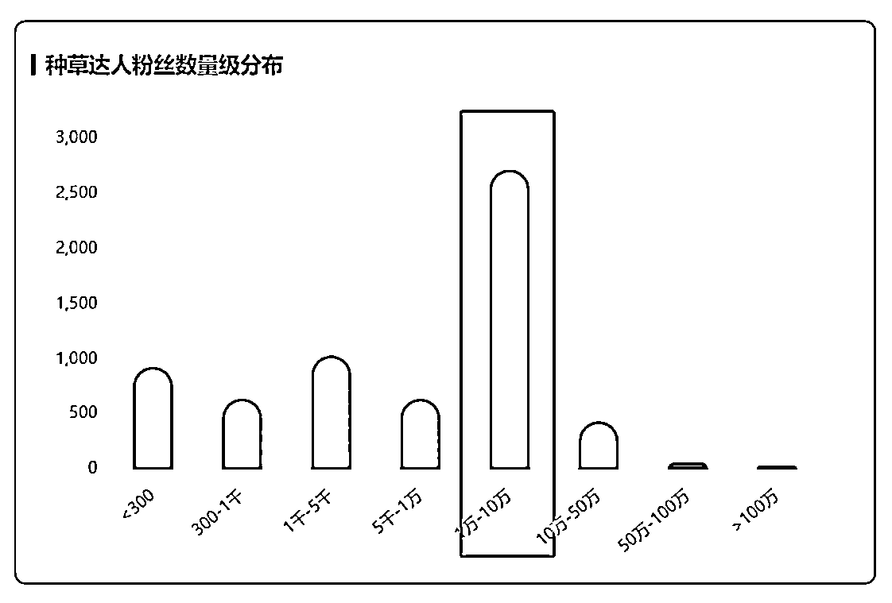
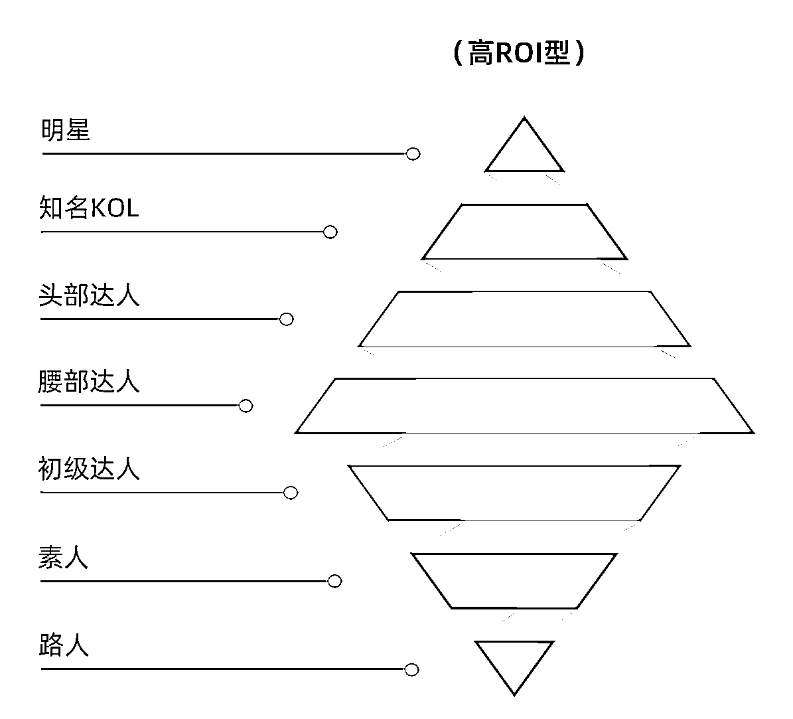

# 7.4.7.3 达人投放，三种模型怎么选

品牌做📕种草，达人矩阵并非一套打法通吃。关键要看品牌所处阶段和投放目标，再决定把预算压在哪一层达人身上。

1）五角星投放模型：目标先行，垂直打透

五角星投放模型先锁定投放要达成什么，再倒推达人组合；它不按粉丝层级设限，而是把重心放在垂直内容上，让信息更准确地触达目标用户。尤其适合刚起步的品牌，或预算相对有限的中小品牌，用来搭建📕种草营销的达人投放矩阵。

2）金字塔投放模型：自上而下，层层扩散

这套模型遵循传播扩散的基本原理：先由明星在社交场造势，再借知名 KOL、头部达人把话题带热；腰部达人承接专业测评与种草，初级达人在垂直圈层扩散，素人和路人随后跟进效仿，从上层到下层串成完整的传播链路。它更适合成长期品牌的📕种草营销达人投放矩阵。

3）橄榄型投放模型：押注腰部，追求性价比

橄榄型投放模型与📕平台的流量机制相契合，把主要预算投向性价比更高的腰部、初级达人。它更适合成熟期品牌的📕种草营销达人投放矩阵。

内容来源：千瓜数据

