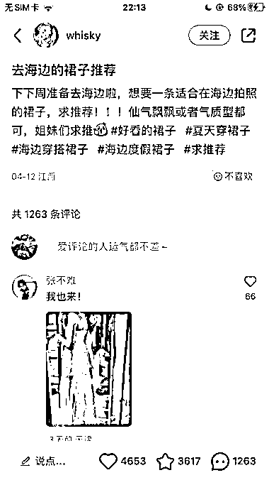
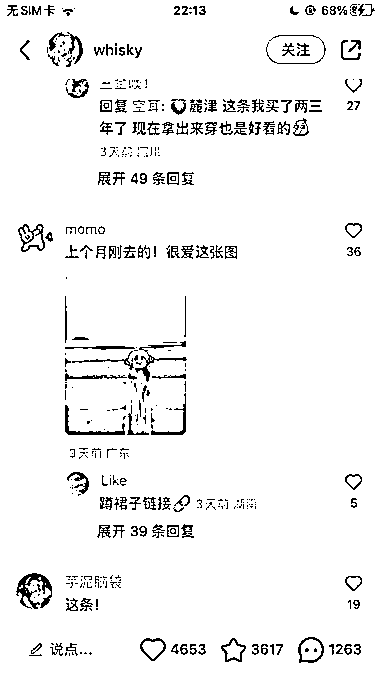
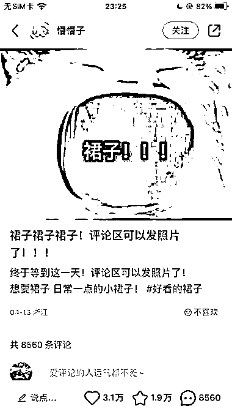

# 7.6 方法六：评论区截流，借别人的流量 @云端行走 @Sanuk 小伞

很多人刷小红书都会看到这样一个场景：热门笔记的评论区里，总有那么几条“在哪买？”“求链接？”的评论，底下却往往没有答案。这其实就是一个天然的截流入口。

如果发现被问到的这位商家并没有开店，机会就来了。我们可以自己开一家店，然后跑到这些评论区里，淡定地回复一句：“小红书搜**商品就能直接下单。”原本想去问别人的用户，可能就顺着这句话，直接摸到了你的店里。

现在小红书已经开放了评论区发图功能，玩法又更进一步了。在那些“求推荐”的笔记底下，直接发一张商品实拍图，用户的目光瞬间就被吸引过来了。再配合几个小号在图片下面刷一句“蹲链接”“蹲一个”，评论区立刻热闹起来，其他用户也会以为这产品真火，跟着纷纷问链接。流量，就是这样一波一波被截过来的。

用别人的评论区，养自己的生意，这个办法几乎零成本，关键是操作起来也很简单。

内容来源：[`wx.zsxq.com/dweb2/index/topic_detail/214221225154211`](https://wx.zsxq.com/dweb2/index/topic_detail/214221225154211)

