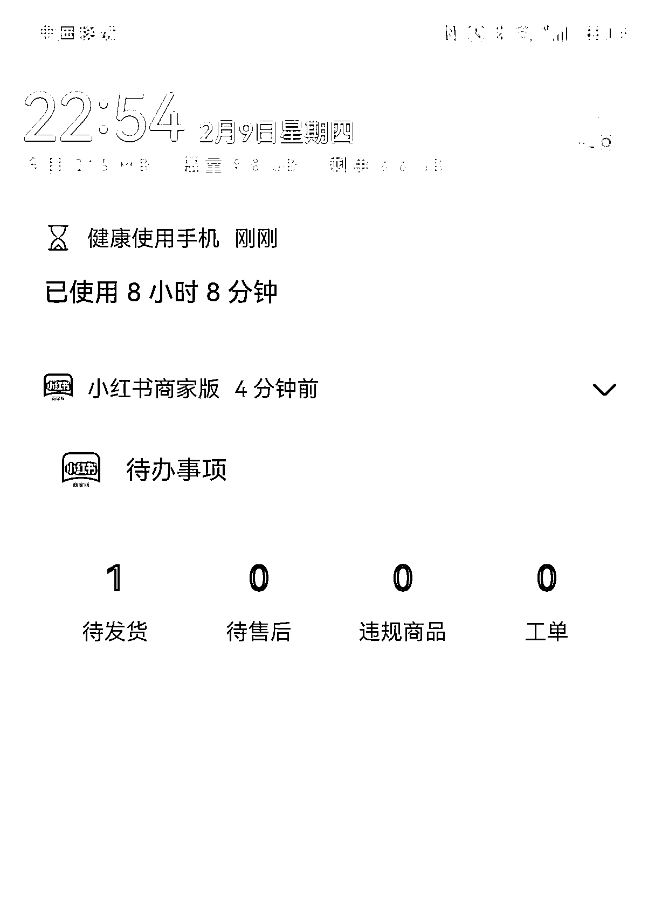
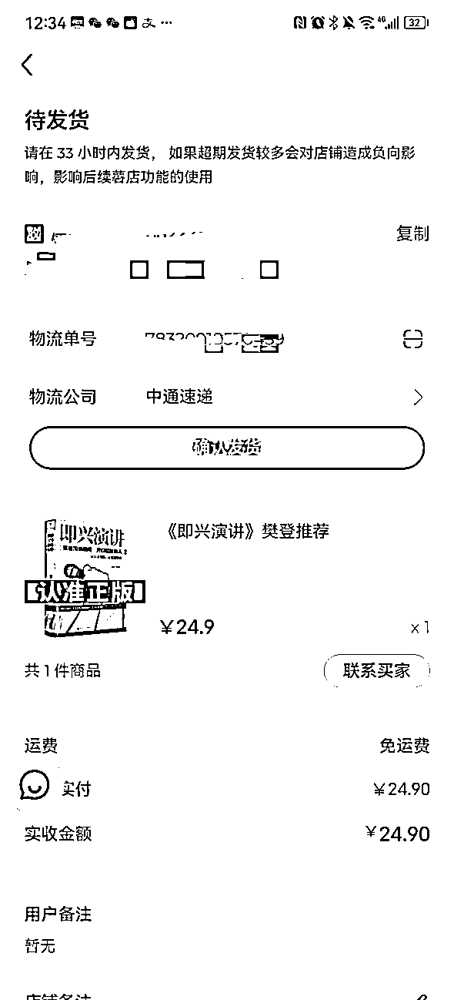

# 8.2 售中管理：下单后，发货别出错
@云端行走 @曜文@蓝子鱼 @范师傅

买家在📕商家版App完成付款后，系统会立刻推送通知，提醒你该备货、安排发货了。

进入📕商家App后台，在对应栏位填入快递单号，系统便会自动匹配承运的物流公司。

售中环节最常碰到的问题，基本都集中在物流上：平台对发货时限、发货方式等都设有管理规范，而且不同商品类目的发货要求并不统一。一旦没有按这些标准执行，平台也会依据规则作出相应处理。