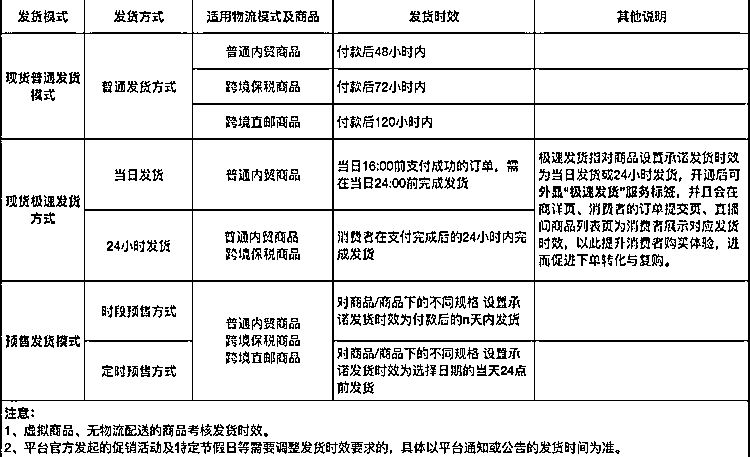

# 8.2.1 不同场景发货标准与话术

补充说明：📕后台支持商家自行设置发货时效，包括当天发货、24 小时内发货、48 小时内发货；也提供时段预售（下单后 xx 天发货）与定时预售（xx 日前发货）。

1）能按约定时效寄出时
- 亲，这个链接现在有货，拍下后就能安排寄出哦。
- 您好，这边可以按约定时间寄出。想先确认一下，您那边收货是否顺畅？通常我们会在 48 小时内安排寄出。

2）遇到特殊情况，无法按原时效寄出时
- 库存不足：亲，近期订单量上涨，当前库存暂时不够，我们已经在加紧补货了。
- 受自然灾害、大型会议等不可抗力影响：亲，受***影响，目前确实无法寄出，我们同样心急。若您急用，不妨问问其他店铺能否安排发货；给您添麻烦了，真的抱歉！